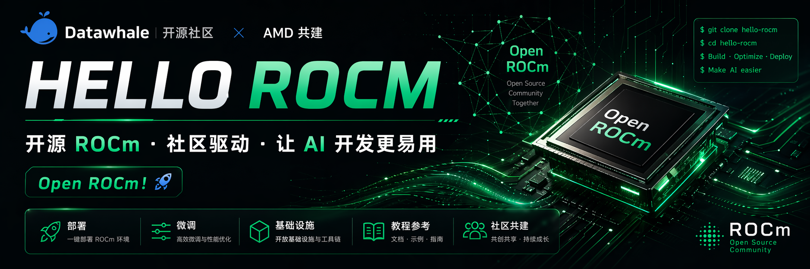

<div align="center">
  
  <h2>每个 AI 小白，从零开始，动手实践的第一站。</h2>
  <strong>基于 AMD 平台的 AI 与 Agentic AI 入门实践手册（全栈总览先导课） 🚀</strong>
</div>

<div align="center">

*“我把自己的 AMD 电脑，变成了学习和工作的 AI 助手。”*

<p align="center">
  <a href="./README_en.md"></a>
  <a href="./README.md"></a>
  <a href="./docs-readme/zh-TW/README.md"></a>
  <a href="./docs-readme/ja-JP/README.md"></a>
  <a href="./docs-readme/es-ES/README.md"></a>
  <a href="./docs-readme/fr-FR/README.md"></a>
  <a href="./docs-readme/ko-KR/README.md"></a>
  <a href="./docs-readme/ar-SA/README.md"></a>
  <a href="./docs-readme/vi-VN/README.md"></a>
  <a href="./docs-readme/de-DE/README.md"></a>
</p>

<a href="https://datawhalechina.github.io/hello-rocm/"></a> | <a href="https://datawhalechina.github.io/hello-rocm/atlas/rocm/index.html"></a> | <a href="./docs/zh/learning/index.md"></a> | <a href="./docs/zh/cloud/amd-radeon-cloud.md"></a> | <a href="./docs/zh/cloud/aup-learning-cloud.md"></a>

</div>

<p align="center">
  
  &nbsp;&nbsp;&nbsp;&nbsp;
  
</p>

---

## 📖 项目定位：为什么从 `hello-rocm` 出发？

自 **ROCm 7.10+** 与 **[TheRock](https://github.com/ROCm/TheRock) / ROCm 10.0.0** 模块化重构以来，**Windows 11 与 Ubuntu** 用户都能以极低门槛在 AMD Radeon 独显、Ryzen AI 核显/NPU（或免费 [AMD Radeon Cloud](./docs/zh/cloud/amd-radeon-cloud.md) 云算力）上运行和微调主流开源大模型。

作为 **Datawhale 社区面向零基础学习者的「AI 与 Agentic AI 全栈总览先导课」**，本项目告别“上来先背底层术语、面对十几种工具无从下手”的传统痛点，以**真实办公与学习获得感**为主线，做好以下 **三大收敛与闭环**：

1. **主体模型收敛为四大分档黄金主力**：全书主线围绕 **`Gemma 4 E4B`**（🟢 8G 端侧全模态轻量王牌）、**`Qwen3.5-9B`**（🔵 16G+ 中文办公填表与中文微调主力）、**`Gemma 4 12B`**（🔵 16G+ 强逻辑推理与 `Qoder` 编程主力）以及 **`Qwen3.6-35B-A3B`**（🟣 旗舰档 35B 总参 / 3B 激活 MoE 超长上下文王牌）展开；
2. **推理服务收敛为三大标准引擎**：统一仅使用 **`llama-server`（`llama.cpp`）**、**`lemonade-server`** 与 **`vLLM`** 拉起本地 OpenAI 兼容服务（`/v1`），配套 [`src/configs/`](./src/configs/README.md) 现成验证配置；
3. **第一步先用起来，学完精准导流深造**：开篇即接入 **WorkBuddy**（唯一采用开源 **`dashi-ppt-skill` 大师 PPT Skill** 生成可编辑 `.pptx` + AI 自动填表 + 定时处理日常办公）及 **`Qoder` / `Codex`**；随后跑通个人知识库、可共享给别人调用的 **「知识管理 MCP」**、中文 LoRA 微调与 **`AMD Quark` / `Hyperloom`** 量化加速，沉淀简历五件套并一章一课导流至 Datawhale 各专精课程继续深造！

> 🚀 **零基础极速起跑路线**：**[第 0 章导读与硬件自检](./docs/zh/00-guide/index.md)** ➡️ **[第 1 章三大引擎部署](./docs/zh/01-first-model/index.md)** ➡️ **[第 2.2 节 WorkBuddy 大师 PPT 与办公三件套首发实战](./docs/zh/02-connect-tools/03-workbuddy-dashi-ppt.md)**！

---

## 🎯 课程四大主体模型与硬件档位选型表

全书所有章节实验、[`src/configs/`](./src/configs/README.md) 配置文件与评测脚本均以以下 **四款最新高性价比开源模型** 为主体构建（精准对应入门、甜点与旗舰档位）：

| 主体模型 | 官方权重标识 | 核心特长与课程分工 | 推荐硬件档位 | 主推服务引擎 |
|:---|:---|:---|:---|:---|
| **`Gemma 4 E4B`** | `google/gemma-4-E4B-it`<br/>(`Gemma-4-E4B-it-GGUF`) | 有效参数 ~4.5B 原生多模态（文本/图像/音频 + 原生工具调用），极省显存，8G 卡开 32K 上下文依然丝滑 | 🟢 **入门档**（8G–12G 独显 / 16G–32G 锐龙核显 & XDNA2 NPU） | `llama-server` / `lemonade-server` |
| **`Qwen3.5-9B`** | `Qwen/Qwen3.5-9B`<br/>(`Qwen3.5-9B-GGUF`) | 中文母语级语义理解与结构化 JSON 抽取强项，担纲 **第 2 章中文办公填表** 与 **第 5 章纯中文 LoRA 微调 / `AMD Quark` 量化对比** 主力 | 🔵 **甜点档**（16G–24G 独显） / ☁️ **云算力** | `llama-server` / `vLLM` |
| **`Gemma 4 12B`** | `google/gemma-4-12B-it`<br/>(`gemma-4-12B-it-GGUF`) | 12B 稠密统一多模态强推理模型，擅长跨文件代码重构、长文献横评与多步推理，担纲 **`Qoder` / `Codex` 编程** 主力 | 🔵 **甜点档**（16G–24G 独显） / 🟣 **旗舰档** | `vLLM` / `llama-server` / `lemonade-server` |
| **`Qwen3.6-35B-A3B`** | `Qwen/Qwen3.6-35B-A3B`<br/>(`Qwen3.6-35B-A3B-GGUF`) | **35B 总参数 / 仅 3B 激活参数** 的 MoE 旗舰模型（GGUF UD-Q4 约 20–23 GiB），兼具大模型智商与 3B 级飞快解码速度，担纲 **`OpenClaw` 全隐私管家与复杂长上下文规划** 旗舰主力 | 🟣 **旗舰档**（64G–128G 统一内存 AI PC 如 Ryzen AI Max+ 395） / ☁️ **云算力** | `lemonade-server` / `llama-server` / `vLLM` |

> 💡 *手头暂时没有 AMD 显卡？* 直接查看 **[AMD Radeon Cloud 免费云算力指南](./docs/zh/cloud/amd-radeon-cloud.md)** 或 **[AUP Learning Cloud 指南](./docs/zh/cloud/aup-learning-cloud.md)**，通过一条 SSH 端口映射命令即可在本地桌面无缝使用云端算力完成全部实操！

---

## 🧭 用户学习体验旅程（6 站成长闭环）

| 旅程站点 | 对应章节 | 解决的学习者痛点 | 亲手做出的核心交付物 |
|:---:|:---:|:---|:---|
| **第 1 站：破冰启程** | **第 0～1 章** | 不懂参数量/量化/显存账，怕配崩环境 | 算清显存“三本明白账”，用三大标准引擎之一拉起本地 `/v1` 服务 |
| **第 2 站：办公提效** | **第 2 章（首发）** | 终端能聊天了，怎么帮我做 PPT、填表、写代码？ | 跑通 **WorkBuddy（`dashi-ppt-skill` 出可编辑 `.pptx` + 自动填表 + 定时办公）** 与 **`Qoder` / `Codex`** |
| **第 3 站：注入记忆** | **第 3 章** | 模型不懂我的私有课件，爱一本正经瞎编 | 闯关 6 节提示词课，做完菜谱切分实验，搭好 **`WorkBuddy + Obsidian`** 双链笔记库 |
| **第 4 站：长出手脚** | **第 4 章** | 个人知识库怎么跨软件用、甚至分享给别人调用？ | 用 `FastMCP` 封装可共享的 **「知识管理 MCP Server」** + 省显存办公 `SKILL.md` |
| **第 5 站：痛点攻坚** | **第 5～6 章** | 中文通知提取偶发写歪、网感不足；长文响应慢 | 完成 **`Qwen3.5-9B` / `Gemma 4 E4B` 中文微调评测** + **`AMD Quark` 单模型量化前后对比与 `Hyperloom` 自动加速** |
| **第 6 站：收获远航** | **第 7～9 章** | 怎么转化成简历竞争力并选择深造方向？ | 打包个人作品集五件套与简历经历、畅玩 15 个趣味案例、进入专精课程与 AMD 开源生态 |

---

## 📚 完整课程章节目录与 Datawhale 专精课程双向引用关系（第 0～9 章）

作为全景总览入口课，`hello-rocm` 每一章均与 Datawhale 对应垂直王牌课程建立 **「上游精华实验引用 + 下游学完进阶导流」** 的一对一衔接：

| 章节入口 | 本章核心内容与配套仓库代码 | 引用与进阶导流课程 |
|:---|:---|:---|
| **[第 0 章｜导读：把 AMD 电脑变成 AI 助手](./docs/zh/00-guide/index.md)** | [六站体验旅程](./docs/zh/00-guide/index.md) · [3分钟硬件体检与模型选型](./docs/zh/00-guide/03-hardware-and-cloud.md) · [全景地图与伴学 Skill](./docs/zh/00-guide/04-roadmap-and-skill.md) | 全栈总览先导入口 |
| **[第 1 章｜环境配置与三大引擎部署](./docs/zh/01-first-model/index.md)** | [显存三本账](./docs/zh/01-first-model/01-model-intuition.md) · [ROCm 10 环境配置](./docs/zh/01-first-model/02-rocm-env-setup.md) · [`llama-server`](./docs/zh/01-first-model/03-llama-server.md) / [`lemonade-server`](./docs/zh/01-first-model/04-lemonade-server.md) / [`vLLM`](./docs/zh/01-first-model/05-vllm-server.md) | 🔗 **[`self-llm`（开源大模型食用指南）](https://github.com/datawhalechina/self-llm)** |
| **[第 2 章｜零代码办公先行：WorkBuddy 与 Qoder](./docs/zh/02-connect-tools/index.md)** | [接入避坑](./docs/zh/02-connect-tools/02-workbuddy-setup.md) · 🌟 [大师 PPT](./docs/zh/02-connect-tools/03-workbuddy-dashi-ppt.md) · [自动填表与定时任务](./docs/zh/02-connect-tools/04-workbuddy-excel-and-cron.md) · [`Qoder`](./docs/zh/02-connect-tools/05-qoder-ide.md) & [`Codex`](./docs/zh/02-connect-tools/06-codex-and-toy-cli.md) · [`src/configs/`](./src/configs/README.md) | 🔗 **[Datawhale WorkBuddy 官方教程](https://www.datawhale.cn/learn/content/382/8712?from=homepage)** |
| **[第 3 章｜让助手读懂你：提示词与个人知识库](./docs/zh/03-prompt-and-rag/index.md)** | [6 关提示词闯关](./docs/zh/03-prompt-and-rag/01-prompt-6-levels.md) · [黑暗料理菜谱切分实验](./docs/zh/03-prompt-and-rag/02-chunking-intuition.md) · [`WorkBuddy + Obsidian` 双链笔记库](./docs/zh/03-prompt-and-rag/03-workbuddy-obsidian-rag.md) | 🔗 **[`all-in-rag`（RAG 技术全栈指南）](https://github.com/datawhalechina/all-in-rag)** |
| **[第 4 章｜让助手长出手脚：知识管理 MCP 与 Skills](./docs/zh/04-mcp-and-skills/index.md)** | [可共享「知识管理 MCP」教程](./docs/zh/04-mcp-and-skills/02-knowledge-mcp-server.md)（[源码](./src/main-assistant/knowledge_mcp/server.py)）· [省显存办公 `SKILL.md`](./docs/zh/04-mcp-and-skills/03-custom-office-skill.md) · [安全护栏](./docs/zh/04-mcp-and-skills/04-safety-guardrails.md) | 🔗 **[`hello-agents`（从零开始构建智能体）](https://github.com/datawhalechina/hello-agents)** |
| **[第 5 章｜能力不够？第一次中文模型微调](./docs/zh/05-fine-tune/index.md)** | [弱智吧 5 分钟破冰](./docs/zh/05-fine-tune/02-lora-and-ruozhiba.md) · [中文通知抽取微调](./docs/zh/05-fine-tune/03-office-json-sft.md) · [前后客观评测](./docs/zh/05-fine-tune/04-eval-before-after.md) · [`WeClone`/小红书分身](./docs/zh/05-fine-tune/05-weclone-and-xhs.md) | 🔗 **[`happy-llm`（从零开始的大语言模型原理与实践）](https://github.com/datawhalechina/happy-llm)** |
| **[第 6 章｜速度不够？AMD 量化对比与自动加速](./docs/zh/06-optimize-speed/index.md)** | [`AMD Quark` 单模型量化前后对比](./docs/zh/06-optimize-speed/02-quark-before-after.md)（[测速脚本](./src/main-assistant/quant_bench/quark_before_after_bench.py)）· [零 C++ 唤醒 `AITER`](./docs/zh/06-optimize-speed/03-zero-cpp-operators.md) · [Prefix Caching](./docs/zh/06-optimize-speed/04-agent-prefix-caching.md) & [`Hyperloom` 寻优](./docs/zh/06-optimize-speed/05-hyperloom-auto-opt.md) | 🔗 **[`hello-gpu`（GPU 架构与算子优化实战）](https://github.com/datawhalechina/hello-gpu)** |
| **[第 7 章｜收获时刻：作品集与简历成果锻造](./docs/zh/07-portfolio-resume/index.md)** | 成功故事纪实模板、作品集五件套打包清单、STAR 简历项目经历与面试高频追问指南 | 毕业深造驿站 |
| **[第 8 章｜学以致用：15 个趣味实战案例库](./docs/zh/08-fun-cases/index.md)** | [上辑 Case 01~08（办公/研报/论文/知识库）](./docs/zh/08-fun-cases/office-and-study-cases.md) · [下辑 Case 09~15（语音/Qoder/规划/游戏）](./docs/zh/08-fun-cases/voice-code-agent-game-cases.md) · [五要素模板](./docs/zh/08-fun-cases/_CASE_TEMPLATE.md) | 全覆盖 8 大日常场景 |
| **[第 9 章｜拓展视野：AMD 优秀项目与资源百宝箱](./docs/zh/09-amd-ecosystem/index.md)** | 官方开源明星（`amd/gaia`、`Hyperloom`、`Quark`、`AITER`、`Primus`）、前沿行业案例与全系 `gfx` 硬件字典 | 🔗 [`every-embodied`](https://github.com/datawhalechina/every-embodied) / [`torch-rechub`](https://github.com/datawhalechina/torch-rechub) |

---

## 🗂️ 仓库目录结构（纯净 2.0 架构）

```text
hello-rocm/
├── docs/                           # VitePress 教程站点源文件
│   ├── zh/                         # 第 0～9 章全量中文教材级教程
│   │   ├── 00-guide/               # 第0章：导读、6站体验旅程、硬件选型与总览地图
│   │   ├── 01-first-model/         # 第1章：四大主体模型、三本明白账、ROCm10环境与三大引擎独立部署
│   │   ├── 02-connect-tools/       # 第2章：WorkBuddy办公三件套(dashi-ppt/填表/定时)、Qoder与Codex
│   │   ├── 03-prompt-and-rag/      # 第3章：提示词6关闯关、菜谱切分实验与WorkBuddy+Obsidian笔记库
│   │   ├── 04-mcp-and-skills/      # 第4章：可共享「知识管理MCP」、Agent Skills与安全护栏
│   │   ├── 05-fine-tune/           # 第5章：中文模型微调(弱智吧破冰/通知抽取/WeClone分身)与测试集评测
│   │   ├── 06-optimize-speed/      # 第6章：AMD Quark单模型量化前后对比、零C++算子与Hyperloom寻优
│   │   ├── 07-portfolio-resume/    # 第7章：成功故事、五件套作品集与STAR简历成果锻造
│   │   ├── 08-fun-cases/           # 第8章：case-01 ~ case-15 共15篇独立五要素趣味实战教程
│   │   └── 09-amd-ecosystem/       # 第9章：AMD官方开源明星项目、前沿科研行业案例与全系gfx字典
│   └── en/                         # English overview portal
├── src/
│   ├── configs/                    # 已验证 WorkBuddy / Qoder / Codex 配置文件模板库
│   ├── main-assistant/             # 知识管理 MCP Server、中文评测与 AMD Quark 测速源码
│   ├── cases/                      # 第8章趣味案例配套可运行源码与 Notebook
│   └── hello-rocm-skill/           # 内置 AI 伴学助教 Skill
└── tests/                          # 路由死链、配置契约与实战源码自动化单元测试套件
```

---

## 🤖 内置 AI 伴学助教：`hello-rocm Skill`

如果你正在使用 **WorkBuddy**、**`Qoder`**、**Codex** 或 Claude Code，可直接加载本仓库内置的 **[`src/hello-rocm-skill`](./src/hello-rocm-skill/SKILL.md)**，让 AI 自动根据你的显卡型号推荐最适合的章节与排障方案：

```text
请使用当前仓库的 src/hello-rocm-skill 作为 hello-rocm Skill，将其加载到你的技能目录（如 .codebuddy/skills 或 .agents/skills），并根据我的硬件配置引导我完成课程学习与排错。
```

---

## 📰 ROCm 生态重要动态

- **2026.08.26** — [*ROCm 10.0.0 Release Notes*](https://rocm.docs.amd.com/en/latest/about/release-notes.html)：十年节点大版本，在 TheRock 基座之上补齐 **ROCm.AI 三件套**（[AMD Skills](https://github.com/amd/skills) + [Hyperloom](https://github.com/AMD-AGI/Hyperloom) + [ROCm CLI](https://github.com/ROCm/rocm-cli)）。详见本项目 [第 1.2 节 ROCm 10 环境配置](./docs/zh/01-first-model/02-rocm-env-setup.md) 与 [第 9 章 AMD 生态百宝箱](./docs/zh/09-amd-ecosystem/index.md)。
- **2026.07.15** — [*ROCm 7.14.0 Release Notes*](https://rocm.docs.amd.com/en/latest/about/release-notes.html)：正式转向 **[TheRock](https://github.com/ROCm/TheRock)** 模块化构建与发布体系。
- **2025.12.11** — [*ROCm 7.10.0*](https://rocm.docs.amd.com/en/7.10.0-preview/about/release-notes.html)：正式支持 Windows 平台及直接安装至 Python 虚拟环境。

---

## 🤝 参与试学与开源贡献

我们非常欢迎零基础同学与资深开发者共同参与共建！
- **成为「新手试学官」**：跟做任意章节或案例时遇到卡点，欢迎直接提交 **[🧪 新手试学反馈卡](https://github.com/datawhalechina/hello-rocm/issues/new/choose)**，被收录的排错经验将直接署名计入仓库 Contributors！
- **贡献新案例或改进教程**：参与前请查阅 **[内容规范指南](./CONTENT_GUIDE.md)**、**[五要素案例模板](./docs/zh/08-fun-cases/_CASE_TEMPLATE.md)** 与 **[CONTRIBUTING.md](./CONTRIBUTING.md)**，提交前可运行 `PYTHONPATH=. python3 tests/test_course_v2.py` 一键完成链接与配置自检。
- **交流社群与性能榜单**：欢迎加入 **[飞书社区讨论](https://zcnijjcepfie.feishu.cn/docx/R2a4dDRUBoo1R2x7mOjcPpPPnOO)**；Strix Halo（Ryzen AI Max+ 395）真机推理速度对照可参考社区联合维护的 **[Strix Arena 性能排行榜](https://strix-arena.web.app/)**。

---

## 🙏 致谢与核心贡献者

- [宋志学 (不要葱姜蒜) - 项目负责人](https://github.com/KMnO4-zx)（Datawhale 成员，`self-llm`、`happy-llm` 项目负责人）
- [陈榆 - 项目负责人](https://github.com/lucachen)（内容创作者 - 谷歌开发者机器学习技术专家）
- [陈思州 - 项目成员](https://github.com/jjyaoao)（Datawhale 成员，`hello-agents` 项目负责人）
- [潘嘉航 - 项目成员](https://github.com/amdjiahangpan)（内容创作者 - AMD 软件工程师）
- [刘伟鸿 - 项目成员](https://github.com/Weihong-Liu)（Datawhale 成员）
- [郝东波 - 项目成员](https://github.com/wlkq151172)（内容创作者 - 江南大学研究生）
- [柯慕灵 - 项目成员](https://github.com/1985312383)（Datawhale 成员，`Torch-RecHub` 项目负责人）

感谢 **AMD University Program** 对本项目的支持，以及每一位提交 Issue、试学反馈与 PR 的社区伙伴！

<div align="center" style="margin-top: 24px;">
  <a href="https://github.com/datawhalechina/hello-rocm/graphs/contributors">
    
  </a>
</div>

## License

[MIT License](./LICENSE)

---

<div align="center">

**让我们一起构建更开放、更易用的 AMD AI 学习生态！** 💪  
Made with ❤️ by the hello-rocm & Datawhale community

</div>
