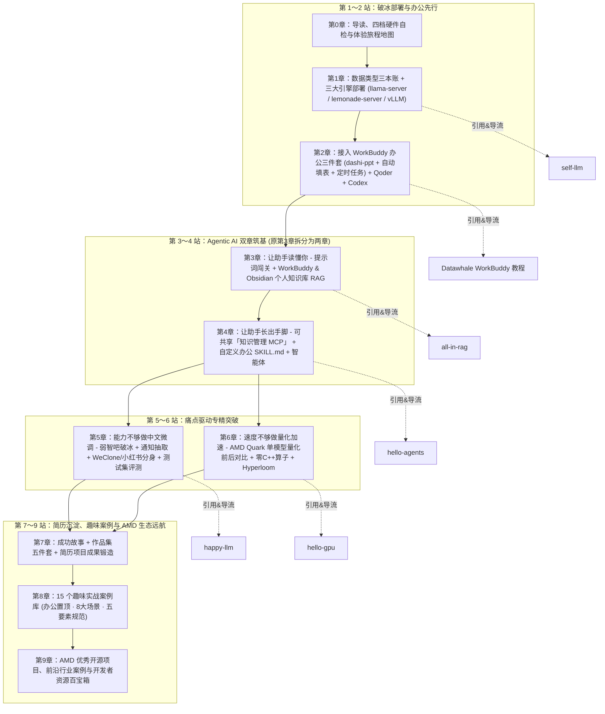

# DESIGN：hello-rocm 2.0 课程体系架构与 0～9 章设计（定稿版）

> **当前阶段**：6A 工作流 - 阶段 2：Architect（同步 0～9 章与生态双向引用架构）  
> **任务名称**：`course-refactor`  
> **权威总纲对照**：完整章节细节见同目录 `CURRICULUM_OUTLINE_v2.md`。

---

## 一、整体课程分层与生态联动架构图



---

## 二、仓库目录重构映射方案（0～9 章结构，无损兼容旧路由）

```text
hello-rocm/
├── docs/zh/
│   ├── 00-guide/               # 第0章：导读、6站用户学习体验旅程、课程引用全景图、四档硬件自检
│   ├── 01-first-model/         # 第1章：数据类型三本账 + llama-server / lemonade-server / vLLM 部署 (→ self-llm)
│   ├── 02-connect-tools/       # 第2章：WorkBuddy(PPT+填表+定时) / Qoder / Codex 已验证配置 (→ WorkBuddy教程)
│   ├── 03-prompt-and-rag/      # 第3章：提示词6关闯关 + 菜谱切分实验 + WorkBuddy&Obsidian 知识库 (→ all-in-rag)
│   ├── 04-mcp-and-skills/      # 第4章：可共享「知识管理 MCP」+ 自定义办公 SKILL.md + 安全护栏 (→ hello-agents)
│   ├── 05-fine-tune/           # 第5章：中文微调（弱智吧 + 通知抽取 + WeClone/小红书分身 + 测试集）(→ happy-llm)
│   ├── 06-optimize-speed/      # 第6章：AMD Quark 单模型量化前后对比 + 零C++算子 + Hyperloom (→ hello-gpu)
│   ├── 07-portfolio-resume/    # 第7章：成功故事模板、作品集五件套、简历指南与毕业深造驿站
│   ├── 08-fun-cases/           # 第8章：15 个趣味实战案例库（办公置顶 · 统一五要素 + 新手试学 FAQ）
│   └── 09-amd-ecosystem/       # 第9章：AMD 官方优秀开源项目、前沿行业案例(具身/推荐/集群/算子)与资源百宝箱
└── src/
    ├── configs/                # 三大引擎与 WorkBuddy / Qoder / Codex 已验证配置文件库
    ├── main-assistant/         # 纵向主线「个人学习助手 v2.0（含知识管理 MCP）」源码与评测测速脚本
    ├── cases/                  # 第8章 15 个趣味案例独立可运行源码与示例数据
    └── ecosystem-advanced/     # 第9章高阶行业案例与底层 HIP 算子源码归档
```

---

## 三、统一案例五要素契约与新手试学机制

1. **五要素强制标准**：每个案例均包含 **① 🎬 效果演示**、**② ✅ 支持配置清单（锁定三大服务引擎验证参数）**、**③ 💻 完整代码与分步实操**、**④ 🔍 验证方法与验收标准**、**⑤ 🚀 扩展任务与对应专精课程导流链接**，文末附 **新手试学 FAQ**。
2. **新手试学闭环**：每章/每案例上线前经 ≥2 名不同硬件环境零基础学习者盲测，卡点直接优化正文并计入 Contributors。
