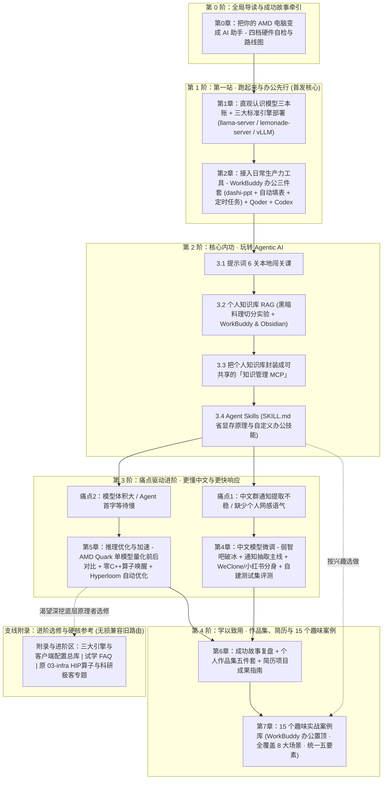
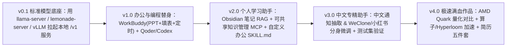

# DESIGN：hello-rocm 2.0 课程体系架构与完整大纲设计（精炼定稿版）

> **当前阶段**：6A 工作流 - 阶段 2：Architect（架构阶段 · 同步最新精炼大纲）  
> **任务名称**：`course-refactor`  
> **设计核心**：以学习者真实痛点与即时获得感为引擎，构建「三大引擎跑通模型 → 接入 WorkBuddy 办公三件套 & Qoder/Codex → 玩转 Agent 与可共享知识管理 MCP → 中文微调与 AMD 量化/Hyperloom 加速 → 15 个趣味案例 → 作品与简历沉淀」的完整闭环。

---

## 一、课程整体定位设计（Course Positioning）

### 1.1 品牌核心定义

| 维度 | 内容定义 |
|:---|:---|
| **课程名称** | **hello-rocm** |
| **核心主标语（Slogan）** | **每个 AI 小白，从零开始，动手实践的第一站。** |
| **课程副标题（定位）** | **基于 AMD 平台的 AI 与 Agentic AI 入门实践手册（全栈总览先导课）。** |
| **生态角色与导流机制** | **总览第一站入口课** —— 学完各模块及结业后精准导流至 [`self-llm`](https://github.com/datawhalechina/self-llm)（部署/微调）、[Datawhale WorkBuddy 教程](https://www.datawhale.cn/learn/content/382/8712?from=homepage)（第2章办公）、[`all-in-rag`](https://github.com/datawhalechina/all-in-rag) & [`hello-agents`](https://github.com/datawhalechina/hello-agents)（知识库与Agent）、[`hello-gpu`](https://github.com/datawhalechina/hello-gpu)（算子优化） |
| **统一推理服务底座** | 全书仅使用 **`llama-server`（`llama.cpp`）**、**`vLLM`**、**`lemonade-server`** 三大标准引擎拉起本地 `/v1` 服务 |
| **核心成长故事线** | **“我把自己的 AMD 电脑，变成了学习和工作的 AI 助手。”** |
| **教学方法论** | **先用起来，再深进去（Use First, Deepen by Need）** —— 第一步直接用 WorkBuddy 做出可编辑 PPT、自动填表与定时办公，再按真实痛点进入 RAG/MCP、中文微调与量化加速 |

### 1.2 新旧版本定位对比（1.0 vs 2.0）

| 对比项 | 1.0 旧版（底层技术字典） | 2.0 新版（小白 AI 与 Agentic AI 实践手册） |
|:---|:---|:---|
| **视角出发点** | 工程师软件栈视角（环境 → 7 模型部署矩阵 → 微调 → C++ 算子） | 学习者任务视角（跑起服务 → 接进 WorkBuddy/Qoder → 知识管理 MCP → 解决笨和慢 → 交作品） |
| **推理与工具选型** | 工具散乱、命令口径不统一 | 推理锁定 **`llama-server` / `vLLM` / `lemonade-server`**；PPT 唯一锁定 **`dashi-ppt-skill`**；IDE 采用 **`Qoder` + `Codex`** |
| **第一阶段获得感** | 查 `gfx` 编号、装内核、看架构演进 | 直觉算清参数/显存/精度三本账，当场跑通 **WorkBuddy AI PPT 生成 + AI 自动填表 + 定时办公自动化** |
| **案例标准** | 30 分钟脚本与 127GB 编译混排，格式不统一 | 精选 **15 个日常高频趣味案例**（办公置顶），强制统一「五要素规范」与「新手试学机制」 |
| **学习终点** | 跑通几条终端命令 | 沉淀 **个人助手源码 + 知识管理 MCP + 微调记录 + 测试集与量化前后对比报告 + 简历项目经历** |

### 1.3 目标学习者与硬件分层设计（零焦虑对号入座）

| 硬件档位标签 | 典型设备代表 | 主推引擎与模型规格 | 可流畅完成的课程模块 |
|:---|:---|:---|:---|
| **🟢 入门档（8G–12G 独显 / 16G–32G 核显）** | RX 7600 / 7650 GRE、Ryzen AI 7/9 轻薄本 | `llama-server` / `lemonade-server` + `0.6B ~ 4B (Q4_K_M)` | 部署、WorkBuddy 办公三件套、`Qoder`、RAG/知识管理 MCP、小模型 LoRA、量化对比 |
| **🔵 甜点档（16G–24G 独显）** | RX 7800 XT / 7900 GRE / 7900 XTX / RX 9070 XT | 三大引擎全支持 + `4B ~ 14B (Q4_K_M / Q8_0 / BF16)` | 全模块畅玩（复杂办公长表、4B–8B 微调、`AMD Quark` 量化对比、`vLLM` 加速） |
| **🟣 大内存旗舰档（64G–128G 统一内存 AI PC）** | Ryzen AI Max+ 395（Radeon 8060S）迷你主机/工作站 | 三大引擎全支持 + `14B ~ 35B+ MoE` 超长上下文 | 全模块满血体验（超长上下文 `OpenClaw`、多任务并发与全双工语音等） |
| **☁️ 云端兜底档（无本地 AMD 卡）** | 浏览器 / SSH 接入免费 AMD Radeon Cloud | `llama-server` / `vLLM` | 零硬件成本完成部署、微调、`AMD Quark` 量化与 `Hyperloom` 端到端自动优化 |

---

## 二、整体课程架构与学习流向图

### 2.1 整体课程分层架构图



### 2.2 纵向主线项目能力演进流向图



---

## 三、分章节详细课程大纲设计（同步 `CURRICULUM_OUTLINE_v2.md`）

### 第 0 章｜导读：把你的 AMD 电脑变成学习和工作的 AI 助手
- `0.1` 为什么从本地 AI 开始？（零 Token 费用焦虑、办公文件与个人隐私 100% 不出本机、可亲手定制）
- `0.2` 学习者成功故事全景：「我把自己的 AMD 电脑，变成了学习和工作的 AI 助手」
- `0.3` 3 分钟硬件对号入座与免费 AMD Radeon Cloud 领用（绿/蓝/紫/云四档标签）
- `0.4` 全局学习路线图与内置 AI 伴学助教（`hello-rocm Skill`）

### 第 1 章｜第一站：直观认识数据类型与三大引擎最低成本部署
- `1.1` **【直觉必修课】数据类型与模型资源的“三本明白账”**：参数量是什么；参数量 vs 权重文件大小 vs 运行显存/内存（字典净重 + KV Cache 草稿纸 + 运行时开销）；不同精度版本（BF16 / FP16 / FP8 / Q8_0 / Q4_K_M）的原理与《AMD 显存档位 × 精度版本选型速查表》。
- `1.2` **极简环境准备（Windows 11 & Ubuntu 双平台基线）**
- `1.3` **轻量极速引擎：用 `llama-server`（`llama.cpp`）拉起本地 GGUF 服务**（`http://127.0.0.1:8080/v1`）
- `1.4` **端侧一体与异构引擎：用 `lemonade-server` 拉起本地 GPU / NPU 服务**（`http://127.0.0.1:13305/v1`）
- `1.5` **高吞吐并发引擎：用 `vLLM` 拉起标准推理服务**（`http://127.0.0.1:8000/v1`）及三大引擎选型对比表
- **本章实战产出**：使用三大引擎任一拉起本地 `/v1` 服务，完成《本机显存水位与速度初测卡》。

### 第 2 章｜即刻用起来：零代码办公先行 —— 接入 WorkBuddy、Qoder 与 Codex
- `2.1` **读懂“万能插座”（OpenAI 兼容接口）与本地 Agent 三大安全铁律**（独立英文沙盒目录、非 C 盘缓存、批量操作 `dry-run` 预览确认）
- `2.2` **🌟【第一步重点推出】接入 WorkBuddy：AI PPT 生成、AI 自动填表与定时办公自动化**
  - 发布对接 `llama-server` / `vLLM` / `lemonade-server` 的官方验证 `models.json` 与避坑清单（UI `/v1` vs `models.json` `/v1/chat/completions`、非空 `apiKey`、强制 `32768` 上下文与 Tool Call 参数）；
  - **实战一 · AI PPT 生成**：唯一锁定安装 **`dashi-ppt-skill`（大师 PPT Skill，`npx dashi-ppt-skill@latest`）**，12 套主题 + 1,020 版式 + 浏览器微调台，一键导出 WPS/PowerPoint 原生可二次编辑 `.pptx`；
  - **实战二 · AI 自动填表**：参考 [Datawhale WorkBuddy 教程](https://www.datawhale.cn/learn/content/382/8712?from=homepage)，批量解析单据/简历文件夹自动填入汇总 Excel；
  - **实战三 · 用 AI 定时任务自动处理日常办公事项**：配置 WorkBuddy RRULE 定时规则（手动跑通 Prompt → 绑定沙盒目录 → 激活定时），到点自动统计填表与生成日报周报。
- `2.3` **接入 `Qoder`：打造全离线零成本 AI 编程 IDE**
  - 在 `Qoder`（设置 → 模型 → `OpenAI Compatible` / `Chat Completions API`）接入本地三大引擎，一键校验并体验代码补全、对话重构与 `.agents/skills/` 技能加载。
- `2.4` **接入 `Codex CLI` 与终端轻量智能体（含仓库 `toy-cli`）**
- **本章实战产出**：零 API 费用跑通 WorkBuddy「AI PPT + 自动填表 + 定时办公任务」三件套，并完成 `Qoder` / `Codex` 本地编程联调。

### 第 3 章｜玩转 Agentic AI：提示词闯关、个人知识库、知识管理 MCP 与 Skills
- `3.1` **提示词闯关课：6 关本地交互式 Notebook 驯服中小模型**
- `3.2` **个人知识库实战（RAG）：从「黑暗料理菜谱切分实验」到 `WorkBuddy + Obsidian` 私人笔记库**（借鉴 Datawhale `all-in-rag` 菜谱切分对比 + 挂载官方 `obsidian-skills` 维护 `[[双向链接]]` 与出处溯源）
- `3.3` **工具与万能插座 MCP：体验趣味 MCP + 手把手将「个人知识库」封装成可共享的 `知识管理 MCP`**
  - 使用 `FastMCP` (`@mcp.tool()`) 将 3.2 节的个人知识库封装为标准的 **`知识管理 MCP Server`**（检索笔记、沉淀新卡片、按标签盘点），可在 WorkBuddy、`Qoder`、Codex 中跨软件调用，也能直接分享给别人调用！
- `3.4` **模块化技能包 Agent Skills（`SKILL.md`）：渐进式省显存秘籍与自定义办公技能**（解剖 `hello-rocm-skill` 与 `dashi-ppt-skill`，编写专属日常办公 `SKILL.md`）
- `3.5` **安全护栏与进阶痛点复盘（自然引出第 4、5 章）**
- **本章实战产出**：**「个人学习助手 v2.0」（集成私人笔记 RAG + 知识管理 MCP + 自定义办公 `SKILL.md`）**。

### 第 4 章｜能力不够怎么办？动手做第一次中文模型微调（魔搭纯中文生态）
- `4.1` **微调决策树：什么时候改提示词、加知识库，什么时候必须微调？**
- `4.2` **直觉算清 LoRA 显存账 + 5 分钟「弱智吧（`COIG-CQIA`）」中文逻辑破冰实验**（`LLaMA-Factory WebUI` + `SwanLab`）
- `4.3` **中文数据清洗与脱敏构造实战**
- `4.4` **主线实战：基于 `MSAgent-Bench` 与 `InstructIE` 微调中文通知抽取与工具调用**
- `4.5` **自建中文测试集评估微调前后效果 & 导出上线**（重接回 `llama-server` / `vLLM` / `lemonade-server`）
- `4.6` **趣味进阶实战（网感与分身）：`WeClone` 微信聊天记录数字分身 / 小红书爆款种草体**（唯一精选高人气中文个性化赛道，通过破功词下降率与双盲测试评估）
- **本章实战产出**：微调权重 + SwanLab 训练记录 + 《自建中文测试集微调前后效果评估报告》。

### 第 5 章｜速度不够怎么办？AMD 量化对比、零 C++ 算子加速与 `Hyperloom` 自动优化
- `5.1` **给慢助手做 AI 体检：看懂 TTFT / TPS 指标 + 用 `AMD-AGI/TraceLens` 自动定位瓶颈**
- `5.2` **AMD 官方量化直观实战：用 `AMD Quark` 跑通同一模型量化前后对比**
  - 选定一个基准开源模型，使用 `AMD Quark` (`pip install amd-quark`) 执行量化，**实测对比量化前 vs 量化后的文件大小（GB）、显存占用、推理速度（tok/s）与回答效果**。
- `5.3` **零 C++ 算子加速：`@torch.compile` 自动融合 + 一键唤醒 `hipBLASLt` / `rocWMMA FA` / `AITER`**（`ROCBLAS_USE_HIPBLASLT=1 -fa on` 与 `VLLM_ROCM_USE_AITER=1`）
- `5.4` **让 WorkBuddy、`Qoder` 与 Codex 秒回：Prefix Caching 前缀缓存与投机采样**（含 `lemonade-server` NPU+GPU 异构分流）
- `5.5` **【Agentic 自动寻优压轴】结合 [`AMD-AGI/Hyperloom`](https://github.com/AMD-AGI/Hyperloom) 与 `AMD Skills` 实现全自动优化**（在 `Qoder`/Codex 中通过 `@hyperloom/inference_optimizer/SKILL.md` 驱动 `Magpie → TraceLens → Arbor + GEAK` 闭环）
- **本章实战产出**：《模型量化前后与算子加速实测对比表（体积 / 显存 / 速度 / 效果）》。

### 第 6 章｜收获时刻：成功故事、个人作品集与简历成果锻造
- `6.1` **撰写你的成功故事**：「我把自己的 AMD 电脑，变成了学习和工作的 AI 助手」
- `6.2` **个人 AI 作品集五件套打包清单**（代码 + 演示 + 微调记录 + 测试集与量化对比报告 + 个人贡献说明）
- `6.3` **简历项目打磨与面试追问指南**（证明部署、数据、集成、评测四大工程能力）

---

## 四、第 7 章：15 个趣味实战案例库详细规划（首发办公三件套置顶 · 8 大场景全覆盖）

> 底层统一仅使用 **`llama-server`、`vLLM` 或 `lemonade-server`** 拉起服务。

| 编号 | 所属场景（8大类） | 案例名称 | 核心玩法与交付成果 | 接入工具 / 开源项目 | 最低硬件档位 |
|:---:|:---|:---|:---|:---|:---:|
| **Case 01** | 📊 报告生成 | **🌟【首发王牌】一句话文档变可编辑汇报 PPT** | 拖入总结文档/数据，套用 1020 套版式并浏览器局部微调，一键导出 WPS/Office 原生可编辑 `.pptx` | `WorkBuddy` + `dashi-ppt-skill` | 🟢 8G / 🔵 16G |
| **Case 02** | 🗂️ 文件整理 | **【办公必装】AI 自动填表与杂乱文件夹智能归档** | 参考 Datawhale WorkBuddy 教程，批量解析单据/简历 PDF 自动填入标准 Excel 表，并智能归档杂乱目录 | `WorkBuddy` + 本地沙盒 | 🟢 8G |
| **Case 03** | 🗺️ 任务规划 | **【到点自动干活】用 WorkBuddy AI 定时任务自动处理日常办公事项** | 配置 RRULE 每日/每周定时任务，自动读取最新数据完成统计填表、生成日报周报与待办提醒 | `WorkBuddy 定时任务` | 🟢 8G |
| **Case 04** | 📊 报告生成 | **全本地万字深度调研报告专家** | 给一个课题自动多轮检索网页、论文与本地资料，输出带完整引用角标的深度研究报告 | `Local Deep Research` | 🔵 16G |
| **Case 05** | 📄 论文阅读 | **多篇英文文献横评对比表 & 组会汇报 PPT 一键生成** | `@` 多篇同领域论文 PDF，先输出方法与局限性横评表，再调用 `dashi-ppt-skill` 直出组会 `.pptx` | `WorkBuddy` + `dashi-ppt-skill` | 🔵 16G |
| **Case 06** | 📄 论文阅读 | **公式图表纹丝不乱：双语学术论文精翻神器** | 调用本地模型整本精翻英文 arXiv 论文 PDF，数学公式与双栏图表排版 100% 零损保留 | `PDFMathTranslate` + `Zotero` | 🟢 8G |
| **Case 07** | 📚 个人知识库 | **`WorkBuddy + Obsidian` 双链第二大脑 & 可共享「知识管理 MCP」** | 本地笔记双链沉淀问答，并用 `FastMCP` 将个人知识库打包成标准 MCP 服务供他人或跨工具调用 | `WorkBuddy + Obsidian` + `FastMCP` | 🟢 8G |
| **Case 08** | 📚 个人知识库 | **复习讲义秒变双人播客 & 微信/小红书网感分身** | 把枯燥 PDF 讲义一键转双人对话播客 MP3 路上听，并用聊天记录/种草文微调专属网感分身 | `Open Notebook` + `WeClone` | 🟢 8G / 🔵 16G |
| **Case 09** | 🎙️ 语音交互 | **全离线保密会议与网课纪要神器** | 录音一秒不上云，实时捕获转写、区分发言人并提炼会议结论与待办清单（Action Items） | `Meetily` + `Faster-Whisper` | 🟢 8G |
| **Case 10** | 🎙️ 语音交互 | **桌面 Live2D 实时语音伴侣与英语口语陪练** | 告别打字！与桌面上有表情、支持随时打断的本地虚拟伙伴全离线实时练口语对话 | `Open-LLM-VTuber` / 仓库 `MiniCPM-o` | 🟢 8G / 🔵 16G |
| **Case 11** | 💻 编程助手 | **`Qoder` 全离线 AI 编程搭档实战** | 将本地 `vLLM` / `llama-server` / `lemonade-server` 接入 `Qoder` IDE，零成本实现代码补全、重构与单测生成 | `Qoder` + 本地三大引擎 | 🟢 8G / 🔵 16G |
| **Case 12** | 💻 编程助手 | **终端自主修 Bug 智能体与百行源码解剖** | 在终端让本地模型自动读报错改代码跑测试，并花 30 分钟读懂极简 Coding Agent 核心循环 | `OpenAI Codex CLI` + 仓库 `toy-cli` | 🟢 8G / 🔵 16G |
| **Case 13** | 🗺️ 任务规划 | **网页自动化操控与智能旅行规划师** | 让本地 AI 自动操作浏览器比价查资料，并调用高德地图天气 MCP 排好整趟旅行日程 | `Browser-Use` + 仓库 `smart-travel-planner` | 🔵 16G |
| **Case 14** | 🗺️ 任务规划 | **24 小时全隐私多端个人管家中枢** | 手机飞书随手发一句话，家里的 AMD 电脑自动拆解复杂任务并管理本地工作区 | 仓库 `OpenClaw` + Prefix Caching | 🟣 旗舰 / ☁️ 云 |
| **Case 15** | 🎮 游戏互动 | **从扫雷挑战赛、《我的世界》AI 搭档到文字跑团剧场** | 先在扫雷棋盘看清 Agent 推理闭环，再放进 Minecraft 自动砍树建房或驱动单人文字冒险剧场 | 仓库 `Minesweeper Agent` & `Mindcraft` | 🟢 8G / 🔵 16G |

---

## 五、统一案例规范与新手试学机制设计（接口契约）

### 5.1 统一案例「五要素」标准模板契约

所有 15 个趣味案例必须严格包含以下 5 个标准模块：
1. **🎬 效果演示（Demo）**：动图 GIF / 对比截图 + 3 句话讲清输入、AI 动作与实用交付物。
2. **✅ 支持配置清单（Verified Configurations）**：经真机实测的硬件系统、三大服务引擎（`llama-server` / `lemonade-server` / `vLLM`）版本与启动参数、推荐模型档位、客户端（`WorkBuddy` / `Qoder` / `Codex`）版本与配置文件路径。
3. **💻 完整代码与分步实操（Code & Step-by-Step）**：独立目录一键脚本 + 复制即跑三步指令。
4. **🔍 验证方法与验收标准（Verification）**：冒烟测试指令与 3 项自测打勾清单（常规/长输入/防踩坑）。
5. **🚀 扩展任务与简历加分改造（Extension Tasks）**：青铜（自用改造） / 白银（量化或缓存测速表） / 黄金（微调或评测集沉淀简历亮点）三级进阶，附底部 **新手试学常见问题（FAQ）**。

### 5.2 新手试学机制（Novice Trial SOP）

1. **盲测准入**：每篇核心章节与案例发布前，至少邀请 2 名不同硬件环境新手仅凭文档独立盲测跑通。
2. **结构化反馈卡**：收集实际耗时、第一卡点位置（停顿 >5 分钟处）、报错原文与解决命令、日常获得感评分。
3. **准出闭环**：≥2 名新手卡壳处必须直接优化正文或默认配置，报错归入文末 FAQ，试学官点亮「✅ 新手试学已验证」徽章并计入仓库 Contributors。

---

## 六、仓库目录重构映射方案（无损兼容旧路由）

```text
hello-rocm/
├── docs/zh/
│   ├── 00-guide/               # 第0章：导读、成功故事、四档硬件自检与选型速查
│   ├── 01-first-model/         # 第1章：数据类型直觉三本账 + llama-server / lemonade-server / vLLM 部署
│   ├── 02-connect-tools/       # 第2章：接入 WorkBuddy(PPT+填表+定时) / Qoder / Codex 已验证配置库
│   ├── 03-agentic-ai/          # 第3章：提示词闯关、WorkBuddy+Obsidian 知识库、可共享知识管理 MCP、Skills
│   ├── 04-fine-tune/           # 第4章：中文模型微调（弱智吧破冰 + 通知抽取 + WeClone/小红书分身 + 测试集评测）
│   ├── 05-optimize-speed/      # 第5章：AMD Quark 单模型量化前后对比 + 零C++算子加速 + Hyperloom 自动优化
│   ├── 06-portfolio-resume/    # 第6章：成功故事模板、作品集五件套与简历成果指南
│   ├── 07-fun-cases/           # 第7章：15 个趣味实战案例库（办公三件套置顶，统一五要素+试学FAQ）
│   └── 99-advanced-appendix/   # 进阶选修与参考附录（原 03-infra HIP算子、具身/推荐/预训练专题、排错总表）
└── src/
    ├── configs/                # 经过验证的三大引擎与 WorkBuddy / Qoder / Codex 配置文件模板库
    ├── main-assistant/         # 纵向贯穿第1~5章的「个人学习助手 v2.0（含知识管理 MCP）」演进源码与评测脚本
    ├── cases/                  # 15 个趣味案例标准化可运行代码与示例数据目录
    └── advanced/               # 原 infra / 重度科研专题源码归档
```
