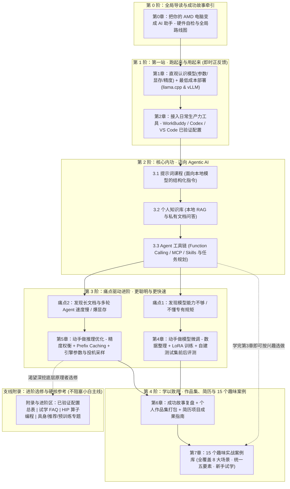
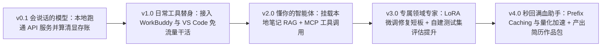

# DESIGN：hello-rocm 2.0 课程体系架构与完整大纲设计

> **当前阶段**：6A 工作流 - 阶段 2：Architect（架构阶段）  
> **任务名称**：`course-refactor`  
> **设计核心**：以学习者真实痛点与获得感为引擎，构建「跑通模型 → 接入工具 → 玩转 Agent → 按需微调与加速 → 15 个趣味案例 → 作品与简历沉淀」的完整闭环。

---

## 一、课程整体定位设计（Course Positioning）

### 1.1 品牌核心定义

| 维度 | 内容定义 |
|:---|:---|
| **课程名称** | **hello-rocm** |
| **核心主标语（Slogan）** | **每个 AI 小白，从零开始，动手实践的第一站。** |
| **课程副标题（定位）** | **基于 AMD 平台的 AI 与 Agentic AI 入门实践手册。** |
| **核心成长故事线** | **“我把自己的 AMD 电脑，变成了学习和工作的 AI 助手。”** |
| **教学方法论** | **先用起来，再深进去（Use First, Deepen by Need）** —— 告别底层术语堆砌，每一次技术进阶都由真实使用痛点触发 |

### 1.2 新旧版本定位对比（1.0 vs 2.0）

| 对比项 | 1.0 旧版（底层技术字典） | 2.0 新版（小白 AI 与 Agentic AI 实践手册） |
|:---|:---|:---|
| **视角出发点** | 工程师软件栈视角（环境 → 7 模型部署矩阵 → 微调 → C++ 算子） | 学习者任务视角（跑起来 → 接进日常软件 → 做知识库/Agent → 解决慢和笨 → 做作品） |
| **第一课体验** | 查 `gfx` 编号、装内核、看 ROCm 架构演进 | 用买菜算账直觉搞懂参数量/显存/精度，15 分钟跑起第一个模型并连上 WorkBuddy / VS Code |
| **核心能力栈** | 偏重底层编译、HIP 算子、多卡分布式 | 聚焦 **本地部署 + 工具生态接入 + Prompt/RAG/Agent + 轻量微调 + 引擎级推理优化 + 评测** |
| **案例标准** | 难度跨度极大（30 分钟脚本与 127GB 编译混排），格式不统一 | 精选 **15 个贴近日常学习工作的趣味案例**，强制统一「五要素规范」与「新手试学机制」 |
| **学习终点** | 跑通几条终端命令 | 沉淀 **可运行个人助手 + 训练记录 + 自建测试集评测报告 + 可直接写进简历的项目经历** |

### 1.3 目标学习者与硬件分层设计（零焦虑对号入座）

为了消除小白“我的电脑能不能跑”的顾虑，全书统一按 **4 档硬件配置标签** 提供抄作业级验证方案：

| 硬件档位标签 | 典型设备代表 | 主推模型规格与量化档位 | 可流畅完成的课程模块 |
|:---|:---|:---|:---|
| **🟢 入门档（8G–12G 独显 / 16G–32G 核显）** | RX 7600 / 7650 GRE、Ryzen AI 7/9 轻薄本 | `0.6B ~ 4B`（`Q4_K_M` GGUF） | 部署、接入日常工具、Prompt/RAG/轻量 Agent、0.6B–1.7B 微调、量化调优 |
| **🔵 甜点档（16G–24G 独显）** | RX 7800 XT / 7900 GRE / 7900 XTX / RX 9070 XT | `4B ~ 14B`（`Q4_K_M` / `Q8_0` / `FP16`） | 全模块畅玩（含 WorkBuddy 复杂工具调用、4B–8B 单卡 LoRA 微调、vLLM 加速） |
| **🟣 大内存旗舰档（64G–128G 统一内存 AI PC）** | Ryzen AI Max+ 395（Radeon 8060S）迷你主机/工作站 | `14B ~ 35B MoE` + 多模型并行（LLM + Embedding + 语音） | 全模块满血体验（支持超长上下文 Agent 工作台如 OpenClaw、全双工语音等） |
| **☁️ 云端兜底档（无本地 AMD 卡）** | 任意电脑浏览器 / SSH 接入免费 AMD Radeon Cloud | 同甜点档 / 旗舰档 | 零硬件成本完成命令行部署、微调、推理优化与 Web/终端案例实验 |

---

## 二、整体课程架构与学习流向图

### 2.1 整体课程分层架构图



### 2.2 纵向主线项目数据与能力演进流向图

每一章均围绕同一个纵向主线项目 **「我的本地全能学习工作助手（My AMD AI Buddy）」** 迭代升级，形成完整的简历故事闭环：



---

## 三、分章节详细课程大纲设计（Chapters 0–7 & Appendix）

### 第 0 章｜导读：把你的 AMD 电脑变成学习和工作的 AI 助手
- **定位**：用真实故事唤醒兴趣，3 分钟找准自己的硬件起点。
- **核心小节**：
  - `0.1` 为什么每个人都值得在自己的电脑上养一个本地 AI？（零 API 账单、隐私安全、断网可用、可动手改造）
  - `0.2` 学长学姐的真实故事：「我如何把吃灰的 AMD 游戏本/台式机，变成全天候私人 AI 助理」
  - `0.3` 3 分钟硬件对号入座：Windows 任务管理器 / Linux 命令行查看你的 AMD 显卡与内存档位（含无卡免费申领 AMD Radeon Cloud 指南）
  - `0.4` 课程地图与伴学利器：把 `hello-rocm Skill` 装进你的 AI 助手陪你学

---

### 第 1 章｜第一站：直观认识模型与最低成本本地部署
- **定位**：先破除“参数量、量化、显存”三大认知迷雾，再用最低成本跑通第一个本地模型。
- **核心小节**：
  - `1.1` **【直觉必修课】不看复杂公式，算清大模型的“三本账”**
    - **参数量（Parameters，如 0.6B / 4B / 8B）**：决定模型“脑容量上限”，什么日常任务分别需要多大模型？
    - **参数量 vs 权重文件大小 vs 运行内存/显存**：为什么 40 亿参数（4B）模型下载到硬盘是 2.6GB，跑起来却吃了 4.5GB 显存？用「字典书本厚度（权重文件）+ 答题草稿纸（上下文 KV Cache）+ 书桌留白（运行时开销）」一眼看懂三者关系。
    - **为什么同一个模型有 FP16 / BF16 / FP8 / Q8_0 / Q4_K_M 不同精度版本？**：用「RAW 原片 vs 高清 JPG vs 微信压缩图」类比数据类型与量化；直接给出 **《不同显存档位精度选型决策表》**（平时闭眼选 `Q4_K_M` / `Q8_0`，微调选 `BF16`）。
  - `1.2` **极简环境准备（Windows 11 & Ubuntu 双通道）**
    - 显卡驱动版本核对、`uv` 极速 Python 环境准备、GPU 可见性一秒自检。
  - `1.3` **单人极速方案：用 `llama.cpp` 5 分钟跑起本地模型**
    - 免编译直接运行 ROCm 预编译版 `llama-server`，加载 GGUF 模型并打开内置本地网页对话；（附 LM Studio / Ollama 图形化与一条命令快捷备选说明）。
  - `1.4` **标准服务方案：用 `vLLM` 拉起高性能本地 API 服务**
    - 一条命令启动官方 ROCm 容器/服务，测试 OpenAI 兼容接口（`http://localhost:8000/v1`），直观对比 `llama.cpp`（省显存、秒启动）与 `vLLM`（高并发、吞吐强）的适用场景。
- **本章里程碑产出**：在本地跑起第一个模型服务，填写你的第一张《本机显卡模型显存与速度实测卡》。

---

### 第 2 章｜即刻提效：零代码办公先行 —— 接入 WorkBuddy、VS Code 与 Codex
> 完整 WorkBuddy 本地接入避坑与办公案例前置设计见同目录 `WORKBUDDY_OFFICE_RESEARCH_course-refactor.md`。

- **定位**：**把人人刚需的“零代码 AI 办公”放在最前面**！刚跑通本地模型，10 分钟内就让它替你理文件夹、洗 Excel、生成汇报 PPT，随后再无缝覆盖编程场景；**全程官方发布已验证版本与配置文件**。
- **核心小节**：
  - `2.1` **理解“万能插座”（OpenAI 兼容接口）与本地 Agent 三大安全铁律**
    - 搞懂 `Base URL`、`API Key`、`Model ID`、`supportsToolCall`；牢记**独立沙盒文件夹、非 C 盘缓存与 `dry-run` 预览确认**三大铁律。
  - `2.2` **【第一顺位 · 零代码办公首秀】接入 WorkBuddy：打造全隐私本地 AI 办公工作台**
    - **保姆级配置与 5 大避坑**：并列对比 UI 填法（`/v1`）与 `~/.workbuddy-ai/models.json` 填法（`/v1/chat/completions`），解决空白回复（强制开启 `32768` 上下文防工具说明书截断）与 `apiKey` 非空校验。
    - **当场体验办公三连击（Ask → Plan → Craft）**：拖入沙盒测试文件夹，零代码完成一次本地文件智能分类盘点或脏乱表格清洗出报告！
  - `2.3` **接入 VS Code 编程助手（`Continue` + `Cline` 已验证配置）**
    - `1.5B` 毫秒级行内补全 + `8B/14B` 多文件修改 Agent 模式；发布经 ROCm 实测不卡死的插件版本与配置模板。
  - `2.4` **接入 Codex CLI 与轻量终端助手（含 `toy-cli`）**
    - 在命令行里用自然语言查报错、写脚本、自动修 Bug；提供 `~/.codex/config.toml` 本地 Provider 标准模板。
- **本章里程碑产出**：零 API 费用跑通 WorkBuddy 本地文件自动化交付（及任选一款编程工具联调）。

---

### 第 3 章｜玩转 Agentic AI：提示词闯关、个人知识库、趣味 MCP 与 Agent Skills
> 完整全网趣味 Agent 教程与生态调研见同目录 `AGENT_TUTORIALS_RESEARCH_course-refactor.md`。

- **定位**：用 **「说话术（Prompt）+ 开卷参考书（RAG）+ 万能外设手脚（MCP）+ 老师傅 SOP 锦囊（Skills）」** 一张图建立清晰认知，全程用互动游戏化实验把模型升级为能干活的智能体。
- **核心小节**：
  - `3.1` **提示词闯关课：6 关交互式 Notebook 驯服本地小模型**
    - 借鉴 Anthropic 官方交互式提示词教程与 Datawhale `ai-prompting-for-everyone` / `smart-prompt`，将 Jupyter Playground 直连本机 AMD 模型 API，边改边通关（角色边界、分隔符隔离、Few-Shot 示范、JSON 强约束、防幻觉认怂）。
  - `3.2` **个人知识库实战（RAG）：从「黑暗料理菜谱切分实验」到私人笔记开卷问答库**
    - 借鉴 Datawhale `all-in-rag`「今天吃什么」趣味菜谱实验，亲眼对比“乱切块做出黑暗料理 vs 按结构切块精准推荐菜谱”；并直接复用 **`WorkBuddy + Obsidian`**（配合官方 `obsidianmd/obsidian-skills` 双链技能），零代码搭好带 `[[双向链接]]` 与出处溯源的个人课程笔记库。
  - `3.3` **Agent 工具与万能插座 MCP：玩转 B站/微信读书/12306 趣味服务 + 20 行代码手搓「AMD 显卡管家 MCP」**
    - 结合 HuggingFace `agents-course` 与 Datawhale `hello-agents` 看懂 `观察→思考→行动` 循环；先一键挂载 B站字幕总结、微信读书划线、高德周边美食或 12306 余票等中文趣味 MCP，再用 `FastMCP` (`@mcp.tool()`) 10 分钟手写一个查本机显卡温度与显存余量的专属 MCP 服务！
  - `3.4` **模块化技能包 Agent Skills（`SKILL.md`）：省显存秘籍与一键装大招**
    - 结合 `datawhalechina/agent-skills-with-anthropic`，讲透为什么 **渐进式披露（Progressive Disclosure）** 能拯救本地小模型有限的上下文显存；现场解剖本仓库 `src/hello-rocm-skill/SKILL.md`、体验「归藏动态网页 PPT Skill / 小红书种草 Skill」，并亲手为 WorkBuddy / Codex 写出你的第一个《周报/作业排版自检 Skill》。
  - `3.5` **安全护栏与进阶悬念（自然引出第 4、5 章）**
    - 加上防死循环与高危操作人工确认锁；同时复盘实战中暴露的两大真问题——小模型偶发写歪工具参数（→ 第 4 章中文微调）与挂满工具后首字变慢（→ 第 5 章 Prefix Caching 加速）。
- **本章里程碑产出**：建成「个人学习助手 v2.0」—— 拥有本地笔记知识库、自研 AMD 显卡监控 MCP 与专属自定义 `SKILL.md`。

---

### 第 4 章｜能力不够怎么办？动手做第一次中文模型微调
> 完整纯中文微调案例与魔搭数据集调研见同目录 `FINETUNE_RESEARCH_course-refactor.md`。

- **定位**：当你在第 2、3 章真实使用中发现**“提示词写破天，本地小模型处理中文群通知总把 JSON 写崩 / 中文双关逻辑总被忽悠 / 模仿中文语气总是露馅”**时，全流程基于 **ModelScope 魔搭社区原生中文数据集** 自然引入微调！
- **核心小节**：
  - `4.1` **微调决策树：先分清该改提示词、加中文知识库，还是做微调？**
    - 一张表讲透 Prompt vs RAG vs 微调各自的擅长点与禁区（避开“用几百条问答硬背事实导致幻觉”的新手第一大坑）。
  - `4.2` **直觉认识 LoRA + 5 分钟中文破冰实验（「弱智吧」逻辑防忽悠微调）**
    - 图解 LoRA 显存账单；直接拉取中科院开源 **`COIG-CQIA`（弱智吧精选中文子集，仅 240–500 条）**，通过 **`LLaMA-Factory WebUI` 零代码点鼠标**（或 60 行精简脚本）+ `SwanLab` 看板，8G 显卡 **5 分钟** 亲眼见证小模型识破中文双关逻辑陷阱的质变！
  - `4.3` **中文数据处理实战：清洗构造高质量中文指令集**
    - 教你从中文办公群记录、错题集或师生蒸馏中清洗构造 200–1,000 条样本，避开中文标点、脱敏与 Chat Template 错位陷阱。
  - `4.4` **主线必修实战：基于 `MSAgent-Bench` 与 `InstructIE` 微调中文工具调用与通知提取专家**
    - 采用魔搭官方中文工具调用集 `MSAgent-Bench` 与浙大中文信息抽取集 `ZJUNLP/InstructIE`，让 `1.5B / 4B` 小模型从口语化中文课程群/办公通知中 **98% 零失误提取待办 JSON 并调用本地工具**。
  - `4.5` **【求职级闭环】自建中文测试集客观评测 & 导出 GGUF 重新接入工具**
    - 构建 50 条真实中文通知与工具调用黄金测试集，一键跑出微调前后 **JSON 合法率、中文实体提取 F1 与函数命中率** 对比表，合并导出 GGUF 无缝换回 WorkBuddy 与 VS Code！
  - `4.6` **五大纯中文高人气微调选修配方超市（全部基于 ModelScope 直连中文数据集）**
    - 🎭 **配方 A（网感人设王）**：`WeClone` 个人微信聊天记录数字分身 / **小红书爆款种草文案机** / 仓库内置 **`Chat-甄嬛`**（破功词统计 + 双盲测试胜率）
    - 🩺 **配方 B（R1 蒸馏王）**：魔搭爆款 `delicate_medical_r1_data` **中文医学问诊 / 理科错题 `<think>` 思维链蒸馏**（对接上海数医 **`MedBench`** 中文真题测 Pass@1）
    - ⚖️ **配方 C（法务与心理）**：复旦 **`DISC-Law-SFT` 中国民法典/租房劳动合同审查助手**（对接 **`LawBench`** 评测）或华工 **`SoulChat-R1` 中文多轮心理共情陪伴**
    - 🗄️ **配方 D（数据求职王）**：中文 **`CSpider` / 百度 `DuSQL` 自然语言查表格小专家**（本地中文 `SQLite` 数据库直接跑真实 **执行准确率 Execution Acc**）
    - 🧾 **配方 E（中文多模态）**：基于 `ms-swift` / `LLaMA-Factory` 微调 **中文增值税电子发票要素提取 / 中文手写错题试卷转结构化卡片**
- **本章里程碑产出**：一份完整的中文微调配置/代码、清洗后中文数据集、SwanLab 训练曲线与《自建中文测试集微调前后客观指标评估报告》。

---

### 第 5 章｜速度不够怎么办？AMD 原生量化、零 C++ 算子唤醒与 `Hyperloom` 自动优化
> 完整 AMD 量化、算子加速与 `Hyperloom` 调研见同目录 `OPTIMIZE_RESEARCH_course-refactor.md`。

- **定位**：当你在用 WorkBuddy 读长论文、用 Codex 改大项目时发现**“等第一个字要十秒、聊几轮就爆显存”**时，**无需写一行 C++ 代码**，从 **AMD 官方 `Quark` 量化与算子开关** 一路体验到 **用 `AMD-AGI/Hyperloom` 多智能体系统全自动调优算子与推理参数（用 AI 自动优化 AI！）**！
- **核心小节**：
  - `5.1` **给慢助手做 AI 体检：看懂 TTFT / TPS 指标 + 用 `AMD-AGI/TraceLens` 自动诊断瓶颈**
    - 直观拆解 Prefill（算力密集）与 Decode（显存带宽密集），配合 `amd-smi` 与跨平台自动剖析工具 **`TraceLens`** 一眼揪出最慢的瓶颈算子。
  - `5.2` **AMD 官方量化实战：用 `AMD Quark` 15 行 Python 压缩微调模型 + 对称 KV Cache 避坑**
    - 拿第 4 章的 128 条中文样本作校准集，用 **`AMD Quark` (`pip install amd-quark`)** 将微调模型压成 **`INT4 AWQ`（全系 Radeon / Ryzen AI 通用）** 或 **`OCP FP8`（RDNA 4 / Instinct 原生加速）**，显存立省 60%+ 且中文评测近乎零损；掌握 `llama.cpp` 对称设置 `-ctk q8_0 -ctv q8_0` 避坑法则。
  - `5.3` **零 C++ 算子加速实战：`@torch.compile` 自动融合 + 一键唤醒 `hipBLASLt` / `rocWMMA FA` / `AITER`**
    - 15 行纯 Python 加上 **`@torch.compile`** 体验 ROCm Triton 自动算子融合（耗时立减 50%+）；一键开启 `llama.cpp` 的 `ROCBLAS_USE_HIPBLASLT=1 -fa on --no-mmap` 与 `vLLM` 的 **`VLLM_ROCM_USE_AITER=1`**（启用 `ROCm/aiter` 高性能融合算子库），长文首字处理与吞吐直接翻 **2–3 倍**！
  - `5.4` **Agent 秒回组合拳：Prefix Caching 前缀缓存、投机采样与 Ryzen AI `NPU+GPU` 异构双打**
    - 开启前缀缓存化解 WorkBuddy / Codex 数万字固定提示词延迟（从 10s 压至 <1s）；体验 0.6B 草稿模型投机采样与锐龙笔记本 `XDNA2 NPU` 省电分流。
  - `5.5` **【全书 Agentic 高潮闭环】结合 [`AMD-AGI/Hyperloom`](https://github.com/AMD-AGI/Hyperloom) 与 `AMD Skills` 实现全自动推理与算子优化**
    - **首尾呼应第 2、3 章**：把 `Hyperloom`（`@hyperloom/inference_optimizer/SKILL.md`）与 `amd/skills` 挂载进你的 Codex / VS Code 助手，只需下达一句自然语言目标，看 **`Magpie`（基准采集）→ `TraceLens-Agent`（瓶颈定位）→ `Arbor`（参数树搜索）+ `GEAK`（多 Agent 自动重写/融合 Triton & HIP 热点算子）** 全自动闭环跑出最优配置并核验精度！（本地 Radeon/Ryzen 电脑体验 `TraceLens` + `amd/skills` 自动诊断寻优，云端 Instinct 环境一键跑通 `python -m hyperloom optimize` 端到端自动改算子与调参）。
- **本章里程碑产出**：产出一份直通简历的《基线 BF16 vs AMD Quark 量化 + AITER 算子加速 + Hyperloom 自动寻优：速度、显存与中文准确率对比报告》。

---

### 第 6 章｜成功故事、作品集沉淀与简历成果锻造
- **定位**：把前面五章亲手做出来的成果，系统包装成能晒朋友圈、能放 GitHub 首页、能写进简历打动面试官的硬核证明。
- **核心小节**：
  - `6.1` **成功故事全景记录模板**
    - 以 **“我把自己的 AMD 电脑，变成了学习和工作的 AI 助手”** 为题，引导学习者串联记录：硬件配置与选型算账 → 第一次跑通模型 → 接入日常工具踩坑记 → 首次微调与优化的数据跃升 → 最终建成的个人应用。
  - `6.2` **个人项目作品包（Portfolio Kit）标准结构**
    - 清单化交付：① 项目源码与一键启动脚本；② 交互演示 GIF / 短视频；③ 数据清洗脚本与 LoRA 训练曲线；④ 自建测试集评测脚本与前后对比报告；⑤ 个人独立贡献说明（区分复用框架部分与本人设计调优部分）。
  - `6.3` **简历成果转化指南与多方向简历示例**
    - 拆解如何用 **STAR 法则 + 量化指标** 证明四大核心工程能力：**模型部署能力、数据处理能力、应用集成能力、科学评测能力**。
    - **标准简历项目示例（可直接按个人实测数据填入）**：
      > **项目名称**：基于 AMD ROCm 平台的本地垂直领域学习助手构建与微调加速  
      > **核心描述**：基于 AMD 平台完成小模型微调并构建本地学习助手，负责数据整理、模型服务与知识检索集成，通过自建测试集评估微调前后及应用效果。  
      > **量化亮点拆解参考**：  
      > - **模型服务与工具集成**：基于 `vLLM` / `llama.cpp` 部署本地量化大模型服务，兼容接入 WorkBuddy 与 VS Code 助手，结合本地向量检索（RAG）与 MCP 工具实现私有文档问答与自动化整理；  
      > - **数据构造与轻量微调**：针对本地小模型在特定指令与结构化输出上的短板，清洗构建 XXX 条高质量指令集并完成单卡 LoRA 微调，在自建 XX 题黄金测试集上任务准确率由 XX% 提升至 XX%；  
      > - **推理性能调优**：引入量化档位优选与 Prefix Caching 前缀缓存机制，在多轮 Agent 工具调用场景下首字延迟（TTFT）降低 XX%，推理吞吐达 XX tok/s，显存占用控制在 XX GB 以内。
  - `6.4` **成为试学官与开源共建者**：如何提交你的试学报告、新案例 PR 并参评优秀学习者与 AMD 布道师通道。

---

## 四、第 7 章：15 个趣味实战案例库详细规划（零代码日常办公案例最前置！）

> 完整全网调研对比见同目录 `CASES_RESEARCH_course-refactor.md` 与 `WORKBUDDY_OFFICE_RESEARCH_course-refactor.md`。

遵循 **「零代码高频办公与学习场景最前置（Case 01–08）→ 语音伴侣、编程开发、网页规划与游戏互动（Case 09–15）」** 的小白友好排序，**100% 覆盖全部 8 大指定场景**：

| 编号 | 所属场景（8大类） | 案例名称（绑定真实明星项目） | 核心玩法与亮点 | 接入工具 / 开源基座 | 推荐硬件最低档位 | 痛点联动（微调/推理优化） |
|:---:|:---|:---|:---|:---|:---|:---|
| **Case 01** | 🗂️ 文件整理 | **【办公头牌】拯救杂乱下载夹：智能归档与文件盘点管家** | 拖入杂乱发票/课件/截图目录，自动建子文件夹重命名并生成《文件清单盘点.md》（带 `dry-run` 预览） | `WorkBuddy` + `LlamaFS` + 本地多模态 `MiniCPM-V` | 🟢 入门档 (8G) | 多模态看图识文 + 沙盒安全预览确认机制 |
| **Case 02** | 📊 报告生成 | **【办公三件套连招】脏乱 Excel ➡️ Word 报告 ➡️ 20页汇报 PPTX** | `Ask→Plan→Craft` 三步全自动清洗汇总乱表、撰写分析报告并交付专业去 AI 味演示文稿 | `WorkBuddy (三模式联动)` + 本地 OpenAI API | 🟢 入门档 / 🔵 甜点档 | 联动第 5 章：开启 Prefix Caching 秒回长指令 |
| **Case 03** | 📊 报告生成 | **一键高级感周报 Skill & 全本地深度调研报告专家** | 零散流水账/Git 记录 30 秒出周报（封装专属 Skill），复杂课题多轮检索生成万字带引用研报 | `WorkBuddy Skill` + `Local Deep Research` | 🟢 入门档 / 🔵 甜点档 | 联动第 3 章：把高频办公套路封装成 `SKILL.md` |
| **Case 04** | 📄 论文阅读 | **多篇 PDF 文献横评对比表 & 组会双语汇报 PPT 生成** | `@` 授权多篇英文论文或财报 PDF，自动输出研究方法局限性横评表，并一键生成组会汇报双语 PPT | `WorkBuddy (Plan模式)` + 本地长上下文 | 🔵 甜点档 (16G) | 发布经过验证的 `models.json` 32K 上下文配置 |
| **Case 05** | 📄 论文阅读 | **公式排版零损双语论文精翻器** | 调用本地模型把英文 arXiv PDF 翻成双语对照版，数学公式与双栏图表丝毫不乱 | `Byaidu/PDFMathTranslate` (20k⭐) + `Zotero` | 🟢 入门档 (8G) | 联动第 5 章：开启 `vLLM` 并发批处理提速 8 倍 |
| **Case 06** | 📚 个人知识库 | **Obsidian 私人第二大脑与 AMD 原生 Agent** | 免装多余客户端，在 WorkBuddy 中加载官方 `obsidian-skills` 检索笔记并自动生成带 `[[双链]]` 知识卡片 | `WorkBuddy + Obsidian` / `amd/gaia` | 🟢 入门档 (8G) | 体验 WorkBuddy 双链沉淀与 AMD `GAIA` 自动评测 |
| **Case 07** | 📚 个人知识库 | **讲义秒变双人播客 & 赛博数字分身** | NotebookLM 本地平替把教材转双人播客 MP3，并用微信记录微调专属“数字分身” | `lfnovo/open-notebook` + `WeClone` | 🟢 入门档 / 🔵 甜点档 | 联动第 4 章：用个人中文语料做 LoRA 微调 |
| **Case 08** | 🎙️ 语音交互 | **全离线保密会议与网课纪要神器** | 录音一秒不上云，实时捕获音频离线转写、区分发言人并提炼待办清单（Action Items） | `Meetily` (`Zackriya-Solutions/meetily`) + `Faster-Whisper` | 🟢 入门档 (8G) | ROCm 语音转写加速 + 结构化待办抽取 |
| **Case 09** | 🎙️ 语音交互 | **桌面 Live2D 实时语音伴侣与口语陪练** | 告别打字！与桌面上有表情、支持随时打断的 AI 虚拟伙伴全离线练英语口语 | `Open-LLM-VTuber` (8k⭐) / 仓库 `MiniCPM-o 4.5` | 🟢 入门档 / 🔵 甜点档 | 端到端低延迟本地语音流（ASR+LLM+TTS/Omni） |
| **Case 10** | 💻 编程助手 | **VS Code 离线双模编程搭档** | 1.5B 毫秒级 Tab 行内补全 + 8B/14B 自动改多文件代码、跑终端修报错 | `Continue` (25k⭐) + `Cline` (40k⭐) + `vLLM`/`llama.cpp` | 🟢 入门档 / 🔵 甜点档 | 联动第 5 章：解决 `Cline` 长上下文首字卡顿 |
| **Case 11** | 💻 编程助手 | **终端自主修 Bug 智能体** | 用官方 `Codex CLI` 连本地模型改代码跑单测，并花 30 分钟拆解 `toy-cli` 百行源码 | `OpenAI Codex CLI` + 仓库 `toy-cli` | 🟢 入门档 / 🔵 甜点档 | 联动第 4 章：提升小模型 Tool Call 格式准确率 |
| **Case 12** | 🗺️ 任务规划 | **浏览器自动化操控与智能旅行规划师** | 让本地 AI 像真人一样操控浏览器比价查资料，并调用高德 MCP 自动编排整趟旅行日程 | `browser-use` (50k⭐) + 仓库 `smart-travel-planner` | 🔵 甜点档 (16G) | 体验 GUI/浏览器自动操作与标准 MCP 协议编排 |
| **Case 13** | 🗺️ 任务规划 | **24 小时全隐私多端个人管家中枢** | 手机飞书/Telegram 随手发消息，家里 AMD 电脑自动拆解复杂待办并调度本地工作区 | 仓库 `openclaw` (`ClawX`) + Prefix Caching 优化 | 🟣 旗舰档 / ☁️ 云端 | 联动第 5 章：化解 39K 超长系统提示词延迟 |
| **Case 14** | 🎮 游戏互动 | **从扫雷挑战赛到《我的世界》AI 生存搭档** | 先在扫雷棋盘看清 Agent 推理循环，再把本地模型放进 Minecraft 自动砍树挖矿盖房 | 仓库 `minesweeper-agent` + `Mindcraft` (5k⭐) | 🟢 入门档 / 🔵 甜点档 | 对比约束式 vs 自主式 Agent 及游戏专用 LoRA |
| **Case 15** | 🎮 游戏互动 | **AI 跑团守秘人（TRPG DM）与古风 NPC 剧场** | 结合规则书 RAG、投骰状态机与《甄嬛传》LoRA 角色人设，打造单人文字冒险游戏 | 仓库 `huanhuan-chat` 升级 + `COC-AI-keeper` | 🟢 入门档 (8G) | 联动第 4 章：人设风格微调与状态一致性记忆 |

> 注：原仓库 `YOLOv10 微信跳一跳` 可作为视觉游戏彩蛋保留；`Every Embodied`、`Torch-RecHub`、`Happy-LLM`、`DS4/Qwen3.8` 完整归入「进阶选修与科研极客专题」。

---

## 五、统一案例规范与新手试学机制设计（接口契约）

### 5.1 统一案例「五要素」标准模板契约

所有 15 个趣味案例（以及社区后续新增 PR 案例）必须严格遵循以下统一的 5 模块结构，缺一不可：

```markdown
# Case XX：[案例标题] —— [一句话吸引人的副标题]

> 🏷️ **场景分类**：[8大场景之一] ｜ ⏱️ **预计耗时**：[30–90 分钟] ｜ 🎮 **最低硬件档位**：[🟢入门 / 🔵甜点 / 🟣旗舰 / ☁️云端]

## 1. 🎬 效果演示（Demo）
- **最终效果预览**：[动图 GIF / 关键对话对比截图 / 30秒演示视频链接]
- **你将亲手做出什么**：用 3 句话说明输入是什么、AI 做了什么、最终产出什么实用结果。

## 2. ✅ 支持配置清单（Verified Configurations）
> 以下组合均由维护者与试学官真机实测跑通，抄作业即可：

| 配置项 | 经过验证的版本 / 推荐参数 |
|:---|:---|
| **验证硬件与系统** | 例：RX 7800 XT (16GB) / Ryzen AI Max+ 395；Windows 11 25H2 & Ubuntu 24.04 |
| **ROCm / 推理引擎版本** | 例：`llama.cpp-rocm bXXXX` 或 `vLLM 0.27.0 (ROCm 10.0.0)` |
| **推荐模型与精度档位** | 例：`Qwen3-8B-Q4_K_M`（最低 `Gemma-4-E4B-it-Q4_K_M`，需约 5.5GB 显存） |
| **接入工具版本与配置文件** | 例：`WorkBuddy vX.Y.Z` / `Continue vX.Y.Z`，配套配置文件路径 `configs/xxx.json` |
| **关键启动参数** | 例：`--ctx-size 16384 --jinja`（确保工具调用与上下文不截断） |

## 3. 💻 完整代码与分步实操（Code & Step-by-Step）
- **源码目录**：`src/cases/case-XX-xxx/`（含 `requirements.txt`、`.env.example` 与一键启动脚本）
- **Step 1**：拉起本地模型服务（复制即跑命令）
- **Step 2**：配置接入工具 / 安装最小依赖
- **Step 3**：运行核心代码与关键逻辑白话拆解（不超过 50 行核心逻辑讲解，拒绝贴几百行无注释代码）

## 4. 🔍 验证方法与验收标准（Verification）
- **冒烟测试（Smoke Test）**：输入指定的标准测试指令 X，预期在 N 秒内看到输出 Y（附正常终端回显对照）。
- **效果自测清单（3 个测试用例）**：包含 1 个常规用例、1 个边界长输入用例、1 个防踩坑异常用例，全部打勾即代表复现成功。

## 5. 🚀 扩展任务与简历加分改造（Extension Tasks）
- **⭐ 青铜改造（15 分钟）**：修改提示词或接入你自己的真实本地文件夹/笔记，做成你每天自用的小工具。
- **⭐⭐ 白银改造（45 分钟）**：对比换用不同量化精度（Q4 vs Q8）或开启 Prefix Caching 前后的速度与回答质量，记录一张实测表。
- **⭐⭐⭐ 黄金改造（可写进简历）**：构造 50 条该场景专属微调数据或 20 题评测集，量化你的优化提升幅度并提交社区展示墙！

## ❓ 新手试学常见问题（Troubleshooting — 持续由试学官共建更新）
- **Q1：[真实新手报错原文]** → 原因解释 + 一行解决命令。
```

### 5.2 新手试学机制（Novice Trial SOP）

为了让课程真正做到“AI 小白零卡点”，设计标准化的 **「新手试学闭环机制」**：

1. **试学准入规则**：每篇主线章节或案例发布前，至少邀请 **2 名不同硬件环境（如 1 名 Windows 独显/核显新手 + 1 名 Ubuntu/云端新手）** 在**无作者口头提示**的情况下，仅凭文档独立从头做到尾。
2. **试学反馈卡（Issue 模板化）**：
   - ⏱️ 实际耗时 vs 文档预计耗时；
   - 🛑 **第一卡点位置**：在哪一步停下来超过 5 分钟没看懂？（哪怕是一个缩写词没解释清楚也必须记下）；
   - 🐛 **配置差异报错**：本机显卡型号、系统版本、报错截图与最终解决办法；
   - 💡 **获得感评分（1–5 分）**：做完后是否真正用到了日常学习工作中？
3. **文档迭代准出红线**：
   - 凡是有 ≥2 名试学新手在同一处卡壳，**不怪新手基础差，直接修改教程正文或默认脚本**，并将报错沉淀进该章底部的 `新手试学常见问题（FAQ）`；
   - 通过验证的软硬件组合，在案例头部的 `支持配置清单` 中点亮 **「✅ 新手试学已验证」** 徽章，试学反馈者直接署名计入仓库贡献者名单（Contributors）。

---

## 六、仓库目录重构映射方案（兼顾新主线清晰度与旧外链兼容）

在后续进入 Stage 5（Automate 自动化改造）时，建议将 `docs/zh/` 重构为清晰体现上述学习旅程的目录结构，同时平滑承接现有资产：

```text
hello-rocm/
├── docs/zh/
│   ├── 00-guide/               # 第0章：导读、成功故事、3分钟硬件自检与选型速查
│   ├── 01-first-model/         # 第1章：直观认识数据类型/精度/显存 + llama.cpp & vLLM 最低成本部署
│   ├── 02-connect-tools/       # 第2章：接入日常工具（WorkBuddy / Codex / VS Code 已验证版本与配置库）
│   ├── 03-agentic-ai/          # 第3章：提示词课程、本地个人知识库（RAG）、Agent 工具链（MCP / Skills）
│   ├── 04-fine-tune/           # 第4章：能力不够做微调（数据整理、LoRA 训练、自建测试集前后评估）
│   ├── 05-optimize-speed/      # 第5章：速度不够做推理优化（量化横评、Prefix Caching、引擎调优、NPU协同）
│   ├── 06-portfolio-resume/    # 第6章：成功故事记录模板、作品集五件套与简历成果指南
│   ├── 07-fun-cases/           # 第7章：15 个趣味实战案例库（按8大场景组织，统一五要素+试学FAQ）
│   └── 99-advanced-appendix/   # 进阶选修与参考附录（原 03-infra HIP算子、多模型字典、具身/推荐/预训练专题、排错总表）
└── src/
    ├── configs/                # 经过验证的 WorkBuddy / Codex / VS Code 配置文件模板库
    ├── main-assistant/         # 纵向贯穿第1~5章的「个人学习助手」分阶段演进源码与评测脚本
    ├── cases/                  # 15 个趣味案例标准化独立可运行代码目录
    └── advanced/               # 原 infra / 重度科研专题源码归档
```

> **兼容性保障策略**：对于外部已广泛引用的旧路由（如 `/zh/00-environment/`、`/zh/01-deploy/`、`/zh/03-infra/`、`/zh/05-amd-yes/`），在 VitePress 配置中保留路由兼容或引导页跳转，确保历史外部文章、视频与组队学习链接 **100% 不产生 404**。
