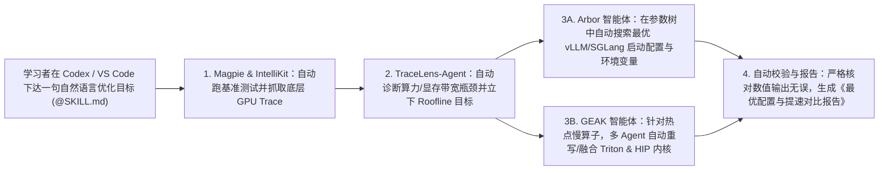

# 全网「AMD 原生量化、零 C++ 算子加速与 Hyperloom 自动优化」调研与课程设计报告

> **关联任务**：`course-refactor`（hello-rocm 2.0 第 5 章「速度不够怎么办？模型推理优化」专项调研）  
> **核心目标**：彻底告别“手写 200 行 C++ HIP 算子”的劝退门槛，聚焦 **100% AMD 官方王牌加速栈** —— 从 **`AMD Quark` 量化**、**`AITER / hipBLASLt / Triton` 一键算子唤醒**，一路进阶到用 **`AMD-AGI/Hyperloom` 多智能体系统全自动改算子与调参（AI Optimizing AI）**！  
> **调研来源**：[`AMD-AGI/Hyperloom`](https://github.com/AMD-AGI/Hyperloom)、`AMD-AGI/GEAK`、`AMD-AGI/TraceLens`、`AMD-AGI/Magpie`、`amd/Quark`、`ROCm/aiter`、`amd/skills` 及 ROCm 10.0 官方文档。

---

## 一、核心理念升级：从「手搓 C++ 算子」跃迁到「AMD 原生加速 + Agentic 自动优化」

作为一本定位为 **《基于 AMD 平台的 AI 与 Agentic AI 入门实践手册》** 的教程，第 5 章不仅是教推理加速，更是全书 **Agentic AI 理念的高潮闭环**——学习者不仅用 Agent 处理日常办公，还能在最后亲手调用 **AMD 开源的多智能体优化系统 `Hyperloom`**，让 AI Agent 替自己做性能剖析、搜参数、甚至自动重写底层 GPU 算子！

| 优化层次 | 传统劝退教法（移入附录选修） | `hello-rocm 2.0` 零 C++ 递进式教法（第 5 章主线） | 实测收益与教学亮点 |
|:---|:---|:---|:---|
| **L1 诊断层** | 人工肉眼翻几万行 JSON Trace | `amd-smi` 直观体检 + **`AMD-AGI/TraceLens`**（跨硬件/跨系统自动标出瓶颈算子） | 5 分钟精准定位是卡在算力（Prefill）还是卡在显存带宽（Decode） |
| **L2 量化层** | 背浮点数二进制指数/尾数公式 | **`AMD Quark`** 15 行 Python 压缩中文微调模型（`INT4 AWQ` / `FP8`）+ 对称 KV Cache 量化 | 显存立省 **50%–70%**，吐字速度 **+80%~150%**，中文评测近乎零损 |
| **L3 算子层** | 手写 200 行 C++ HIP `Fused Swish` | 15 行 Python **`@torch.compile`（Triton 融合）** + 一键开启 **`AITER` / `hipBLASLt` / `rocWMMA FA`** | 零 C++ 悟透算子融合，长文首字处理暴涨 **2x–3.5x** |
| **L4 交互层** | 无针对性 Agent 优化 | **Prefix Caching（前缀缓存）** + **投机采样** + Ryzen AI **`NPU+GPU` 异构分流** | WorkBuddy / Codex 多轮工具调用首字等待从 10s 压至 **<1s** |
| **L5 自动寻优层** | 专家耗时数周手工改 Kernel 调参 | **`AMD-AGI/Hyperloom` 全自动优化闭环**（通过 `SKILL.md` 一句话驱动 `Arbor` 调参 + `GEAK` 自动改算子） | **用 AI 自动优化 AI**！把第 2/3 章学的 Codex/Skills 与第 5 章底层加速完美合龙 |

---

## 二、重磅亮点：`AMD-AGI/Hyperloom` 如何融入小白课程？

### 2.1 为什么 `Hyperloom` 天生就是为本课程量身定做的？

查阅 [`AMD-AGI/Hyperloom`](https://github.com/AMD-AGI/Hyperloom) 与官方 How-To 文档可以发现，Hyperloom 的交互入口**不是复杂的底层 C++ API，而恰恰是学习者刚在第 2、3 章熟练掌握的 `Agent + SKILL.md` 模式**！

学习者只需在自己的 AI 编程助手（Codex / Claude Code / VS Code Agent）中引用 `@hyperloom/inference_optimizer/SKILL.md`（或安装 `npx skills add amd/skills` 中的 `hyperloom-workload-optimizer`），用自然语言下达任务单：

```markdown
@hyperloom/inference_optimizer/SKILL.md
请帮我自动优化以下推理任务：
- 模型：./qwen3-zh-assistant
- 框架：vLLM
- 并发与长度：CONC=32, ISL=2048, OSL=512
- 目标：在保证数值精度无损的前提下，将吞吐量提升 15% 以上
```

### 2.2 一张图让小白看懂 Hyperloom 背后的「四大专职 AI 工程师团队」

不用写复杂代码，小白就能像“技术总监”一样指挥 AMD 开源的 4 个专业子智能体协同干活：



### 2.3 兼顾「本地 Radeon / Ryzen AI 电脑」与「云端 Instinct 算力」的双轨实操设计

为了确保不同硬件条件的小白都能亲手跑通（不因硬件限制卡壳），在 `5.5 节` 设计清晰的双轨体验：

1. **🟢/🔵 本地消费级 AMD 电脑（Radeon 独显 / Ryzen AI 核显，Windows & Linux 通用）**：
   - 动手运行跨平台硬件无关的 **`AMD-AGI/TraceLens`**（或挂载 `amd/skills` 中的 `tracelens-analysis-orchestrator` 与 `rocm-doctor`），喂入一段本地 PyTorch / 推理 Trace，让 AI 自动生成中文瓶颈分析优先级报告；
   - 让加载了 **`amd/skills`** 的 Codex / WorkBuddy 自动检查本机显卡环境并生成最优 `llama.cpp` / `vLLM` 启动脚本。
2. **🟣/☁️ 云端免费算力 / Instinct 环境（AMD Radeon Cloud / MI300X 等）**：
   - 安装 `pip install hyperloom-inference-optimizer --target .`，直接通过 **`python -m hyperloom optimize`** 或 **`@hyperloom/inference_optimizer/SKILL.md`** 启动完整的端到端自动寻优会话，亲眼见证 `Arbor + GEAK` 多轮迭代刷高吞吐峰值，直接把自动产出的优化报告收入个人作品集！

---

## 三、AMD 原生量化与引擎算子唤醒核心实战清单

1. **`AMD Quark` (`amd/Quark`) 15 行 Python 量化实战**：
   - 拿第 4 章中文微调数据集的 128 条样本做校准，一键产出 **`INT4 AWQ`（`uint4_wo_128`，全系 Radeon / Ryzen AI 畅跑）** 或 **`OCP FP8`（RDNA 4 / Instinct 原生支持）** 模型，导出至 `vLLM` / `GGUF` / `ONNX`。
   - **对称 KV Cache 避坑**：在 `llama.cpp` 中强制对称配置 `-fa on -ctk q8_0 -ctv q8_0`，避免触发慢速回退路径。
2. **15 行 Python `@torch.compile` 自动算子融合微实验**：
   - 对比原生逐元素运算 vs 加上 `@torch.compile` 触发 ROCm Triton JIT 算子融合，零 C++ 直观验证耗时减半。
3. **一键唤醒引擎级 AMD 专用算子**：
   - **`llama.cpp`**：`ROCBLAS_USE_HIPBLASLT=1` + `-fa on` (`rocWMMA`) + `-ngl 999 --no-mmap` + `--cache-reuse 256`（前缀缓存）；
   - **`vLLM`**：`VLLM_ROCM_USE_AITER=1`（启用 `ROCm/aiter` 高性能融合算子库，可选 `--model-impl atom`）+ `--enable-prefix-caching` + 0.6B 小模型投机采样（Speculative Decoding）。

---

## 四、`hello-rocm 2.0` 第 5 章最终定稿课表

- **`5.1` 给慢助手做 AI 体检：看懂 TTFT/TPS 指标 + 用 `AMD-AGI/TraceLens` 自动揪出性能瓶颈**
- **`5.2` AMD 官方量化实战：用 `AMD Quark` 15 行 Python 压缩中文微调模型 + 对称 KV Cache 避坑**
- **`5.3` 零 C++ 悟透算子加速：一行 `@torch.compile` 融合算子 + 一键唤醒 `hipBLASLt` / `rocWMMA FA` / `AITER`**
- **`5.4` 让 WorkBuddy 与 Codex 秒回：Prefix Caching 前缀缓存、投机采样与 Ryzen AI `NPU+GPU` 异构分流**
- **`5.5` 【高潮闭环 · 用 Agent 自动优化 AI】基于 `AMD-AGI/Hyperloom` 与 `AMD Skills` 的全自动推理与算子寻优实战**
  - 在 Codex / VS Code 中通过 `@hyperloom/inference_optimizer/SKILL.md` 一句话启动 `Magpie → TraceLens → Arbor + GEAK` 多智能体自动调优闭环，产出可复现的最优推理配方与提速评测报告！
