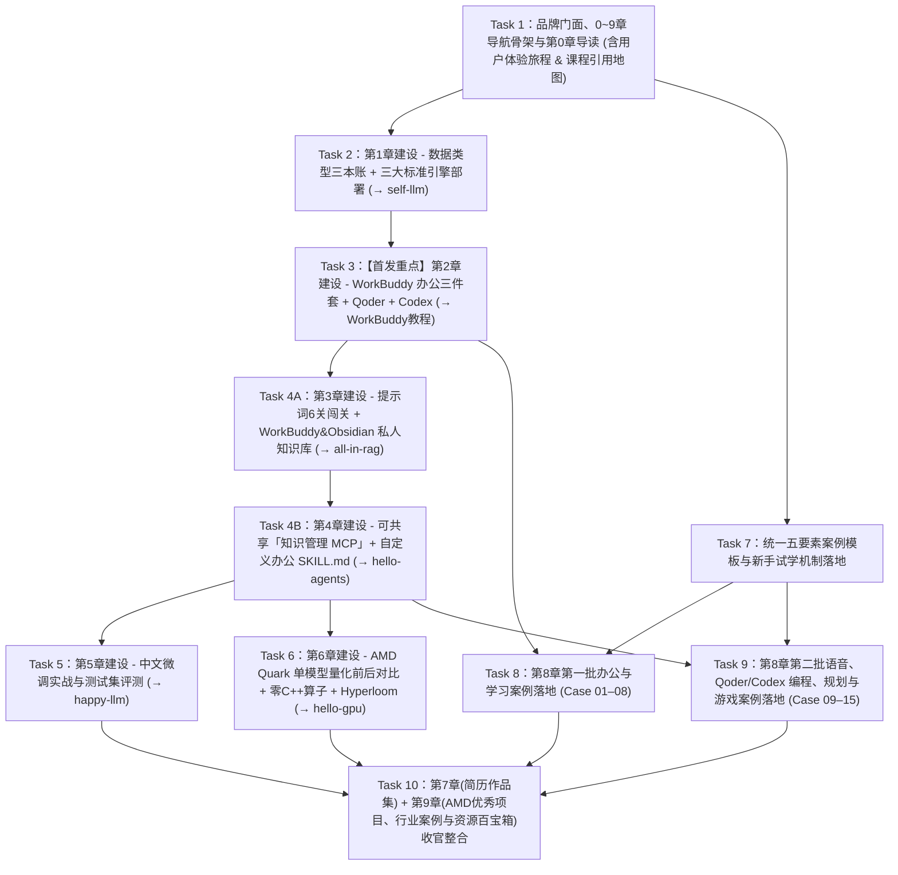

# TASK：hello-rocm 2.0 课程重构原子化任务拆解计划（0～9 章定稿版）

> **当前阶段**：6A 工作流 - 阶段 3/4：Atomize & Approve（对齐 0～9 章总大纲）  
> **前置依据**：`CURRICULUM_OUTLINE_v2.md`、`CONSENSUS_course-refactor.md`、`DESIGN_course-refactor.md`  
> **执行分支约束**：所有改造均在 `dev_1.0` 分支推进，确保本地与云端 `master` 完全一致零污染。

---

## 一、原子任务依赖关系图

---

## 二、原子任务契约摘要

- **Task 1（门面与第 0 章）**：更新 `README.md`、`docs/zh/index.md` 与 `config.mts`（0～9 章导航）；落地第 0 章（含 6 站学习体验旅程与 Datawhale 课程引用导航）。
- **Task 2（第 1 章 · 部署）**：落地数据类型三本账及 `llama-server`、`lemonade-server`、`vLLM` 部署指南，章末链接 [`self-llm`](https://github.com/datawhalechina/self-llm)。
- **Task 3（第 2 章 · 首发办公与 IDE）**：落地 WorkBuddy（`dashi-ppt-skill` 出 PPT + 自动填表 + 定时任务）、`Qoder`、`Codex` 教程与 `src/configs/` 验证配置，联动链接 [Datawhale WorkBuddy 教程](https://www.datawhale.cn/learn/content/382/8712?from=homepage)。
- **Task 4A（第 3 章 · Prompt & RAG）**：落地 6 关提示词 Notebook、黑暗料理菜谱切分实验与 `WorkBuddy + Obsidian` 双链笔记库，引用并导流 [`all-in-rag`](https://github.com/datawhalechina/all-in-rag)。
- **Task 4B（第 4 章 · MCP & Skills）**：落地 `FastMCP` 可共享「知识管理 MCP Server」与自定义办公 `SKILL.md`，交付「个人学习助手 v2.0」，引用并导流 [`hello-agents`](https://github.com/datawhalechina/hello-agents)。
- **Task 5（第 5 章 · 中文微调）**：落地弱智吧破冰、中文通知抽取主线、`WeClone`/小红书网感分身与中文测试集评估脚本，**章末链接 [`happy-llm`](https://github.com/datawhalechina/happy-llm)**。
- **Task 6（第 6 章 · 量化与加速）**：落地 `TraceLens` 体检、`AMD Quark` 单模型量化前后对比、零 C++ 融合算子唤醒、Prefix Caching 与 `Hyperloom` 自动寻优，章末链接 [`hello-gpu`](https://github.com/datawhalechina/hello-gpu)。
- **Task 7（模板与试学）**：落地 `_CASE_TEMPLATE.md` 与新手试学反馈模板。
- **Task 8 & Task 9（第 8 章 · 15 个趣味案例）**：按五要素落地 Case 01–15（办公三件套置顶）并附各案例专精课程导流。
- **Task 10（第 7 章简历成果 + 第 9 章 AMD 生态百宝箱）**：落地第 7 章作品集与简历指南；落地**第 9 章（AMD 官方开源明星项目、仓库具身/推荐/集群/算子高阶行业案例无损整合、免费云算力与全系硬件速查资源）**，确保旧路由零 404。
