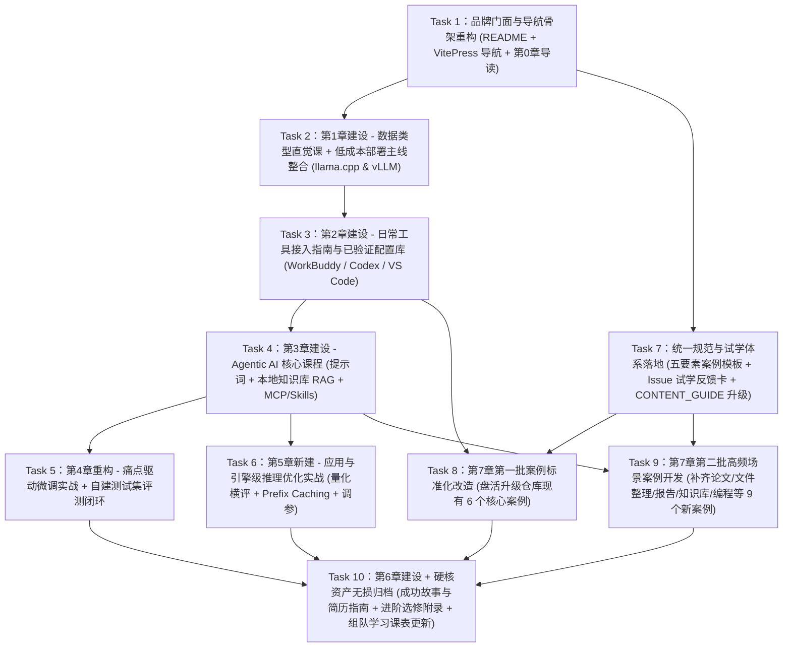

# TASK：hello-rocm 2.0 课程重构原子化任务拆解计划

> **当前阶段**：6A 工作流 - 阶段 3：Atomize（原子化阶段）  
> **前置依据**：`ALIGNMENT_course-refactor.md`、`CONSENSUS_course-refactor.md`、`DESIGN_course-refactor.md`  
> **说明**：本文件将课程定位与大纲定稿后的**仓库重构落地工作**拆解为可独立推进、可独立验收的原子任务。当前处于 **阶段 4（Approve 人工审批）前置就绪状态**，待审批确认后按序执行。

---

## 一、原子任务依赖关系图

---

## 二、原子任务详细契约定义

### Task 1：品牌门面与 VitePress 导航骨架重构（含第 0 章导读）
- **输入契约**：`DESIGN_course-refactor.md` 第 1、2、6 节；现有 `README.md`、`docs/zh/index.md`、`docs/.vitepress/config.mts`。
- **输出契约**：
  - 更新根 `README.md` 与 VitePress 首页 `docs/zh/index.md`，突出新标语「每个 AI 小白，从零开始，动手实践的第一站」与「基于 AMD 平台的 AI 与 Agentic AI 入门实践手册」。
  - 新建 `docs/zh/00-guide/`（成功故事引入、4 档硬件 3 分钟自检表、全局路线图）。
  - 更新 `docs/.vitepress/config.mts` 顶部导航与侧边栏结构，保留旧路由兼容不报 404。
- **实现约束**：确保 `npm run docs:build` 零报错编译通过。
- **依赖关系**：无前置依赖；解锁 Task 2、Task 7。

### Task 2：第 1 章建设 —— 数据类型直觉认知与最低成本部署主线
- **输入契约**：现有 `00-environment/` 与 `01-deploy/` 中的 `llama.cpp`、`vLLM`、Gemma4/Qwen3 教程。
- **输出契约**：
  - 新建 `docs/zh/01-first-model/`：
    - `01-model-intuition.md`（参数量 vs 权重大小 vs 运行显存/内存直觉图解、不同精度原因与选型速查表）；
    - `02-quick-env.md`（Windows 11 / Ubuntu / 免费云算力精简基线）；
    - `03-llamacpp-quickstart.md` 与 `04-vllm-quickstart.md`（收敛到 1 个主力推荐模型快速跑通，多模型矩阵移入参考索引）。
- **验收标准**：零基础读者无需查阅底层架构表即可按显存档位选对模型并在 15–30 分钟内调通本地接口。
- **依赖关系**：前置 Task 1；后置 Task 3。

### Task 3：第 2 章建设 —— WorkBuddy 零代码办公首秀最前置 + VS Code / Codex 已验证配置库
- **输入契约**：Task 2 暴露的本地 OpenAI 兼容端点规范；`WORKBUDDY_OFFICE_RESEARCH_course-refactor.md`。
- **输出契约**：
  - 新建 `docs/zh/02-connect-tools/`：
    - `01-openai-socket-and-safety.md`（OpenAI 兼容接口白话原理 + 本地 Agent 沙盒目录与 `dry-run` 安全铁律）；
    - `02-workbuddy-office-first.md`（**第一顺位**：WorkBuddy 接入保姆级指南、UI vs `models.json` 5 大隐形避坑，当场跑通「理文件夹 + 洗 Excel + 出 PPT」零代码办公首秀）；
    - `03-vscode-coding-assistants.md`（VS Code `Continue` + `Cline` 双模配置指南）；
    - `04-codex-terminal-agent.md`（`Codex CLI` 与 `toy-cli` 接入指南）。
  - 新建 `src/configs/`，存放经过真机验证的 `workbuddy-models.json`、VS Code 插件配置模板、Codex `config.toml` 与对应验证版本号清单。
- **验收标准**：提供复制即用的 JSON/TOML 配置文件，明确标注解决空白回复/截断所需的上下文窗口（`32768`）与 Tool Calling 启动参数（`--jinja` / `--enable-auto-tool-choice`）。
- **依赖关系**：前置 Task 2；后置 Task 4、Task 8、Task 9。

### Task 4：第 3 章建设 —— 互动闯关式 Agentic AI 核心课程（Prompt + 趣味 RAG + FastMCP + Skills）
- **输入契约**：Task 3 工具环境；`AGENT_TUTORIALS_RESEARCH_course-refactor.md`；现有 `src/hello-rocm-skill/` 与 `05-amd-yes/hello-agents/` 素材。
- **输出契约**：
  - 新建 `docs/zh/03-agentic-ai/` 与配套实验代码：
    - `01-prompt-game.ipynb`：直连本机 API 的 6 关交互式提示词闯关练习场；
    - `02-rag-kitchen.md`：「黑暗料理菜谱切分对比实验」+ `Cherry Studio / Obsidian` 零代码个人知识库实战；
    - `03-mcp-playground.md`：中文趣味 MCP（B站字幕/微信读书/高德/12306）体验 + 20 行 `FastMCP` 手写《AMD 显卡健康管家 MCP Server》；
    - `04-agent-skills.md`：解剖渐进式披露省显存机制与 `hello-rocm-skill`，体验归藏 PPT / 种草 Skill，并在 WorkBuddy (`.codebuddy/skills/`) 与 Codex (`.agents/skills/`) 中手写第一个自定义 `SKILL.md`；
    - `05-guardrails.md`：防死循环护栏与引出微调/推理优化的痛点复盘。
- **验收标准**：单卡 8G 环境下可跑通全部 4 个趣味互动实验，自定义 MCP 与 `SKILL.md` 可在 WorkBuddy / Cherry Studio / Codex 中真实触发。
- **依赖关系**：前置 Task 3；后置 Task 5、Task 6、Task 9。

### Task 5：第 4 章重构 —— 纯中文生态双通道微调实战（魔搭原生中文集 + LLaMA-Factory / TRL）
- **输入契约**：`FINETUNE_RESEARCH_course-refactor.md`；现有 `02-fine-tune/` 与 `src/fine-tune/`（含内置 `huanhuan.json`）资产。
- **输出契约**：
  - 重构为 `docs/zh/04-fine-tune/`：包含「何时该微调 vs RAG」诊断、**5 分钟「弱智吧（`COIG-CQIA`）」中文逻辑破冰实验**、`LLaMA-Factory WebUI` 零代码通道与 60 行精简代码通道、ModelScope 国内源加速与 SwanLab 中文生成预览。
  - 落地 **1 个纯中文主线必修案例**（基于魔搭 `MSAgent-Bench` 与浙大 `InstructIE` 微调中文办公群通知抽取与工具调用）+ **5 个纯中文高人气选修配方**（`WeClone` 微信分身/小红书文案/`Chat-甄嬛`、`delicate_medical_r1_data` 中文医学 R1 思考链蒸馏、复旦 `DISC-Law-SFT` 中国法律/`SoulChat` 心理共情、中文 `CSpider`/`DuSQL` 查表、中文增值税发票/错题多模态提取），配套中文自动评测脚本 `eval_before_after_zh.py`（支持对接 `MedBench` / `LawBench` / 本地中文 SQLite）并导出 GGUF 接回日常工具。
- **验收标准**：所有数据集 100% 可通过 ModelScope 免代理直连拉取；运行 `eval_before_after_zh.py` 一键输出中文测试集微调前后客观指标对比表。
- **依赖关系**：前置 Task 4；后置 Task 10。

### Task 6：第 5 章新建 —— AMD 原生量化（`Quark`）、零 C++ 算子加速与 `AMD-AGI/Hyperloom` 自动寻优实战
- **输入契约**：`OPTIMIZE_RESEARCH_course-refactor.md`；Task 2 部署基础、Task 3/4 Codex & `SKILL.md` 工具链与 Task 5 中文微调模型。
- **输出契约**：
  - 新建 `docs/zh/05-optimize-speed/` 与配套纯 Python 测速/自动寻优模板：
    - `01-bottleneck-tracelens.md`（TTFT / TPS 与 `amd-smi` + `AMD-AGI/TraceLens` 自动诊断瓶颈）；
    - `02-amd-quark-quant.md`（15 行 Python 用 `AMD Quark` 做 `INT4 AWQ` / `FP8` 校准量化 + `llama.cpp` 对称 `-ctk/-ctv q8_0` 避坑）；
    - `03-zero-cpp-kernels.md`（15 行 Python `@torch.compile` 唤醒 ROCm Triton 自动融合 + 一键开启 `ROCBLAS_USE_HIPBLASLT=1`、`rocWMMA -fa on`、`VLLM_ROCM_USE_AITER=1`）；
    - `04-agent-speedup.md`（Prefix Caching 解决 WorkBuddy/Codex 首字慢 + 投机采样 + Ryzen AI NPU+GPU 协同）；
    - `05-hyperloom-auto-opt.md`（结合 [`AMD-AGI/Hyperloom`](https://github.com/AMD-AGI/Hyperloom) 与 `amd/skills`，在 Codex/VS Code 中用 `@hyperloom/inference_optimizer/SKILL.md` 驱动 `Magpie → TraceLens → Arbor + GEAK` 全自动调参与改算子实战，兼顾本地诊断与云端完整跑通）。
- **验收标准**：全程零手写 C++/HIP 代码，提供一键压测脚本与 Hyperloom Skill 调用模板，产出完整性能与准确率对比报告。
- **依赖关系**：前置 Task 4；后置 Task 10。

### Task 7：统一案例五要素模板与新手试学机制落地
- **输入契约**：`DESIGN_course-refactor.md` 第 5 节；现有 `CONTENT_GUIDE.md`、`.github/`。
- **输出契约**：
  - 创建标准案例模板 `docs/zh/07-fun-cases/_CASE_TEMPLATE.md`（强制含代码、演示、支持配置、验证方法、扩展任务 + 试学 FAQ）。
  - 创建 `.github/ISSUE_TEMPLATE/novice-trial-feedback.yml`（新手试学反馈表单）并更新 `CONTENT_GUIDE.md`。
- **验收标准**：模板字段完整清晰，贡献者与试学官可直接套用。
- **依赖关系**：前置 Task 1；后置 Task 8、Task 9。

### Task 8：第 7 章头牌办公与学习新案例优先落地（Case 01–08，零代码办公置顶！）
- **输入契约**：Task 3、Task 4、Task 7；`WORKBUDDY_OFFICE_RESEARCH_course-refactor.md`、`CASES_RESEARCH_course-refactor.md`。
- **输出契约**：按「五要素标准模板」优先落地排在最前面的 **8 个日常办公、论文、知识库与纪要刚需案例**：
  - **Case 01（办公头牌·文件整理）**：拯救杂乱下载夹 —— `WorkBuddy + LlamaFS + MiniCPM-V` 智能归档与《文件清单盘点.md》（含 `dry-run` 预览）
  - **Case 02（办公连招·报告生成）**：脏乱 Excel 清洗 ➡️ Word 分析报告 ➡️ 20页去 AI 味汇报 PPTX 全自动流水线（`WorkBuddy Ask→Plan→Craft`）
  - **Case 03（周报与研报·报告生成）**：一键高级感周报 Skill & 全本地深度调研报告专家（`WorkBuddy Skill` + `Local Deep Research`）
  - **Case 04（学术办公·论文阅读）**：多篇 PDF 文献横评对比表 & 组会双语汇报 PPT 一键生成（`WorkBuddy Plan模式`）
  - **Case 05（排版零损·论文阅读）**：公式图表纹丝不乱双语论文精翻器（`PDFMathTranslate` + `Zotero`）
  - **Case 06（第二大脑·个人知识库）**：Obsidian 私人笔记库与 MCP 自动写复盘（`Cherry Studio` / `amd/gaia`）
  - **Case 07（听学与分身·个人知识库）**：复习讲义秒变双人播客 & 微信赛博数字分身（`Open Notebook` + `WeClone`）
  - **Case 08（离线纪要·语音交互）**：网课与保密会议实时离线转写纪要神器（`Meetily` + `Faster-Whisper`）
- **验收标准**：排在最前面的办公案例零代码即可复现，配齐 `models.json`、安全沙盒指引与冒烟验收。
- **依赖关系**：前置 Task 3、Task 4、Task 7；后置 Task 10。

### Task 9：第 7 章语音伴侣、编程助手、自动化规划与游戏案例升级落地（Case 09–15，盘活仓库 6 大精品！）
- **输入契约**：Task 3、Task 7；现有 `toy-cli`、`minicpm-o`、`minesweeper-agent`、`huanhuan-chat`、`smart-travel-planner`、`openclaw`。
- **输出契约**：按「五要素标准模板」升级并落地 **Case 09（`Open-LLM-VTuber` + `MiniCPM-o` 桌面语音口语伴侣）、Case 10（VS Code `Continue` + `Cline` 双模编程搭档）、Case 11（`Codex CLI` + `toy-cli` 终端修 Bug）、Case 12（`browser-use` 网页自动化 + `smart-travel-planner` 高德 MCP）、Case 13（`openclaw` 全隐私多端管家 + Prefix Caching）、Case 14（`minesweeper-agent` + `Mindcraft` 我的世界 AI）、Case 15（`COC-AI-keeper` 跑团 DM + `huanhuan-chat` 古风剧场）**。
- **验收标准**：全部 15 个案例 100% 覆盖 8 大场景且符合统一五要素结构。
- **依赖关系**：前置 Task 3、Task 7；后置 Task 10。

### Task 10：第 6 章（成功故事与简历指南）建设、硬核附录归档与组队学习升级
- **输入契约**：Task 5、6、8、9 全部成果；现有 `03-infra/`、`05-amd-yes/` 高阶项目及 `learning/20-day-learning-plan.md`。
- **输出契约**：
  - 新建 `docs/zh/06-portfolio-resume/`（成功故事纪实模板、作品集五件套打包清单、多岗位简历项目经历模板与面试问答指南）。
  - 整理 `docs/zh/99-advanced-appendix/`，无损归档原 `03-infra` HIP 算子编程、具身智能、推荐系统、分布式预训练与多模型部署字典。
  - 同步升级新版面向小白的组队学习计划（去掉手写 C++ 算子强制要求，改为「部署+工具接入 → Agent/知识库 → 微调评测 → 推理优化 → 自选趣味案例作品答辩」）。
- **验收标准**：全站 `npm run docs:build` 编译通过，中英文导航与历史链接兼容无死链。
- **依赖关系**：收官任务，前置 Task 5、6、8、9。
