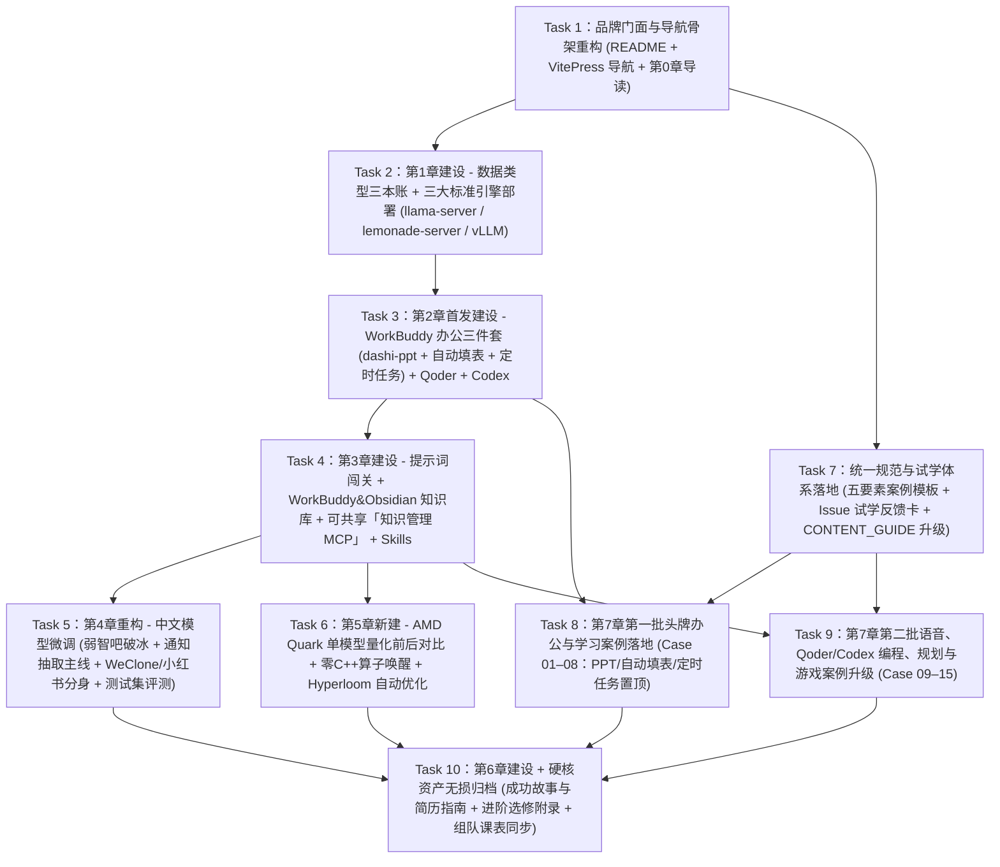

# TASK：hello-rocm 2.0 课程重构原子化任务拆解计划（精炼定稿版）

> **当前阶段**：6A 工作流 - 阶段 3/4：Atomize & Approve（同步最新精炼大纲）  
> **前置依据**：`CURRICULUM_OUTLINE_v2.md`、`CONSENSUS_course-refactor.md`、`DESIGN_course-refactor.md`  
> **执行分支约束**：所有落地改造均在 `dev_1.0` 分支执行，保持 `master` 与 `origin/master` 完全干净一致。

---

## 一、原子任务依赖关系图

---

## 二、原子任务详细契约定义

### Task 1：品牌门面与 VitePress 导航骨架重构（含第 0 章导读）
- **输入契约**：`CURRICULUM_OUTLINE_v2.md`；现有 `README.md`、`docs/zh/index.md`、`docs/.vitepress/config.mts`。
- **输出契约**：
  - 更新根 `README.md` 与 `docs/zh/index.md`，突出标语「每个 AI 小白，从零开始，动手实践的第一站」与「基于 AMD 平台的 AI 与 Agentic AI 入门实践手册」。
  - 新建 `docs/zh/00-guide/`（成功故事引入、绿/蓝/紫/云 4 档硬件自检表、全局路线图）。
  - 更新 `docs/.vitepress/config.mts` 导航结构，保留旧路由兼容零 404。
- **依赖关系**：无前置依赖；解锁 Task 2、Task 7。

### Task 2：第 1 章建设 —— 数据类型直觉认知与三大引擎最低成本部署
- **输入契约**：现有 `00-environment/` 与 `01-deploy/` 教程资产。
- **输出契约**：
  - 新建 `docs/zh/01-first-model/`：
    - `01-model-intuition.md`（参数量、权重文件大小与运行显存/内存区别，不同精度版本原因与选型速查表）；
    - `02-quick-env.md`（Windows 11 / Ubuntu / 免费 AMD Radeon Cloud 精简基线）；
    - `03-llama-server.md`、`04-lemonade-server.md`、`05-vllm-server.md`（**全书唯一锁定此三大引擎拉起 `/v1` 服务**，附三大引擎选型对比表）。
- **依赖关系**：前置 Task 1；后置 Task 3。

### Task 3：【第一步重点推出】第 2 章建设 —— WorkBuddy 办公三件套 + Qoder + Codex 已验证配置库
- **输入契约**：Task 2 三大引擎 `/v1` 接口；[Datawhale WorkBuddy 官方教程](https://www.datawhale.cn/learn/content/382/8712?from=homepage)；`chuspeeism/dashi-ppt-skill`。
- **输出契约**：
  - 新建 `docs/zh/02-connect-tools/`：
    - `01-openai-socket-and-safety.md`（OpenAI 兼容接口原理 + 沙盒目录、非 C 盘缓存、`dry-run` 三大安全铁律）；
    - `02-workbuddy-office-suite.md`（**首发王牌**：对接三大引擎的 `models.json` 与 `32768` 上下文避坑；完整打通 **① `dashi-ppt-skill` 大师 PPT 生成可编辑 `.pptx`**、**② AI 自动填表**、**③ 用 AI 定时任务自动处理日常办公事项**）；
    - `03-qoder-coding-ide.md`（**接入 `Qoder`**：`OpenAI Compatible` 接口配置、一键校验、代码补全重构与 `.agents/skills/` 技能加载）；
    - `04-codex-terminal-agent.md`（`Codex CLI` 与 `toy-cli` 接入指南）。
  - 新建 `src/configs/`，存放经过验证的 `workbuddy-models.json`、`qoder` 配置参数示范与 `codex-config.toml`。
- **依赖关系**：前置 Task 2；后置 Task 4、Task 8、Task 9。

### Task 4：第 3 章建设 —— 个人知识库（`WorkBuddy + Obsidian`）与可共享「知识管理 MCP」
- **输入契约**：Task 3 工具环境；`AGENT_TUTORIALS_RESEARCH_course-refactor.md`；`obsidianmd/obsidian-skills`。
- **输出契约**：
  - 新建 `docs/zh/03-agentic-ai/` 与配套代码：
    - `01-prompt-game.ipynb`：6 关交互式提示词闯关练习场；
    - `02-rag-workbuddy-obsidian.md`：「黑暗料理菜谱切分实验」+ `WorkBuddy + Obsidian`（搭配 `obsidian-skills`）私人笔记问答库；
    - `03-knowledge-mcp-server.md`：趣味 MCP 体验 + **使用 `FastMCP` 将个人知识库封装成标准的「知识管理 MCP Server」**（支持跨 WorkBuddy/`Qoder`/Codex 调用及打包分享给他人调用）；
    - `04-agent-skills.md`：渐进式披露省显存原理、解剖 `hello-rocm-skill` 与 `dashi-ppt-skill`、手写自定义办公 `SKILL.md`；
    - `05-guardrails.md`：安全护栏与痛点复盘。
  - **里程碑交付**：**「个人学习助手 v2.0」（集成私人笔记 RAG + 知识管理 MCP + 自定义办公 `SKILL.md`）**。
- **依赖关系**：前置 Task 3；后置 Task 5、Task 6、Task 9。

### Task 5：第 4 章重构 —— 纯中文微调实战（聚焦办公通知抽取 + `WeClone`/小红书网感分身）
- **输入契约**：`FINETUNE_RESEARCH_course-refactor.md`；现有 `02-fine-tune/` 资产。
- **输出契约**：
  - 新建 `docs/zh/04-fine-tune/`：微调决策树、5 分钟「弱智吧（`COIG-CQIA`）」中文逻辑破冰实验（`LLaMA-Factory WebUI` + 60 行透明代码双通道）、中文数据清洗脱敏、`MSAgent-Bench`/`InstructIE` 中文通知抽取与工具调用主线微调、自建中文测试集前后对比评估脚本。
  - **4.6 节唯一精选进阶配方**：**配方 A（网感与分身）：`WeClone` 微信聊天记录数字分身 / 小红书爆款种草体**（含破功词统计与双盲评测）。
- **依赖关系**：前置 Task 4；后置 Task 10。

### Task 6：第 5 章新建 —— `AMD Quark` 单模型量化前后对比、零 C++ 算子加速与 `Hyperloom` 自动优化
- **输入契约**：`OPTIMIZE_RESEARCH_course-refactor.md`；`AMD-AGI/Hyperloom`。
- **输出契约**：
  - 新建 `docs/zh/05-optimize-speed/`：
    - `01-bottleneck-tracelens.md`（TTFT / TPS 指标与 `AMD-AGI/TraceLens` 自动诊断）；
    - `02-amd-quark-before-after.md`（**选定单个基准模型，用 `AMD Quark` 跑通量化前与量化后实测，直观对比文件大小、显存占用、推理速度 `tok/s` 与回答效果**）；
    - `03-zero-cpp-kernels.md`（`@torch.compile` 自动融合 + 一键开启 `ROCBLAS_USE_HIPBLASLT=1 -fa on` 与 `VLLM_ROCM_USE_AITER=1`）；
    - `04-agent-speedup.md`（Prefix Caching 秒回 WorkBuddy/`Qoder`/Codex + 投机采样 + `lemonade-server` NPU+GPU 协同）；
    - `05-hyperloom-auto-opt.md`（结合 `AMD-AGI/Hyperloom` 与 `amd/skills`，通过 `@hyperloom/inference_optimizer/SKILL.md` 全自动寻优）。
- **依赖关系**：前置 Task 4；后置 Task 10。

### Task 7：统一案例五要素模板与新手试学机制落地
- **输入契约**：`DESIGN_course-refactor.md` 第 5 节；`CONTENT_GUIDE.md`。
- **输出契约**：创建 `docs/zh/07-fun-cases/_CASE_TEMPLATE.md`、`.github/ISSUE_TEMPLATE/novice-trial-feedback.yml` 并升级 `CONTENT_GUIDE.md`。
- **依赖关系**：前置 Task 1；后置 Task 8、Task 9。

### Task 8：第 7 章第一批办公与学习案例落地（Case 01–08，WorkBuddy 办公三件套置顶）
- **输入契约**：Task 3、Task 4、Task 7。
- **输出契约**：按统一五要素模板落地 **Case 01（WorkBuddy + `dashi-ppt-skill` 一句话变可编辑 `.pptx`）**、**Case 02（AI 自动填表与文件夹归档）**、**Case 03（WorkBuddy AI 定时任务自动处理日常办公事项）**、**Case 04（`Local Deep Research` 深度调研报告）**、**Case 05（多篇论文横评表 + `dashi-ppt-skill` 组会 PPT）**、**Case 06（`PDFMathTranslate` 双语论文精翻）**、**Case 07（`WorkBuddy + Obsidian` 双链笔记与可共享「知识管理 MCP」）**、**Case 08（`Open Notebook` 讲义转播客 + `WeClone` 网感分身）**。
- **依赖关系**：前置 Task 3、Task 4、Task 7；后置 Task 10。

### Task 9：第 7 章第二批语音、`Qoder`/Codex 编程、规划与游戏案例升级落地（Case 09–15）
- **输入契约**：Task 3、Task 7；仓库现有精品案例资产。
- **输出契约**：按统一五要素模板落地 **Case 09（`Meetily` + `Faster-Whisper` 离线会议纪要）**、**Case 10（`Open-LLM-VTuber` / `MiniCPM-o` 桌面口语伴侣）**、**Case 11（`Qoder` 全离线 AI 编程搭档）**、**Case 12（`Codex CLI` + `toy-cli` 终端修 Bug）**、**Case 13（`Browser-Use` + 高德 MCP 旅行规划）**、**Case 14（`OpenClaw` 多端个人管家 + Prefix Caching）**、**Case 15（`Minesweeper Agent` + `Mindcraft` 游戏互动）**。
- **依赖关系**：前置 Task 3、Task 7；后置 Task 10。

### Task 10：第 6 章（成功故事、简历指南与毕业课程导流）建设、硬核附录无损归档与组队课表同步
- **输入契约**：Task 5、6、8、9 全部成果。
- **输出契约**：
  - 新建 `docs/zh/06-portfolio-resume/`（含 `6.4 毕业导流驿站`：将完成总览课的学习者按兴趣精准导流至 `self-llm`、Datawhale WorkBuddy 教程、`all-in-rag`、`hello-agents`、`hello-gpu`）；
  - 在第 1~5 章章末及第 7 章 15 个案例扩展任务中嵌入上述对应专精课程外链（部署/微调→`self-llm`、第2章办公→WorkBuddy教程、知识库/Agent→`all-in-rag` & `hello-agents`、算子优化与原 `03-infra`→`hello-gpu`）；
  - 无损归档原 `03-infra` 等高阶资产至 `docs/zh/99-advanced-appendix/`，同步更新组队学习课表并验证全站构建通过。
- **依赖关系**：前置 Task 5、6、8、9。
