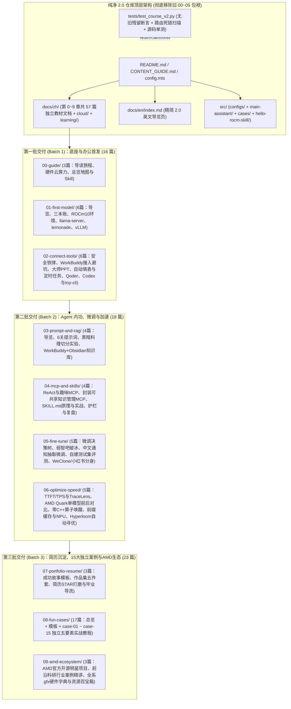

# DESIGN：hello-rocm 2.0 纯净目录架构与全量教材级内容设计文档

> **当前阶段**：6A 工作流 - 阶段 2：Architect（系统分层、纯净目录与单篇契约设计）  
> **任务名称**：`v2-full-content`

---

## 一、整体文档与代码架构图

---

## 二、净空后的完整文件目录树与单篇职责契约

### 2.1 删除清单（在 Batch 1 第一步彻底移除）
- `docs/zh/00-environment/`、`docs/zh/01-deploy/`、`docs/zh/02-fine-tune/`、`docs/zh/03-infra/`、`docs/zh/04-references/`、`docs/zh/05-amd-yes/`
- `docs/en/00-environment/`、`docs/en/01-deploy/`、`docs/en/02-fine-tune/`、`docs/en/03-infra/`、`docs/en/04-references/`、`docs/en/05-amd-yes/`
- `src/infra/`（底层手写 C++ HIP 旧源码，已由第 6 章零 C++ 加速与 `hello-gpu` 导流替代）
- 将原 `src/amd-yes/minesweeper_agent/` 等保留供第 8 章案例使用的精选脚本统一归整至 `src/cases/`，清理冗余空目录。

### 2.2 全量 2.0 教程文件规划（共 57 篇独立 Markdown 教程）

#### 【Batch 1】第 0～2 章（15 篇章节正文 + 门面导航更新）
- **`docs/zh/00-guide/`（3 篇）**
  1. `index.md`：0.1 为什么从本地 AI 开始 & 0.2 学习者成功故事与 6 站体验旅程
  2. `03-hardware-and-cloud.md`：0.3 3 分钟硬件对号入座（绿/蓝/紫/云 × 四大主体模型）与免费 AMD Radeon Cloud 领用
  3. `04-roadmap-and-skill.md`：0.4 全栈总览地图、Datawhale 课程双向引用关系与 `hello-rocm Skill` 伴学助教安装
- **`docs/zh/01-first-model/`（6 篇）**
  1. `index.md`：第 1 章导览与四大分档主体模型（`Gemma 4 E4B` / `Qwen3.5-9B` / `Gemma 4 12B` / `Qwen3.6-35B-A3B`）详解
  2. `01-model-intuition.md`：1.1 数据类型与模型资源的“三本明白账”（参数量、权重 vs KV Cache vs 显存、精度选型表）
  3. `02-rocm-env-setup.md`：1.2 ROCm 10 + `uv` + PyTorch 2.13 与推理环境完整配置（Win11 / Ubuntu 24.04 / 云算力 + 三连体检）
  4. `03-llama-server.md`：1.3 用 `llama-server`（`llama.cpp`）拉起本地 GGUF 服务完整实操（预构建二进制、Docker 编译备选、`--ctx-size 32768 --jinja` 与测速）
  5. `04-lemonade-server.md`：1.4 用 `lemonade-server` 拉起本地 GPU / XDNA2 NPU 服务完整实操（`Gemma 4 E4B` 与旗舰 `Qwen3.6-35B-A3B` 双演练）
  6. `05-vllm-server.md`：1.5 用 `vLLM` 拉起高吞吐并发服务完整实操（ROCm 10 镜像、`Qwen3.5-9B` / `Gemma 4 12B` 工具调用配置、三大引擎对比表与 `self-llm` 导流）
- **`docs/zh/02-connect-tools/`（6 篇）**
  1. `index.md`：2.1 读懂 OpenAI 兼容“万能插座”与本地桌面 Agent 三大安全铁律
  2. `02-workbuddy-setup.md`：2.2.1 WorkBuddy 本地模型接入保姆级指南（UI vs `models.json` 差异与 5 大隐形避坑全解）
  3. `03-workbuddy-dashi-ppt.md`：2.2.2 🌟 首发实战一：WorkBuddy + `dashi-ppt-skill` 一键生成可二次编辑 `.pptx` 完整教程
  4. `04-workbuddy-excel-and-cron.md`：2.2.3 🌟 首发实战二 & 三：AI 自动填表与 RRULE 定时任务自动处理日常办公事项（联动 Datawhale WorkBuddy 教程）
  5. `05-qoder-ide.md`：2.3 接入 `Qoder`：打造全离线零成本 AI 编程 IDE（自定义模型校验、代码重构、单测生成与 `.agents/skills/`）
  6. `06-codex-and-toy-cli.md`：2.4 接入 `Codex CLI` 与百行极简终端智能体 `toy-cli` 源码级实战

#### 【Batch 2】第 3～6 章（18 篇章节正文 + 实战源码联动）
- **`docs/zh/03-prompt-and-rag/`（4 篇）**
  1. `index.md`：第 3 章导览：从“能聊天”到“懂规矩、守事实”
  2. `01-prompt-6-levels.md`：3.1 提示词闯关课：6 关本地交互式实操驯服中小模型
  3. `02-rag-recipe-chunking.md`：3.2 RAG 核心直觉实验：「今天吃什么 · 黑暗料理菜谱切分对比实验」（含可运行对比脚本）
  4. `03-workbuddy-obsidian-kb.md`：3.3 & 3.4 用 `WorkBuddy + Obsidian`（`obsidian-skills`）搭建双链私人笔记库与 10 题防幻觉自测（→ `all-in-rag`）
- **`docs/zh/04-mcp-and-skills/`（4 篇）**
  1. `index.md`：4.1 智能体核心循环（`观察 → 思考 → 行动`）与趣味 MCP 挂载初体验
  2. `02-knowledge-mcp-server.md`：4.2 🌟 核心实战：用 `FastMCP` 将个人知识库封装成可跨端复用并分享给他人调用的「知识管理 MCP Server」
  3. `03-agent-skills.md`：4.3 模块化技能包 `SKILL.md`：渐进式省显存原理、解剖 `dashi-ppt-skill` 与手写自定义办公技能
  4. `04-guardrails-and-review.md`：4.4 本地 Agent 安全护栏、「个人学习助手 v2.0」综合验收与进阶痛点复盘（→ `hello-agents`）
- **`docs/zh/05-fine-tune/`（5 篇）**
  1. `index.md`：5.1 微调决策树：什么时候改提示词、加知识库，什么时候必须微调？
  2. `02-lora-and-ruozhiba.md`：5.2 直觉算清 LoRA 显存账 + 5 分钟「弱智吧（`COIG-CQIA`）」中文双关破冰实验（`LLaMA-Factory WebUI` + `SwanLab`）
  3. `03-office-notification-lora.md`：5.3 & 5.4 中文数据清洗脱敏与基于 `MSAgent-Bench`/`InstructIE` 微调中文通知抽取与工具调用
  4. `04-chinese-testset-eval.md`：5.5 自建中文测试集客观评估微调前后效果 & 合并导出 GGUF 重接三大引擎
  5. `05-weclone-persona-lora.md`：5.6 趣味进阶实战（网感与分身）：`WeClone` 微信聊天记录数字分身 / 小红书爆款种草体（→ `happy-llm`）
- **`docs/zh/06-optimize-speed/`（5 篇）**
  1. `index.md`：6.1 给慢助手做 AI 体检：看懂 `TTFT` / `TPS` 指标与 `AMD-AGI/TraceLens` 自动诊断瓶颈
  2. `02-amd-quark-before-after.md`：6.2 AMD 官方量化直观实战：用 `AMD Quark` 跑通同一模型量化前与量化后（体积/显存/速度/质量）完整对比
  3. `03-zero-cpp-kernels.md`：6.3 零 C++ 算子加速：`@torch.compile` 自动融合 + 一键唤醒 `hipBLASLt` / `rocWMMA FA` / `AITER`
  4. `04-prefix-cache-and-npu.md`：6.4 让 WorkBuddy、`Qoder` 与 Codex 秒回：Prefix Caching 前缀缓存、投机采样与 NPU+GPU 分流
  5. `05-hyperloom-auto-opt.md`：6.5 【Agentic 压轴】结合 `AMD-AGI/Hyperloom` 与 `AMD Skills` 实现全自动推理与算子寻优（→ `hello-gpu`）

#### 【Batch 3】第 7～9 章（23 篇章节与独立案例正文）
- **`docs/zh/07-portfolio-resume/`（3 篇）**
  1. `index.md`：7.1 撰写你的成功故事：「我把自己的 AMD 电脑，变成了学习和工作的 AI 助手」
  2. `02-portfolio-kit.md`：7.2 个人 AI 作品集「五件套」标准打包与展示指南
  3. `03-resume-and-next-steps.md`：7.3 & 7.4 STAR 法则简历项目打磨、高频面试追问指南与 Datawhale 专精课程毕业深造驿站
- **`docs/zh/08-fun-cases/`（17 篇：总览 + 模板 + 15 篇独立五要素完整教程！）**
  - `index.md`（15 大案例全景矩阵与新手试学机制）+ `_CASE_TEMPLATE.md`
  - `case-01-dashi-ppt.md`：一句话文档变可编辑汇报 PPT（WorkBuddy + `dashi-ppt-skill`）
  - `case-02-auto-excel-archive.md`：AI 自动填表与杂乱文件夹智能归档
  - `case-03-scheduled-office.md`：用 WorkBuddy AI 定时任务自动处理日常办公事项
  - `case-04-local-deep-research.md`：全本地万字深度调研报告专家（`Local Deep Research`）
  - `case-05-multi-paper-ppt.md`：多篇英文文献横评对比表 & 组会汇报 PPT 一键生成
  - `case-06-pdf-math-translate.md`：公式图表纹丝不乱双语学术论文精翻神器（`PDFMathTranslate` + `Zotero`）
  - `case-07-obsidian-knowledge-mcp.md`：`WorkBuddy + Obsidian` 双链第二大脑 & 可共享「知识管理 MCP」
  - `case-08-podcast-and-weclone.md`：复习讲义秒变双人播客 & 微信/小红书网感分身（`Open Notebook` + `WeClone`）
  - `case-09-meetily-minutes.md`：全离线保密会议与网课纪要神器（`Meetily` + `Faster-Whisper`）
  - `case-10-live2d-voice-tutor.md`：桌面 Live2D 实时语音伴侣与英语口语陪练（`Open-LLM-VTuber` / `MiniCPM-o`）
  - `case-11-qoder-coding-partner.md`：`Qoder` 全离线 AI 编程搭档实战
  - `case-12-codex-and-toycli.md`：终端自主修 Bug 智能体与百行源码解剖（`Codex CLI` & `toy-cli`）
  - `case-13-travel-planner-mcp.md`：网页自动化操控与智能旅行规划师（`Browser-Use` + 高德 MCP）
  - `case-14-openclaw-hub.md`：24 小时全隐私多端个人管家中枢（`OpenClaw` + `Qwen3.6-35B-A3B` + Prefix Caching）
  - `case-15-minesweeper-and-mindcraft.md`：从扫雷挑战赛、《我的世界》AI 搭档到文字跑团剧场
- **`docs/zh/09-amd-ecosystem/`（3 篇）**
  1. `index.md`：9.1 AMD 官方明星开源 AI 与 Agent 项目深度巡礼（`amd/gaia`、`lemonade`、`amd/skills`、`Hyperloom`、`TraceLens`、`Quark`、`AITER`、`Primus`、`TheRock`）
  2. `02-industry-and-research-cases.md`：9.2 基于 AMD ROCm 的前沿科研与行业高阶案例指南（具身智能 `Every Embodied`、推荐系统 `Torch-RecHub`、集群训练 `Happy-LLM`、旗舰 AI PC 极限部署与 `hello-gpu` 底层算子衔接）
  3. `03-gpu-arch-and-resources.md`：9.3 AMD 全系 GPU/APU `gfx` 架构速查字典（自包含完整表格）、免费云算力福利、已验证配置总表与全局排错急救手册

---

## 三、异常处理与自动化门控设计

1. **旧目录清零门控**：在 `tests/test_course_v2.py` 中新增测试断言 `docs/zh/00-environment` ～ `05-amd-yes` 与 `docs/en/00-environment` ～ `05-amd-yes` 均已物理删除，且全仓新文档与 `config.mts`、`hello-rocm-skill` 中零残留旧路径链接。
2. **分批导航安全过渡**：在 Batch 1 更新 `config.mts` 时，确保尚未深写拆分的后续章节路由均指向有效页面，每完成一个 Batch 同步精细化该批次的侧边栏菜单并运行全量死链扫描，保证每一批 Commit 都能独立 100% 通过构建校验。
