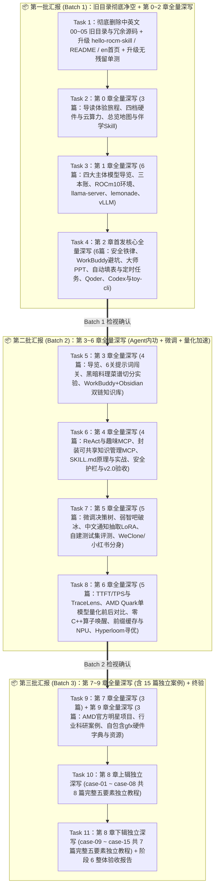

# TASK：hello-rocm 2.0 旧目录净空与全量教材级深写原子任务计划

> **当前阶段**：6A 工作流 - 阶段 3 & 4：Atomize & Approve（原子任务拆解，待确认后启动 Batch 1）  
> **任务名称**：`v2-full-content`

---

## 一、原子任务依赖关系与三批推进节奏图

---

## 二、各原子任务输入/输出契约与验收标准

### 【Batch 1：旧目录净空 + 第 0～2 章教材级深写】

- **Task 1：旧版 `00~05` 中英文目录彻底净空与全局基础设施对齐**
  - **输入**：现有 `docs/zh/00-environment~05-amd-yes`、`docs/en/00-environment~05-amd-yes`、`src/infra`、`src/amd-yes`。
  - **输出**：将第 8 章需复用的轻量案例代码归整至 `src/cases/`；彻底删除中英文 `00~05` 旧目录与 `src/infra`；重写 `docs/en/index.md` 为简洁 2.0 导览页；清理 `README.md`、`docs/zh/cloud/amd-radeon-cloud.md`、`docs/zh/learning/20-day-learning-plan.md` 与 `src/hello-rocm-skill/` 中的全部旧路径引用；升级 `tests/test_course_v2.py` 增加“旧目录与旧路由零残留”强制断言。
  - **验收标准**：`git status` 确认旧目录彻底移除，全仓 grep 旧路径零非法残留。
- **Task 2：第 0 章（`00-guide/`，3 篇独立文档）全量深写**
  - **输出**：`index.md`、`03-hardware-and-cloud.md`、`04-roadmap-and-skill.md`。
- **Task 3：第 1 章（`01-first-model/`，6 篇独立文档）全量深写**
  - **输出**：`index.md`（四大主体模型详解）、`01-model-intuition.md`、`02-rocm-env-setup.md`、`03-llama-server.md`、`04-lemonade-server.md`、`05-vllm-server.md`（独立详写每一引擎的安装、拉模、防截断参数、测速与排错，章末导流 `self-llm`）。
- **Task 4：第 2 章（`02-connect-tools/`，6 篇独立文档）首发核心全量深写**
  - **输出**：`index.md`、`02-workbuddy-setup.md`、`03-workbuddy-dashi-ppt.md`、`04-workbuddy-excel-and-cron.md`、`05-qoder-ide.md`、`06-codex-and-toy-cli.md`（内化完整 `toy-cli` 百行代码拆解，章末导流 Datawhale WorkBuddy 教程），同步更新 `config.mts` 并通过 `test_course_v2.py` 全量测试。

---

### 【Batch 2：第 3～6 章教材级深写】

- **Task 5：第 3 章（`03-prompt-and-rag/`，4 篇独立文档 + 菜谱分块对比实验脚本）**
- **Task 6：第 4 章（`04-mcp-and-skills/`，4 篇独立文档 + `knowledge_mcp` 跨端共享完整教程）**
- **Task 7：第 5 章（`05-fine-tune/`，5 篇独立文档：决策树、弱智吧破冰、通知抽取 LoRA、自建测试集评估、`WeClone`/小红书分身，导流 `happy-llm`）**
- **Task 8：第 6 章（`06-optimize-speed/`，5 篇独立文档：`TraceLens` 诊断、`AMD Quark` 单模型量化前后实测对比、零 C++ 算子唤醒、Prefix Caching、`Hyperloom` 自动寻优，导流 `hello-gpu`）**

---

### 【Batch 3：第 7～9 章教材级深写（含 15 篇独立案例）+ 终验】

- **Task 9：第 7 章（`07-portfolio-resume/`，3 篇）+ 第 9 章（`09-amd-ecosystem/`，3 篇，含自包含全系 AMD GPU/APU `gfx` 架构速查大表）**
- **Task 10：第 8 章上辑（`case-01` ～ `case-08`，8 篇独立五要素完整教程）**
- **Task 11：第 8 章下辑（`case-09` ～ `case-15`，7 篇独立五要素完整教程）+ 阶段 6（`ACCEPTANCE`、`FINAL`、`TODO`）终验**
