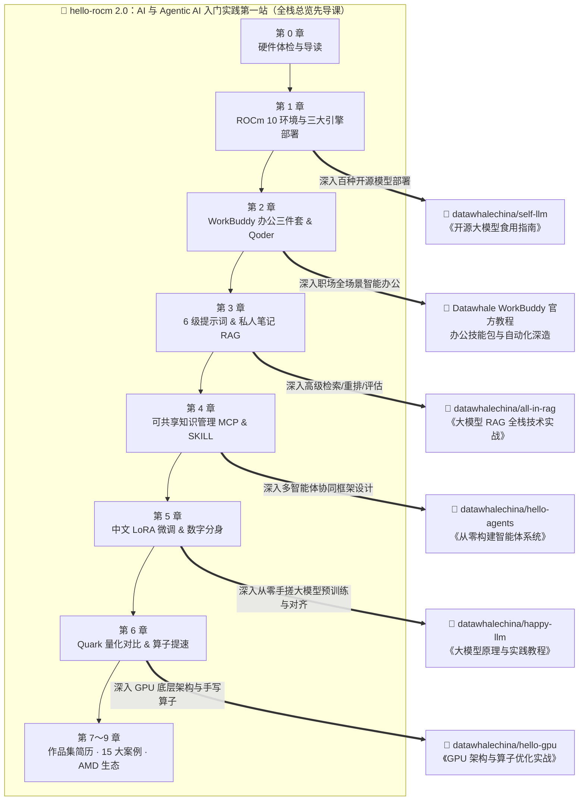

# 0.4 课程全景地图、跨课程引用体系与 `hello-rocm Skill` 伴学安装

> **本节目标**：一图看懂 `hello-rocm 2.0` 作为 **Datawhale AI 全栈总览先导课** 的章节蓝图与六大专精课程导流关系，并用 3 分钟把本仓库自带的 **`hello-rocm Skill` 伴学助教** 安装就位。

---

## 一、本课程在 Datawhale 全栈版图中的定位：你的“第一站全景枢纽”

很多刚入门 AI 的同学在 GitHub 上看到琳琅满目的开源教程时，常常陷入选择困难症：*“我到底该先学部署、先学 RAG 知识库、先学 Agent 智能体、还是先学微调和 GPU 算子？”*

**`hello-rocm 2.0` 就是为你量身打造的「全栈第一站总览先导课（Overview Hub）」**：
1. **横向先跑通闭环**：我们先不陷进某一个子领域的万字数学公式里，而是用最通俗的工程直觉，带你在自己的 AMD 电脑上把 **「环境与模型部署 → 零代码办公（PPT/填表/定时任务）与 IDE 编程 → 私人知识库 RAG → 可共享 MCP 与 SKILL 开发 → 中文 LoRA 微调 → 量化与零 C++ 算子提速 → 简历作品集与 15 个趣味应用」** 完整跑通一遍；
2. **纵向精准深造导流**：当你亲手尝到了全链路的甜头、发现自己对其中某一站（比如“我想深挖多模态大模型部署”、“我想从零手搓 Transformer 训练”或“我想手写底层 HIP/Triton 显卡算子”）产生浓厚兴趣时，每一章末尾都为你无缝对接好了 **Datawhale 对应的王牌专精课程**！



### 📚 本课程与 Datawhale 六大兄弟课程双向引用速查表

| 本书所在章节 | 你在本书亲手掌握的核心能力（0 → 1 实战闭环） | 学完本章后无缝衔接的专精课程（1 → 100 纵深进阶） |
|:---|:---|:---|
| **[第 1 章：环境配置与三大引擎部署](../01-first-model/index.md)** | 算清显存三本账，配好 ROCm 10 + PyTorch，熟练拉起 `llama-server` / `lemonade-server` / `vLLM` 四大主体模型 | 🔗 **[`self-llm`（开源大模型食用指南）](https://github.com/datawhalechina/self-llm)**：探索上百款开源大模型的全套部署与微调配方 |
| **[第 2 章：WorkBuddy 办公三件套与 Qoder](../02-connect-tools/index.md)** | 用 **`dashi-ppt-skill`（大师 PPT）** 生成原生可编辑 PPT、批量单据自动填 Excel、配置 RRULE 定时办公任务，接入 `Qoder` 与 `Codex` | 🔗 **[Datawhale WorkBuddy 官方教程](https://www.datawhale.cn/learn/content/382/8712?from=homepage)**：解锁更多桌面级职场智能体办公流 |
| **[第 3 章：6 级提示词与私人笔记库 RAG](../03-prompt-and-rag/index.md)** | 掌握 6 级提示词阶梯、食谱切分直觉，零代码搭建 `WorkBuddy + Obsidian` 本地双链知识库 | 🔗 **[`all-in-rag`（大模型 RAG 全栈实战）](https://github.com/datawhalechina/all-in-rag)**：攻克混合检索、Rerank 重排、GraphRAG 与 RAGAS 评估 |
| **[第 4 章：可共享知识管理 MCP 与 SKILL](../04-mcp-and-skills/index.md)** | 用 `FastMCP` 把个人知识库封装成**可分享给他人调用的 MCP 服务**，编写自定义办公 `SKILL.md` 与安全护栏 | 🔗 **[`hello-agents`（从零构建智能体）](https://github.com/datawhalechina/hello-agents)**：手写 ReAct / Plan-and-Solve 框架与多智能体编排 |
| **[第 5 章：中文 LoRA 微调与数字分身](../05-fine-tune/index.md)** | 跑通弱智吧破冰实验、中文通知 JSON 精准提取微调、微调前后客观评测与 `WeClone` 微信分身/小红书种草体 | 🔗 **[`happy-llm`（大模型原理与实践）](https://github.com/datawhalechina/happy-llm)**：从零手写 Transformer，贯通预训练、SFT 与 DPO/GRPO 强化对齐 |
| **[第 6 章：Quark 量化对比与零 C++ 算子加速](../06-optimize-speed/index.md)** | 用 `TraceLens` 找瓶颈、跑通单模型 **AMD Quark** 量化前后体积/速度对比、开启 `AITER` 与 `Hyperloom` 自动寻优 | 🔗 **[`hello-gpu`（GPU 架构与算子优化）](https://github.com/datawhalechina/hello-gpu)**：深入 CU / Wavefront / LDS 硬件底层，手写极致 HIP 与 Triton 算子 |

---

## 二、两种推荐通关节奏：按你的空闲时间自由选择

你可以把本手册当作周末突击营，也可以当作系统进阶课：

- **🏃 路线 A：周末 6 小时「实用爽感速通线」（强烈推荐零基础与非计算机专业同学）**
  - **周六上午（2 小时）**：学完 **第 0 章 + 第 1 章**（选好 `Gemma 4 E4B` 或 `Qwen3.5-9B`，用 `llama-server` 或 `lemonade-server` 点亮本地 `/v1` 接口）；
  - **周六下午（2 小时）**：直冲 **第 2 章**（在 WorkBuddy 里跑通 `dashi-ppt-skill` 生成第一份 PPT + 自动填 Excel + 定时任务）；
  - **周日下午（2 小时）**：完成 **第 3 章 + 第 4 章**（接入 Obsidian 笔记库并打包成可分享的「知识管理 MCP」），再去 **[第 8 章案例超市](../08-fun-cases/index.md)** 挑 2 个最感兴趣的案例边玩边晒！
- **🧗 路线 B：完整 10 章「全栈硬核求职通关线」（适合准备秋招/春招、科研或参加 [20 天组队学习营](../learning/20-day-learning-plan.md) 的同学）**
  - 按 **第 0 章 → 第 9 章** 顺序逐节实操，完整产出 5 件套作品集数据（含第 5 章中文微调客观胜率表与第 6 章 AMD Quark 量化测速表），最后在第 7 章直接打磨成高含金量 STAR 简历项目并投递实战！

---

## 三、起跑前必装神器：3 分钟配置 `hello-rocm Skill` 专属伴学助教

为了防止你在装驱动、拉模型或配客户端时因为漏看一个小参数而卡壳，我们把全书所有 **四大主体模型选型、三大引擎标准启动命令、WorkBuddy 五大高频报错急救方案以及章节速查索引** 浓缩成了一个标准的 Agent 技能包 —— **[`src/hello-rocm-skill`](https://github.com/datawhalechina/hello-rocm/tree/dev_1.0/src/hello-rocm-skill)**！

只要把它放进你的 AI 编程或桌面助手（WorkBuddy、`Qoder`、Codex CLI 或 Claude Code），它就会立刻变身最懂你显卡的 **24 小时贴身助教**。

### Step 1：把本仓库克隆到纯英文工作目录

> [!WARNING]
> **路径避坑铁律**：在 Windows 或 Linux 上存放代码、模型和沙箱文件夹时，**请务必使用纯英文且不含空格的路径**（例如 `D:\ai_workspace\hello-rocm` 或 `~/ai_workspace/hello-rocm`），避免部分底层 C++/Python 工具链因中文字符或空格路径解析失败！

```bash
# 创建清爽的纯英文工作区目录并克隆本仓库
mkdir -p ~/ai_workspace && cd ~/ai_workspace
git clone https://github.com/datawhalechina/hello-rocm.git
cd hello-rocm
```

*(Windows PowerShell 同学若希望放在非系统盘如 D 盘，可执行：`mkdir D:\ai_workspace; cd D:\ai_workspace; git clone https://github.com/datawhalechina/hello-rocm.git`)*

### Step 2：一行命令安装 `hello-rocm-skill`

你可以根据手头已有的客户端任选一种挂载方式（哪怕现在还没装客户端也没关系，第 2 章装好 WorkBuddy 和 `Qoder` 后随时回来执行这一行即可）：

```bash
# 方式 1：安装到项目级/全局标准 .agents/skills 目录（WorkBuddy、Qoder、Codex 通用识别）
mkdir -p ~/.agents/skills
cp -r ./src/hello-rocm-skill ~/.agents/skills/hello-rocm-skill

# 方式 2：如果你使用 Claude Code，也可同步复制到 ~/.claude/skills
mkdir -p ~/.claude/skills
cp -r ./src/hello-rocm-skill ~/.claude/skills/hello-rocm-skill
```

### Step 3：复制这 3 句口令试一试你的伴学助教！

安装完成后，打开支持 `SKILL.md` 的助手对话框，随时输入类似下面的大白话提问：
1. 💬 *“我的电脑是 AMD RX 7800 XT 16G 显存，按 hello-rocm 2.0 课程推荐我该选哪款主体模型、用哪个引擎启动命令？”*
2. 💬 *“我在 WorkBuddy 里连本地 llama-server 提示无响应或工具调用被截断，帮我按 hello-rocm 排错清单检查一下！”*
3. 💬 *“我想学怎么把自己的 Obsidian 笔记做成 MCP 给同学调用，应该看 hello-rocm 第几章哪个源码文件？”*

---

## 🎉 第 0 章通关！正式点火出发

热身完毕！你已经选好了自己的专属战车（硬件档位与主体模型），拿到了全栈藏宝图，还配齐了贴身助教。

深呼吸，让我们推开实战大门，亲手在你的电脑上点亮第一个满血运行的本地大模型服务：

➡️ **[进入第 1 章｜跑通你的第一个本地大模型：环境配置与三大引擎极速部署](../01-first-model/index.md)**
