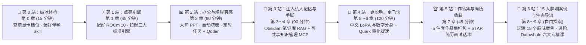

# 第 0 章｜欢迎来到本地 AI 世界：课程导读与你的成长旅程

> **每个 AI 小白，从零开始，动手实践的第一站。**  
> *基于 AMD 平台的 AI 与 Agentic AI 入门实践手册（Datawhale AI 全栈课程体系总览先导课）。*

欢迎来到 `hello-rocm 2.0`！无论你是一名刚刚打开电脑的大一新生、一位每天被周报和报销单淹没的职场人，还是一位手里有一台 AMD 锐龙笔记本或 Radeon 游戏显卡却只拿它打过游戏的开发者——这本手册都是专门为你写的。

你**不需要**提前学过微积分和线性代数，**不需要**背诵深度学习论文，也**不需要**一上来就去啃晦涩的 C++ 底层显卡代码。在这里，我们只做一件最有成就感的事：**手把手带你把身边的 AMD 电脑（或免费申领的云端算力），一步步变成真正能帮你做 PPT、填 Excel、查私人笔记、写代码甚至模仿你语气聊天的全能 AI 助手。**

---

## 0.1 为什么现在人人都该在自己电脑里装一个本地 AI？

很多同学打开本教程的第一个疑问往往是：*“手机和网页上已经有那么多现成的大模型可以聊天了，我为什么还要折腾在自己电脑上跑一个本地大模型？”*

答案非常简单——当你从“偶尔问 AI 几个脑筋急转弯”走向**真正让 AI 介入你的核心学习和日常工作（Agentic AI 智能体时代）**时，云端网页对话框很快就会撞上 **4 堵看不见的墙**，而你手边的本地 AMD 电脑恰好能一次性打穿它们：

| 真实痛点场景 | ☁️ 纯云端网页 AI 的尴尬与限制 | 💻 本地 AMD AI 助手的降维体验 |
|:---|:---|:---|
| **🔒 1. 核心隐私与数据安全红线** | 未发表的毕业论文初稿、实验室内部实验记录、公司财务报销发票、个人微信聊天记录与日记，一旦上传第三方公有云就存在合规风险与心理负担。 | **数据一秒不出本机硬盘**。哪怕拔掉网线，你的合同、成绩单、私人 Obsidian 笔记与聊天记录也只在你自己的显卡显存里流转。 |
| **💸 2. Agent 循环与定时任务的 Token 焦虑** | 智能体（Agent）修一个代码 Bug 往往要在后台自动读写文件、调工具循环 20～50 轮；每天自动巡检文件夹的定时任务更会源源不断消耗昂贵的 API 额度。 | **电费级零边际成本**。一旦模型跑在自己的 Radeon GPU 或 Ryzen AI NPU 上，无论是让它通宵整理 500 份文献，还是每早 9 点定时生成日报，**0 元 API 账单，随便试错不心疼**！ |
| **✈️ 3. 断网环境与内网可用性** | 在飞机高铁上、校园网欠费断网时、或是涉密科研院所/企业内网环境中，云端 AI 瞬间变成空白报错页。 | **100% 全离线随时待命**。在万米高空的航班上，你依然可以用 `WorkBuddy` 一键生成答辩 PPT，用 `Qoder` 全离线补全和重构代码。 |
| **🧬 4. 深度定制“专属于你”的第二大脑** | 公有云通用模型不认识你上周记的课堂笔记，不懂你们单位特有的通知填表规矩，张嘴闭嘴都是千篇一律的“总而言之、作为一个人工智能”。 | **从外挂知识库到专属微调完全可控**。你可以挂载自己的本地知识库 MCP，更可以在第 5 章亲手用 LoRA 把模型微调成懂内部规矩、甚至说话语气和你一模一样的数字分身！ |

> [!TIP]
> **好消息：现在的开源中小模型已经强得超乎想象！**  
> 过去大家觉得“本地小模型笨”，是因为两年前的模型连格式都输出不稳。而今天，以 **`Gemma 4 E4B` / `12B`**、**`Qwen3.5-9B`** 以及混合专家旗舰 **`Qwen3.6-35B-A3B`** 为代表的新一代开源模型，在一台普通消费级 AMD 电脑上就能流畅完成工具调用（Tool Calling）、多模态识图、长文档摘要与结构化填表！

---

## 0.2 你的专属成长主线：“我把自己的 AMD 电脑，变成了学习和工作的 AI 助手”

为了让你每学完一章都能立刻在生活中用起来、晒出来，本课程彻底告别了“前五章纯讲枯燥理论、最后一章才写 Hello World”的传统写法，采用 **「一条主线贯穿到底、每章原地升级一个版本」** 的通关式设计。

想象一下两周后的你：
- **早上 9:00**：电脑后台的 `WorkBuddy` 定时任务准时苏醒，利用本地显卡把昨晚收到的十几张报销单和通知自动提取成规整的 Excel 表格，缺失字段贴心标好 `待确认`；
- **下午 2:00**：导师或老板临时要一份项目汇报，你把凌乱的 Markdown 提纲丢进 `WorkBuddy`，调用 **`dashi-ppt-skill`（大师 PPT）**，3 分钟导出一份版式精美、原生可编辑的 `.pptx` 幻灯片；
- **晚上 8:00**：你在 `Qoder` 里复习代码或准备期末考，随时通过自己手搓的 **「知识管理 MCP」** 跨软件检索 Obsidian 里的每一条双链笔记，甚至还能把这个知识库打包分享给同组队友直接调用！

### 🗺️ 你的六站式通关学习体验旅程

全书共分为 **6 大体验驿站（对应第 0～9 章）**，每一站都有清晰的心理里程碑与看得见、摸得着的实战作品：

让我们提前看看你将亲手打造的 **「个人学习与工作助手」5 次进化阶梯**：

| 助手版本 | 所在章节 | 你亲手赋予它的新超能力 | 本站立刻带走的实战成果 |
|:---|:---|:---|:---|
| **`助手 v0.1`（引擎点火版）** | 第 1 章 | 在本地 `8080` / `13305` / `8000` 端口跑通标准 OpenAI `/v1` 服务 | 终端首句中文对话成功 + 《本机显存与 `tok/s` 测速记录卡》 |
| **`助手 v1.0`（零代码办公与编程版）** | 第 2 章 | 接入 **WorkBuddy**（`dashi-ppt-skill` 大师 PPT + 自动填表 + 定时任务）与 **`Qoder` / Codex** | 一份原生可编辑 `.pptx` 课件 + 自动汇总 `.xlsx` 表 + 日常定时巡检任务 |
| **`助手 v1.5`（第二大脑知识库版）** | 第 3 章 | 掌握 6 级提示词模板 + 接入 **Obsidian** 本地双链笔记库，回答句句带真实出处 | 零幻觉的本地私人课程讲义 / 读书笔记问答库 |
| **`助手 v2.0`（全栈智能体可共享版）** | 第 4 章 | 把个人知识库封装成可发给别人调用的 **`知识管理 MCP Server`** + 自定义办公 `SKILL.md` | 3 工具标准 MCP 服务端 + 周五办公自动巡检技能包 |
| **`助手 v3.0`（专属微调与极速版）** | 第 5～6 章 | 中文通知 JSON 抽取 LoRA / `WeClone` 微信分身微调 + **AMD Quark** 量化压缩与零 C++ 算子提速 | 《中文微调前后客观评测表》+《Quark 量化前后体积/速度对比报告》 |

---

## 💡 给零基础同学的 3 颗定心丸

1. **“我连命令行黑框框都很少打开，能学会吗？”**  
   完全可以！第 1 章的每一条命令都支持直接复制粘贴，并且配有逐词白话翻译和预期输出对照；到了第 2、3 章，**你甚至不需要写一行代码**，全程在可视化的 WorkBuddy 和 Obsidian 里点点鼠标就能做出惊艳的 PPT 和私人知识库。
2. **“我的电脑只有核显，或者暂时还是别的显卡怎么办？”**  
   AMD 锐龙 AI 轻薄本自带强劲核显与 XDNA 2 NPU，可以直接用 `lemonade-server` 流畅跑起 **`Gemma 4 E4B`**；就算手头暂时没有任何 AMD 硬件，下一节就会教你**免费申领 100+ 小时 AMD Radeon Cloud 云端大显存算力**，照样零成本通关全书！
3. **“遇到报错卡住了谁来帮我？”**  
   我们在本仓库内置了专属伴学助教 **[`hello-rocm Skill`](./04-roadmap-and-skill.md)**，装进你的客户端后，任何报错截图或日志丢给它，都会按本课程的排错手册精准教你解决。

---

## 👉 下一步

现在，花 **3 分钟** 看看你手里的电脑属于哪一个算力档位，领走最适合你的那颗“主体大模型”：

➡️ **[0.3 3 分钟硬件体检、四大主体模型选型与免费云算力申领指南](./03-hardware-and-cloud.md)**
