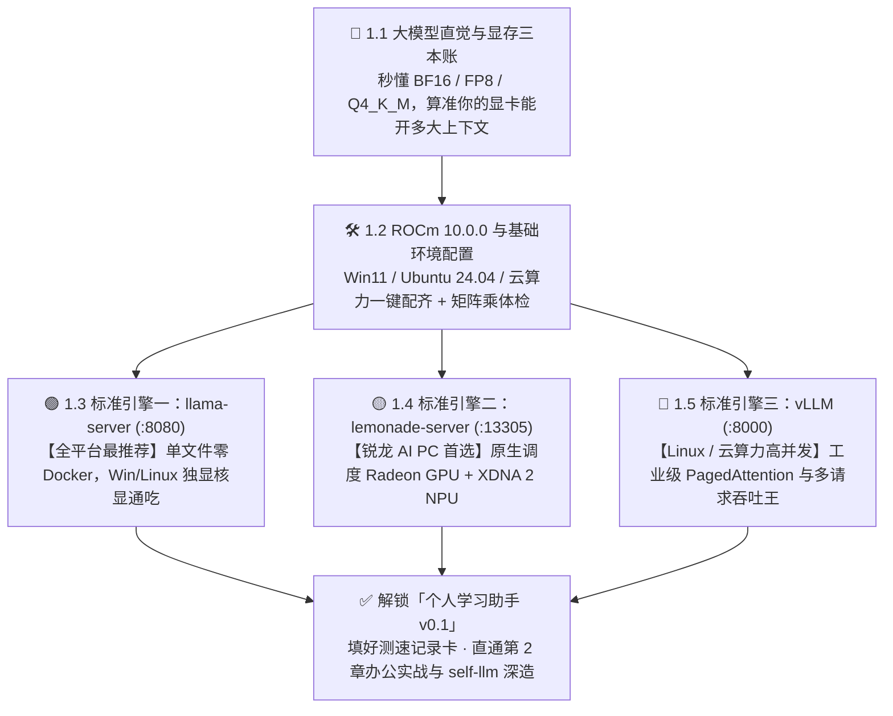

# 第 1 章｜跑通你的第一个本地大模型：ROCm 10 环境与三大标准引擎部署

> **本章使命**：亲手在你的 AMD 电脑（或免费云算力）上配好干净稳固的运行环境，从 **`llama-server`（端口 `8080`）**、**`lemonade-server`（端口 `13305`）**、**`vLLM`（端口 `8000`）** 三大标准引擎中任选其一，点亮你的第一颗主体大模型，解锁 **`个人学习助手 v0.1`**！

很多新手之所以在“部署本地大模型”这一步被劝退，往往是因为网上的野生教程五花八门：今天让你装一套闭源玩具壳子，明天换个软件又得把十几 GB 的模型重新下载一遍，甚至配到第 2 章才发现那个工具根本不支持标准函数调用（Tool Calling）！

在本章中，我们坚持 **「工业标准一步到位、零重复折腾」**：
- 全书**只使用 3 款全开源、工业界与 AMD 官方力推的标准推理引擎**：**`llama-server`**、**`lemonade-server`** 与 **`vLLM`**；
- 它们全部在本地暴露**完全一致的 OpenAI 兼容 `/v1` 接口**——这意味着只要你在本章跑通其中**任意一个**，后面第 2～8 章的 `WorkBuddy` 大师 PPT、`Qoder` 编程助手、Obsidian 知识库与 15 个趣味应用就能**零修改无缝插拔**！

---

## 🌟 本书四大精选主体模型全景档案

在正式动手前，让我们先认识一下贯穿全书实战的 **4 位明星主角**。它们全部支持**中文深度对话、超长上下文（32K～128K+）与原生工具调用（Tool Calling）**，且在魔搭社区（ModelScope）均可国内满速免翻墙下载：

| 档位标签 | 模型名称 | 参数结构与核心黑科技 | 魔搭 ModelScope 官方仓库名（原版 / GGUF） | 最擅长的实战主场 |
|:---|:---|:---|:---|:---|
| **🟢 入门与轻薄本首选** | **`Gemma 4 E4B`** | **有效 4.5B 参数**（含词表与多模态编码器总计 ~8B，Per-Layer Embeddings 架构）；原生 **128K 上下文**，同时支持**文本 + 图像 + 音频输入**与精准函数调用 | • 原版：`google/gemma-4-E4B-it` • GGUF：搜索 `gemma-4-E4B-it-GGUF` | 8G 独显与锐龙 AI 核显/NPU 轻薄本的全能小钢炮，首次跑通链路验证最快（`Q4_K_M` 仅 **~2.9 GB**）！ |
| **🔵 16G 甜点中文王牌** | **`Qwen3.5-9B`** | **90 亿（9B）稠密参数**，融合 Gated DeltaNet 线性注意力混合架构，原生支持 **262K 超长上下文**、思考/非思考双模式切换与极强中文指令遵循 | • 原版：`Qwen/Qwen3.5-9B` • GGUF：`Qwen/Qwen3.5-9B-GGUF`（或社区 `bartowski/Qwen_Qwen3.5-9B-GGUF`） | **中文办公绝对主力**！第 2 章自动填 Excel、第 3 章长讲义 RAG、第 5 章中文通知 JSON 抽取表现极稳。 |
| **🔵 16G 甜点编程/推理王牌** | **`Gemma 4 12B`** | **120 亿（12B）稠密参数**，强化的代码生成、跨语言翻译与多步数学/逻辑推理底座，原生 **128K 上下文**与多模态识图 | • 原版：`google/gemma-4-12B-it` • GGUF：搜索 `gemma-4-12B-it-GGUF` | **代码与英文科研利器**！第 2.3 节接入 `Qoder` 跨文件重构代码、读英文顶会 PDF 论文体验极佳。 |
| **🟣 旗舰 AI PC 终极杀器** | **`Qwen3.6-35B-A3B`** | **总参数 350 亿（35B），每词仅激活 30 亿（3B）的稀疏混合专家（MoE）架构**！兼具 35B 级大脑容量与 3B 级闪电生成速度 | • 原版：`Qwen/Qwen3.6-35B-A3B` • GGUF：`Qwen/Qwen3.6-35B-A3B-GGUF` | 专为 **Ryzen AI Max+ 395（64G～128G 统一内存）** 与云算力打造，复杂多步 Agent 规划与 `OpenClaw` 管家中枢天花板！ |

---

## 🗺️ 本章学习地图（5 节独立保姆级教程）

请按以下顺序阅读。其中 **1.1 与 1.2 为必读地基**；到了 **1.3 ～ 1.5 三大引擎实战**，你只需要先挑选**最适合你当前系统的一款引擎**跑通即可立刻进入第 2 章（学有余力再体验另外两款做测速对比）：

### 各节直达导航

1. **[1.1 零数学公式秒懂：参数量、量化精度与“显存三本账”](./01-model-intuition.md)**  
   *不再盲目猜显存！用买书和草稿纸的比喻，10 分钟彻底弄懂 `BF16`、`FP8`、`Q8_0`、`Q4_K_M` 与 `KV Cache`。*
2. **[1.2 保姆级基础环境与 ROCm 10.0.0 配置指南（Win11 / Ubuntu / 云算力）](./02-rocm-env-setup.md)**  
   *区分“极速免 Python 路线”与“完整 PyTorch ROCm 10 路线”，含非 C 盘缓存配置与 4 步冒烟体检脚本。*
3. **[1.3 标准引擎一：`llama-server`（`llama.cpp`）轻量全能部署实战（端口 `8080`）](./03-llama-server.md)**  
   *桌面独显与跨平台最稳首选！从魔搭拉取 GGUF 到开启 `32768` 上下文与 `--jinja` 工具调用一步到位。*
4. **[1.4 标准引擎二：`lemonade-server` AMD AI PC 原生引擎部署实战（端口 `13305`）](./04-lemonade-server.md)**  
   *锐龙 AI 笔记本与 Strix Halo 迷你主机绝配！一条命令拉起 `Gemma 4 E4B`（含 NPU 低功耗模式）与旗舰 `Qwen3.6-35B-A3B`。*
5. **[1.5 标准引擎三：`vLLM` 工业级高并发部署、三大引擎横评与 `self-llm` 导流（端口 `8000`）](./05-vllm-server.md)**  
   *体验数据中心级高吞吐服务，完成《三大引擎选型对比表》与《本机测速记录卡》，并对接 Datawhale `self-llm` 专精课。*

---

👉 准备好了吗？让我们先花 10 分钟算清每个本地 AI 玩家都必须掌握的第一课：**[1.1 零数学公式秒懂：参数量、量化精度与“显存三本账”](./01-model-intuition.md)**！
