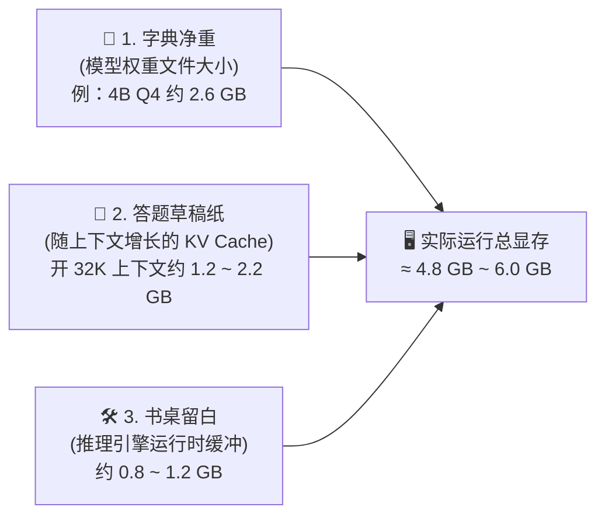

# 第 1 章｜第一站：直观认识数据类型与三大引擎最低成本部署

> **本章目标**：不用看一行复杂数学公式，先算清参数量、文件大小、运行显存与精度版本的“三本明白账”，再用全书统一锁定的 **三大标准服务引擎（`llama-server`、`lemonade-server`、`vLLM`）** 跑起你的第一个本地模型服务！

---

## 1.1 【直觉必修课】数据类型与模型资源的“三本明白账”

新手下载本地模型时，看到 `Qwen3.5-4B-BF16`、`Qwen3.5-4B-Q8_0`、`Qwen3.5-4B-Q4_K_M` 往往一头雾水。只要花 5 分钟算清下面**三本账**，你以后看到任何开源模型都能一秒选对版本！

---

### 第一本账：参数量（`0.6B` / `4B` / `8B` / `32B`）到底是什么？

- **`B` 代表 Billion（十亿）**：`4B` 就是约 **40 亿个参数**，`8B` 就是约 **80 亿个参数**。
- **直觉类比**：参数量就像模型的**“大脑神经连接数上限”**。连接越多，逻辑推理、长文归纳和复杂指令遵循能力越强，但需要的硬盘和显存也水涨船高：
  - **`0.6B ~ 1.7B`（超轻量级）**：像敏捷的速记员，适合极速代码行内补全、简单分类、投机采样草稿模型。
  - **`4B ~ 8B`（本地黄金甜点级）**：像靠谱的本科/硕士助理，足以胜任 **WorkBuddy 做 PPT、自动填 Excel、个人笔记问答（RAG）与日常写代码**！
  - **`14B ~ 35B+ MoE`（进阶专家级）**：适合大显存独显或统一内存 AI PC 处理超长多轮复杂规划。

---

### 第二本账：参数量、权重文件大小与运行显存/内存有什么区别？

> ❓ **新手灵魂拷问**：“我下载了一个 `2.6 GB` 的 `4B` 模型文件，为什么一跑起来吃掉了将近 `5.5 GB` 显存？”

因为模型跑在显卡里时，显存账单由 **三部分相加** 组成：

1. **权重文件大小（硬盘上的 `.gguf` / `.safetensors`）**：相当于一本字典本身的印刷厚度，只取决于 **参数量 × 每个参数占几个字节**。
2. **上下文草稿纸（`KV Cache`）**：模型一边读你的长文档和工具说明书、一边往下写字时，必须把历史上下文记在“草稿纸”上。**重点提醒**：第 2 章接入 WorkBuddy、`Qoder` 等智能体时，软件会自动注入上万字的工具说明，我们需要开启 `32768`（32K）上下文，因此必须给这张“草稿纸”留出 `1.5 GB ~ 3 GB` 余量！
3. **运行时开销（Runtime Overhead）**：推理引擎启动计算核所需的固定工作台空间（约 `0.8 ~ 1.2 GB`）。

> 💡 **一秒速算口诀**：**你的可用显存 ≥ 模型权重文件大小 × 1.3 + 2 GB（32K Agent 草稿纸余量）**，就能稳稳跑通不爆显存！

---

### 第三本账：为什么同一个模型有不同精度版本，该如何选择？

训练刚结束的原版模型，每个参数通常用 **16 位浮点数（`BF16` 或 `FP16`，占 2 个字节）** 存储。为了让普通消费级显卡也能轻松装下，工程师会把参数压缩成更紧凑的数据类型（即**量化 Quantization**）。

你可以直接用手机里的**照片格式**来理解：

| 精度版本名称 | 每参数约占空间 | 照片直觉类比 | 4B 模型文件约多大 | 什么时候选它？ |
|:---|:---:|:---|:---:|:---|
| **`BF16` / `FP16`** | 2 字节（16 bit） | 📷 **相机无损 RAW 原片** | ~8.0 GB | **第 5 章做模型微调训练时的底座**，或大显存做基准对照 |
| **`FP8` / `Q8_0`** | 1 字节（8 bit） | 🖼️ **肉眼零差别的最高清原图** | ~4.2 GB | 16G+ 甜点独显日常主力，回答质量几乎与原版 100% 一致 |
| **`Q4_K_M` / `INT4 AWQ`** | ~0.55 字节（4 bit） | 📱 **高画质精修压缩图（性价比之王）** | **~2.6 GB** | **全书小白首选！** 体积立省近 70%，日常办公/RAG 几乎感知不到智商下降 |
| **`Q2_K`（不推荐）** | ~0.3 字节（2 bit） | 🌫️ **满屏马赛克的缩略图** | ~1.4 GB | 压缩过狠容易胡言乱语、写崩 JSON，除非极限尝鲜否则避开 |

#### 📋 《AMD 四档硬件 × 精度版本选型抄作业表》

| 你的硬件档位 | 日常连接 WorkBuddy / `Qoder`（需开 32K 上下文）首选 | 第 5 章微调训练推荐底座 |
|:---|:---|:---|
| **🟢 入门档（8G–12G）** | `Qwen3.5-4B-Q4_K_M` 或 `Gemma-4-E4B-it-Q4_K_M` | `Qwen3-0.6B` / `1.7B (BF16)` |
| **🔵 甜点档（16G–24G）** | `Qwen3.5-8B-Q4_K_M` / `Qwen3.5-4B-Q8_0` | `Qwen3.5-4B (BF16)` |
| **🟣 旗舰档（64G–128G）** | `Qwen3-30B-A3B-Q4_K_M` / `Gemma-4-27B-Q8_0` | `Qwen3-8B / 14B (BF16)` |
| **☁️ 云端兜底档** | 按分配云卡显存同甜点档 / 旗舰档 | `Qwen3.5-4B / 8B (BF16)` |

---

## 本章实操分步导航

算清这三本明白账后，接下来两步带你 15 分钟拉起本地模型服务：

1. 👉 **[1.2 极简环境准备（Windows 11 / Ubuntu 24.04 / 免费云算力连通）](./quick-env.md)**
2. 👉 **[1.3～1.5 三大标准引擎部署实战（`llama-server` / `lemonade-server` / `vLLM`）](./three-engines-deploy.md)**

> 🔗 **本章课程引用与进阶导流**：完成本章首个模型服务部署后，若你想进一步探索 DeepSeek、GLM、InternLM、Llama 等**百余款国内外主流开源大模型的部署食谱**，欢迎延伸学习 Datawhale 王牌课程 **[`self-llm`（开源大模型食用指南）](https://github.com/datawhalechina/self-llm)**！
