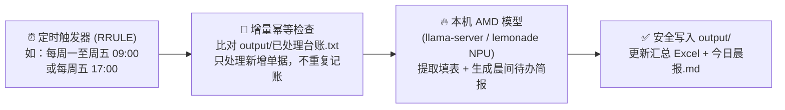

# 2.2.3 办公王牌实战二与三：AI 自动填表（Excel）与定时任务日常办公自动化

> **本节目标**：深度参考 [Datawhale WorkBuddy 官方教程](https://www.datawhale.cn/learn/content/382/8712?from=homepage)，用你的本地 AMD 大模型攻克职场与学生会最让人头秃的两大日常杂事：  
> 1. **AI 自动填表**：把一堆格式五花八门的通知、收据、报名文本批量提取成标准 `.xlsx` 汇总表，并严格遵守 **「缺失字段填 `待确认`、零幻觉不瞎编」** 契约；  
> 2. **AI 定时任务（Scheduled Tasks）**：配置 `RRULE` 自动触发规则，让电脑每天早 9 点或每周五下午自动巡检归档日常办公事项！

---

## 实战二：告别手工复制粘贴 —— 批量非结构化单据 AI 自动填 Excel

无论是在学校社团统计几十份活动报名留言，还是在公司每周汇总各组发来的杂乱采购报销说明，最痛苦的就是每个人的写法都不一样：有人写全了发票号，有人漏写了日期，手工往 Excel 里抄半小时眼睛就花了。

下面我们用 **3 分钟** 在本地沙箱里模拟并彻底自动化这个场景！

### Step 1：10 秒在沙箱创建 4 份真实“杂乱办公单据”（含故意挖坑的缺失项！）

打开终端，复制运行下面这段命令，在 `~/ai_workspace/sandbox/inbox_docs/` 下生成 4 份风格迥异的报销与采购记录（Windows 用户也可直接在 `D:\ai_workspace\sandbox\inbox_docs\` 里新建这几个 `.txt` / `.md` 文件）：

```bash
mkdir -p ~/ai_workspace/sandbox/inbox_docs ~/ai_workspace/sandbox/output

cat << 'EOF' > ~/ai_workspace/sandbox/inbox_docs/01_张三差旅说明.txt
财务老师好，我是算法组张三。上周（2026-10-12）去上海参加开源大会，高铁往返一共花了 1106.00 元，电子发票号是 2631200000018892，麻烦帮忙走一下差旅费报销，谢谢！
EOF

cat << 'EOF' > ~/ai_workspace/sandbox/inbox_docs/02_李四耗材采购.md
# 实验室采购备忘
- 经办人：李四
- 购买日期：2026年10月15日
- 明细：购买 2TB NVMe 固态硬盘一块用于存放本地大模型权重，实付金额 ¥899.50。
- 备注：京东商家说电子发票下周一才开出来，发票号暂时还没有。
EOF

cat << 'EOF' > ~/ai_workspace/sandbox/inbox_docs/03_王五活动茶歇.txt
10月18号下午举办《AMD 本地 AI 读书会》买了咖啡和点心共 328 元，申请人王五，发票号码：2631200000056710（团建活动费）。
EOF

cat << 'EOF' > ~/ai_workspace/sandbox/inbox_docs/04_赵六算力充值.txt
赵六申请报销实验室云算力测试充值费 500.00 元，发票号 2631200000091234。（忘了写具体哪天充值的了）
EOF
```

看！这里面既有 `.txt` 又有 `.md`，而且我们故意埋了两个真实办公中最常见的雷：
- **李四的硬盘采购还没有开出发票号**；
- **赵六忘了写具体采购日期**！

如果是不懂工程约束的新手直接让 AI “填表”，有些粗心的模型可能会顺手瞎编一个 `12345678` 的假发票号——在财务场景里这可是大忌！接下来看我们如何用 **「字段契约 + 缺失项兜底规则」** 让本地模型稳如老会计。

---

### Step 2：在 WorkBuddy（Craft 模式）发送「零幻觉自动填表金牌提示词」

确认 WorkBuddy 处于 **Craft 模式** 且绑定了 `sandbox` 目录（推荐选用中文抽取超稳的 **`Qwen3.5-9B`**，或 8G 档 **`Gemma 4 E4B`** / 旗舰 **`Qwen3.6-35B-A3B`**），直接发送以下指令：

```text
请扫描当前沙箱下 inbox_docs/ 文件夹中的所有单据文件，逐一提取信息并在 output/ 目录下生成一份标准的 Excel 表格文件 `output/10月部门报销自动汇总表.xlsx`：

1. 表头列严格按以下 7 列排列：
   【序号 | 来源文件名 | 发生日期(YYYY-MM-DD) | 申请人 | 费用类别 | 金额(元，保留两位小数) | 发票号码 | 审核状态备注】
2. 防幻觉铁律（极其重要！）：
   - 所有数据必须 100% 忠实于原文件，严禁猜测或编造任何数字！
   - 若原文件中未提及某项字段（例如暂无发票号或未写具体日期），该单元格必须严格填入字符串 `待确认`，并在【审核状态备注】列注明缺失原因（信息齐全则填 `要素齐全`）。
3. 汇总统计与安全边界：
   - 在表格最后一行追加【合计】行，自动计算总金额；
   - 严禁修改或删除 inbox_docs/ 下的任何原始文件；生成完毕后请在对话框先打印一份 Markdown 核对预览表。
```

---

### Step 3：打开生成的 `.xlsx` 报表做四项硬核验收！

几秒钟后，WorkBuddy 会在后台编写并运行一段极简的 `openpyxl` / `pandas` 脚本（如果环境未装 `openpyxl` 它还会贴心自动安装），直接生成 `sandbox/output/10月部门报销自动汇总表.xlsx`！打开 WPS 或 Excel 核对：

| 序号 | 来源文件名 | 发生日期(YYYY-MM-DD) | 申请人 | 费用类别 | 金额(元) | 发票号码 | 审核状态备注 |
|:---:|:---|:---:|:---:|:---:|---:|:---|:---|
| 1 | `01_张三差旅说明.txt` | `2026-10-12` | 张三 | 差旅费 | `1106.00` | `2631200000018892` | 要素齐全 |
| 2 | `02_李四耗材采购.md` | `2026-10-15` | 李四 | 耗材采购 | `899.50` | **`待确认`** | 电子发票待下周一开具 |
| 3 | `03_王五活动茶歇.txt` | `2026-10-18` | 王五 | 团建活动费 | `328.00` | `2631200000056710` | 要素齐全 |
| 4 | `04_赵六算力充值.txt` | **`待确认`** | 赵六 | 云算力测试费 | `500.00` | `2631200000091234` | 原文未注明发生日期 |
| **合计** | — | — | — | — | **`2833.50`** | — | **共 4 笔（2 笔待补全）** |

- ✅ **零幻觉验收**：李四缺失的发票号和赵六缺失的日期精准标为 **`待确认`**，一个数字都没乱编！
- ✅ **金额计算验收**：`1106 + 899.5 + 328 + 500 = 2833.50` 元分毫不差！
- ✅ **原件无损验收**：`inbox_docs/` 里的 4 份原始文件毫发无伤！

---

## 实战三：让 AI 替你准点打卡干活 —— 配置 WorkBuddy 定时任务（Scheduled Tasks）

刚才手动发一次指令填表已经很爽了；但如果你希望**每天早上 9:00 打开电脑喝咖啡时，昨晚收件箱里攒下的新单据、会议纪要和今日待办简报已经自动躺在 `output/` 文件夹里等你审阅**呢？

这就是 WorkBuddy 超实用的 **「定时任务（Automation / Scheduled Tasks）」** 能力——而且因为用的是你自己的本地 AMD 显卡，**每天定时跑 365 天也是 0 元 Token 账单**！



### Step 1：进入定时任务面板并创建第一条日常自动化规则

打开 WorkBuddy 左侧导航栏的 ⏰ **「定时任务 / 自动化（Scheduled Tasks）」** 面板，点击 **「新建定时任务」**，按以下 4 项标准填写：

1. **任务名称**：`每日 09:00 收件箱单据增量汇总与办公晨报`
2. **绑定工作目录（Workspace）**：严格绑定你的安全沙箱 **`~/ai_workspace/sandbox`**（或 **`D:\ai_workspace\sandbox`**）
3. **执行时间 / 重复规则（Schedule / RRULE）**：
   - 界面支持可视化勾选「每周一至周五 `09:00`」（底层对应标准日历规则 `FREQ=WEEKLY;BYDAY=MO,TU,WE,TH,FR;BYHOUR=9;BYMINUTE=0`）；
   - 你也可以再建一条「每周五 `17:00` 周报素材自动盘点」（`FREQ=WEEKLY;BYDAY=FR;BYHOUR=17;BYMINUTE=0`）。
4. **定时执行指令（Task Prompt —— 内置“防重复记账”工程幂等锁！）**：

```text
请执行今日例行办公巡检任务：
1. 读取 output/processed_files.log（若不存在则新建）；
2. 检查 inbox_docs/ 目录下是否有尚未记录在 processed_files.log 中的新文件：
   - 如果没有新文件，仅在 output/今日办公晨报.md 写入“今日收件箱无新增待审单据，祝工作顺利！”并结束；
   - 如果有新文件，按标准 7 列表头将其提取追加至 output/10月部门报销自动汇总表.xlsx（缺失项填“待确认”），将已处理文件名追加记录进 output/processed_files.log，并在 output/今日办公晨报.md 中汇报本次新增笔数与存在“待确认”缺项需人工跟进的申请人名单。
3. 严禁修改或删除 inbox_docs/ 下的任何原始文件。
```

### Step 2：先点「立即运行一次」预演，确认无误后从 `PAUSED` 切为 `ACTIVE`！

> [!IMPORTANT]
> **定时任务上线黄金习惯**：  
> 新建定时任务后默认通常处于暂停草稿态（`PAUSED`），请先往 `inbox_docs/` 里丢一个新测试文件 `05_周五打印费.txt`，点击任务卡片右侧的 **「▶️ 立即运行一次（Run Now）」**：
> 1. 确认 `output/今日办公晨报.md` 与 `processed_files.log` 正常生成；
> 2. **再点一次「立即运行一次」**：确认它聪明地识别出所有文件都已登记在 `processed_files.log` 里，不会把同一张报销单重复加两遍钱！
> 3. 验收满分后，将任务状态开关正式拨到 **`ACTIVE`（已启用）**！

*(💡 **锐龙 AI 笔记本续航绝配提示**：如果你希望笔记本合盖或低功耗挂机跑后台定时任务，可以把定时任务绑定的模型选成 [1.4 节](../01-first-model/04-lemonade-server.md) 运行在 `lemonade-server` **XDNA 2 NPU** 上的 `Gemma 4 E4B`——静默无声、几乎不费电！)*

---

## 🔗 办公自动化进阶导流：Datawhale WorkBuddy 官方教程

恭喜你！不写一行后端代码，你已经把 **大师 PPT 生成 + 零幻觉自动填 Excel + 日常定时巡检** 三大职场利器全部收入囊中！

如果你想解锁更多丰富的桌面级办公玩法（例如：多份长合同条款比对、公众号排版自动化、跨文件夹智能归档与海量办公 Skill 组合技），强烈推荐在课后同步深造 Datawhale 出品的专项课程：
👉 **[Datawhale WorkBuddy 从入门到实战官方教程](https://www.datawhale.cn/learn/content/382/8712?from=homepage)**！

---

## 👉 下一节：为你的编程学习与开发插上全离线翅膀！

搞定了日常文档与表格办公，接下来我们用 10 分钟把同一颗本地 AMD 大模型顺手接进新一代 AI 编程 IDE —— **`Qoder`**，体验断网也能飞速写代码、改重构、补单元测试的快乐：

➡️ **[2.3 接入 `Qoder` 全离线 AI 编程助手：代码解释、跨文件重构与单测生成实战](./05-qoder-ide.md)**
