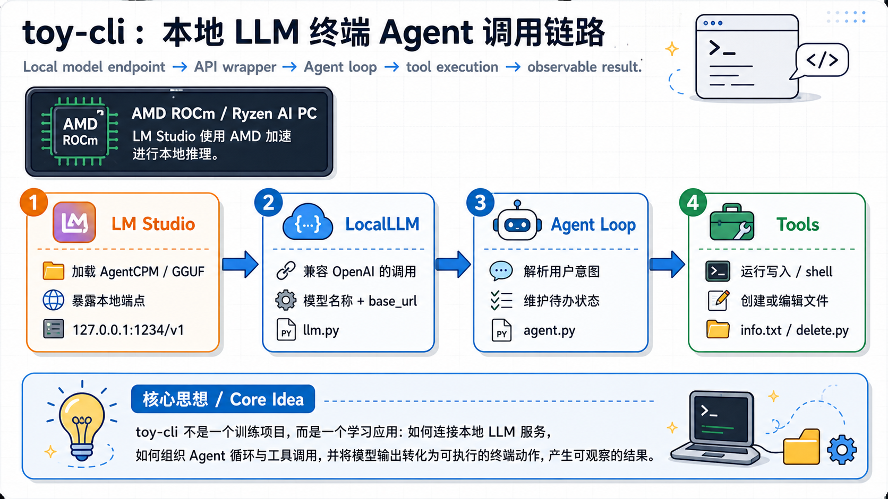

# 2.4 接入 `Codex CLI` 终端智能体 & 百行源码解剖 `toy-cli`

> **本节目标**：  
> 1. 用 5 分钟配置开源终端编程智能体 **`Codex CLI`** 直连本机 AMD 模型服务，在命令行沙箱里体验全自动修 Bug；  
> 2. 用 15 分钟亲手运行并逐行读懂轻量级终端智能体 **[`toy-cli`](https://github.com/KMnO4-zx/toy-cli)** 的百行核心 Python 循环——**从此在你眼里，世上再无神秘的 Agent 黑盒！**

---

## 上半场：5 分钟把 `Codex CLI` 接上本地 AMD 显卡服务

当你在远程 SSH 连着 Ubuntu 工作站或 [AMD Radeon Cloud](../cloud/amd-radeon-cloud.md) 云服务器、手头没有图形桌面时，运行在纯终端里的 **[`openai/codex`](https://github.com/openai/codex)（Codex CLI）** 就是最锋利的瑞士军刀。它原生支持通过 `~/.codex/config.toml` 接入任何本地 OpenAI 兼容服务！

### Step 1：安装 `Codex CLI` 并套用仓库已验证配置

确保本机已装好 Node.js 18+ 后，在终端执行：

```bash
# 1. 全局安装开源 Codex CLI
npm install -g @openai/codex

# 2. 创建配置目录，写入本仓库已通过单测校验的 src/configs/codex-config.toml 模板
mkdir -p ~/.codex
cat << 'EOF' > ~/.codex/config.toml
model = "qwen3.5-9b"
model_provider = "local_rocm"
approval_policy = "on-request"
sandbox_mode = "workspace-write"

[model_providers.local_rocm]
name = "Local AMD ROCm Server (llama-server :8080)"
base_url = "http://127.0.0.1:8080/v1"
env_key = "LOCAL_ROCM_API_KEY"
wire_api = "chat"

[model_providers.lemonade_rocm]
name = "Local AMD Lemonade Server (:13305)"
base_url = "http://127.0.0.1:13305/v1"
env_key = "LOCAL_ROCM_API_KEY"
wire_api = "chat"

[model_providers.vllm_rocm]
name = "Local AMD vLLM Server (:8000)"
base_url = "http://127.0.0.1:8000/v1"
env_key = "LOCAL_ROCM_API_KEY"
wire_api = "chat"
EOF

# 3. 设置本地非空环境变量占位符（无需花一分钱）
export LOCAL_ROCM_API_KEY="local-rocm"
```

> [!IMPORTANT]
> **两个关键避坑配置点**（均已在 [`src/configs/codex-config.toml`](https://github.com/datawhalechina/hello-rocm/blob/dev_1.0/src/configs/codex-config.toml) 中为你配妥）：
> - **`wire_api = "chat"`**：必须显式指定走标准的 `/v1/chat/completions` 接口（否则新版 CLI 可能默认尝试云端专属的 `responses` 接口导致本地报 `404`）；
> - **`approval_policy = "on-request"` + `sandbox_mode = "workspace-write"`**：完美契合我们的「三条安全铁律」——只允许修改当前沙箱目录文件，执行高风险命令前必须经过你敲回车点头同意！
> - *(若你后台跑的是 `gemma-4-e4b` 或 `lemonade_rocm` 上的 `Qwen3.6-35B-A3B-GGUF`，只需对应修改第一行的 `model` 和第二行的 `model_provider` 即可！)*

### Step 2：在沙箱里放一个报错脚本，看 `Codex` 全自动修好它！

```bash
cd ~/ai_workspace/sandbox

# 故意造一个带除零崩溃 Bug 的成绩统计脚本 buggy_grade.py
cat << 'EOF' > buggy_grade.py
def average_passing_score(scores):
    passing = [s for s in scores if s >= 60]
    return sum(passing) / len(passing)

if __name__ == "__main__":
    # 当全班都没及格时直接触发 ZeroDivisionError 崩溃！
    print("平均及格分:", average_passing_score([45, 52, 58]))
EOF

# 启动 Codex CLI 让本地 AMD 模型自动诊断、修复并运行验证！
codex "请运行并检查当前目录下的 buggy_grade.py，修复当没有及格分数时崩溃的 Bug（返回 0.0），并加上断言测试确保运行正常。"
```

看着终端里 `Codex` 自动读文件 → 定位 `len(passing) == 0` 边界漏洞 → 打上优雅补丁 → 重新运行 Python 打印出 `平均及格分: 0.0`——全程行云流水！

---

## 下半场：揭开黑盒！用百行代码看透 `toy-cli` 极简终端智能体

用完了功能强大的 WorkBuddy、`Qoder` 和 `Codex`，现在让我们做一个让无数初学者醍醐灌顶的小实验：**如果把所有花哨的界面全剥掉，一个能自己调工具看文件夹、执行命令的 Coding Agent，最核心的源码到底有几行？**

答案是：**不到 100 行 Python！**

Datawhale 社区开发者开源的经典教学项目 **[`KMnO4-zx/toy-cli`](https://github.com/KMnO4-zx/toy-cli)** 就是专门为初学者准备的“透明玻璃发动机”。先看这张一目了然的工作流全景图：



### 一眼看穿所有 Agent 的黄金四步循环（`While Loop`）

不管是几万行代码的商业 IDE，还是百行代码的 `toy-cli`，它们让本地大模型“长出手脚”的原理 **100% 都是同一个死循环**：

1. **🗣️ 第一步（发说明书）**：把你的问题 + 一份《可用工具 JSON 菜单》（比如 `list_files` 查看目录、`read_file` 读文件）一起发给本地 `http://127.0.0.1:8080/v1`；
2. **🧠 第二步（模型点菜）**：大模型自己并不会碰你的硬盘！它只是在回复里吐出一段特殊的结构化点菜单：`tool_calls: [{"name": "list_files", "arguments": {"path": "."}}]`；
3. **🛠️ 第三步（宿主跑腿 & 拼回历史）**：我们的 Python 小脚本看到模型点了菜，就在本机安全执行 `os.listdir(".")` 拿到真实文件名列表，然后作为一条 `role: "tool"` 的观察结果（Observation）**追加回 `messages` 聊天记录末尾**，再次发给大模型；
4. **✅ 第四步（拿到真凭实据交卷）**：大模型看到工具返回的真实文件列表后，不再点菜，直接输出最终中文回答，循环圆满结束！

---

### 动手跑通你的第一个 70 行透明版 `mini_toy_cli.py`！

你甚至不用克隆外部复杂依赖，直接在 `~/ai_workspace/sandbox/` 下复制保存下面这 **70 行零第三方框架依赖**（只用第 1 章装好的 `openai` 库！）的浓缩版 `mini_toy_cli.py`，直接连接你本机的 `8080`（或 `13305` / `8000`）端口亲手跑一次：

```python
"""mini_toy_cli.py — 70 行看透本地 AMD 智能体工具调用闭环（致敬 KMnO4-zx/toy-cli）"""
import json
import os
from pathlib import Path
from openai import OpenAI

# 1. 连接你在第 1 章启动的三大标准引擎之一（8080 / 13305 / 8000）
client = OpenAI(base_url="http://127.0.0.1:8080/v1", api_key="local-rocm")
MODEL_ID = os.getenv("ROCM_MODEL", "gemma-4-e4b")  # 或改为 qwen3.5-9b
SANDBOX = Path.cwd().resolve()

# 2. 定义给大模型看的「工具菜单说明书 (Tools Schema)」
TOOLS = [
    {
        "type": "function",
        "function": {
            "name": "list_sandbox_files",
            "description": "列出当前安全沙箱目录下的所有文件与子文件夹名称",
            "parameters": {"type": "object", "properties": {}, "required": []},
        },
    },
    {
        "type": "function",
        "function": {
            "name": "read_sandbox_file",
            "description": "读取当前沙箱内指定文本文件的前 1000 个字符内容",
            "parameters": {
                "type": "object",
                "properties": {"filename": {"type": "string", "description": "沙箱内的相对文件名"}},
                "required": ["filename"],
            },
        },
    },
]

def run_tool(name: str, args: dict) -> str:
    """3. 真正的宿主执行器（内置防目录穿越安全锁！）"""
    if name == "list_sandbox_files":
        return json.dumps(sorted(p.name for p in SANDBOX.iterdir()), ensure_ascii=False)
    if name == "read_sandbox_file":
        target = (SANDBOX / args["filename"]).resolve()
        if not target.is_relative_to(SANDBOX) or not target.is_file():
            return "错误：仅允许读取沙箱内真实存在的文件！"
        return target.read_text(encoding="utf-8")[:1000]
    return f"未知工具: {name}"

def agent_loop(user_query: str) -> None:
    messages = [
        {"role": "system", "content": "你是一个严谨的本地文件助手。回答前请先调用工具核实沙箱文件，切勿猜测。"},
        {"role": "user", "content": user_query},
    ]
    for step in range(1, 6):  # 最多循环 5 步防死循环护栏！
        resp = client.chat.completions.create(
            model=MODEL_ID,
            messages=messages,
            tools=TOOLS,
            temperature=0.1,  # 💡 小模型防死循环秘籍：调工具时务必压低随机性！
            top_p=0.7,
        )
        msg = resp.choices[0].message
        messages.append(msg)
        if not msg.tool_calls:
            print(f"\n🎉 [第 {step} 步·最终回答]\n{msg.content}")
            return
        for tc in msg.tool_calls:
            fn_name = tc.function.name
            fn_args = json.loads(tc.function.arguments or "{}")
            print(f"🔧 [第 {step} 步·模型自主调用工具] {fn_name}({fn_args})")
            obs = run_tool(fn_name, fn_args)
            print(f"👀 [工具返回真实结果] {obs[:120]}...")
            messages.append({"role": "tool", "tool_call_id": tc.id, "content": obs})

if __name__ == "__main__":
    agent_loop("请帮我看看当前沙箱里有哪些文件？如果看到 hello_amd.md 或 buggy_grade.py，读一下里面写了什么告诉我！")
```

在终端运行 `python mini_toy_cli.py`（若你启动的是 `qwen3.5-9b`，执行 `ROCM_MODEL=qwen3.5-9b python mini_toy_cli.py`），你会亲眼在屏幕上看到最震撼的透明直播：
1. `🔧 [第 1 步·模型自主调用工具] list_sandbox_files({})`
2. `👀 [工具返回真实结果] ["buggy_grade.py", "hello_amd.md", ...]`
3. `🔧 [第 2 步·模型自主调用工具] read_sandbox_file({'filename': 'hello_amd.md'})`
4. `🎉 [第 3 步·最终回答]` 准确无误地向你汇报文件内容！

> [!TIP]
> **来自 `toy-cli` 实测的一条黄金调参经验**：  
> 当使用 4B～9B 端侧模型执行工具调用时，在代码里把采样参数设为 **`temperature=0.1, top_p=0.7`**（压低胡思乱想的随机度），并加上 `for step in range(1, 6)` 最大步数护栏，能解决 95% 小模型“反复调同一个工具停不下来”的毛病！如果你想体验带彩色终端 UI 与更多文件编辑工具的完整版，欢迎课后直接克隆学习 [`https://github.com/KMnO4-zx/toy-cli`](https://github.com/KMnO4-zx/toy-cli)！

---

## 🎉 第 2 章大满贯收官：恭喜建成「个人学习助手 v1.0」！

停下来为自己鼓个掌吧！在短短两章时间里，你的 AMD 电脑已经完成了华丽变身：
- [x] **能做高颜值演示文稿**：用 WorkBuddy + **`dashi-ppt-skill`（大师 PPT）** 一键生成原生可编辑 `.pptx`；
- [x] **能替你审核单据填 Excel**：批量提取杂乱文本汇总成表，缺失项老老实实标 `待确认`；
- [x] **能每天准点自动值守**：通过 WorkBuddy **定时任务** 增量归档收件箱并输出办公晨报；
- [x] **能全离线陪你写代码修 Bug**：打通了 **`Qoder` IDE** 与 **`Codex CLI`**，还亲手拆解了 **`toy-cli`** 的百行 Agent 心脏！

---

## 👉 下一章预告：为什么它还不认识你电脑里的几百篇私人笔记？

现在的 `助手 v1.0` 虽然手脚麻利，但还有一个小遗憾：**它只看得到你临时塞进 `sandbox` 的一两个文件，却还不认识你大学四年攒下的课程讲义、PDF 论文和几百篇 Obsidian 读书笔记！**

在下一章，我们依然**零代码起手**，先教你一套让小模型智商瞬间暴涨的 **「6 级提示词阶梯」**，再手把手把你的 **Obsidian 私人笔记库** 接进本地助手，让它回答每一个问题都能精准标出 *“出自你哪篇笔记第几节”*：

➡️ **[进入第 3 章｜让 AI 真正懂你：6 级提示词工程与私人笔记库 RAG 实战](../03-prompt-and-rag/index.md)**
