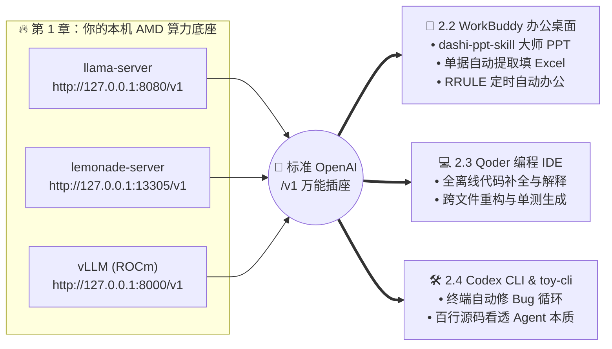

# 第 2 章｜零代码办公先行：把本地大模型接进 WorkBuddy、`Qoder` 与 `Codex`

> **本章使命**：不需要写一行后端代码！把你在第 1 章点亮的本地大模型（`llama-server` / `lemonade-server` / `vLLM`）像插电源一样接进桌面办公神器 **WorkBuddy** 与全离线编程助手 **`Qoder` / `Codex`**，亲手跑通 **大师 PPT 生成、AI 自动填表、日常定时任务自动化** 三大生产力杀手锏，正式建成 **`个人学习助手 v1.0`**！

在很多传统技术教程里，跑通模型后的下一章往往是让你去啃一堆枯燥的框架源码。但我们认为：**最好的学习动力，是今天下午就让本地 AI 替你干完原本要熬夜两小时的活！**

因此在本章中，我们优先面向**每一位同学（无论你是文商科、理工科还是职场办公族）**推出零代码的 **WorkBuddy 桌面智能体办公三件套**，随后再为有写代码需求的同学无缝打通 **`Qoder` IDE** 与 **`Codex CLI` / `toy-cli`**。

---

## 2.1 一图秒懂：为什么一个 `/v1` 接口能通吃所有桌面软件？

在第 1 章结尾，无论你启动的是 `llama-server`（`8080`）、`lemonade-server`（`13305`）还是 `vLLM`（`8000`），我们都反复提到了一个词：**OpenAI 兼容接口（`/v1` API）**。

它到底神奇在哪里？你可以把它想象成家里的 **新国标三孔电源插座**：
- **以前没有统一标准时**：A 厂商的模型只能配 A 软件的插头，换个软件就要重写一套连接代码；
- **现在有了 `/v1` 万能插座**：你的 AMD 显卡在后台默默发电，对外提供一个标准的 `http://127.0.0.1:端口/v1` 插座——无论是做 PPT 的 **WorkBuddy**、写代码的 **`Qoder`**、修终端 Bug 的 **`Codex CLI`**，还是第 8 章里的 **15 款开源趣味应用**，全都自带这个标准插头，**填上地址一秒通电**！



---

## 🛡️ 动手前必立规矩：本地智能体「三条保命安全铁律」

请注意！从本章开始，我们接入的 **WorkBuddy（Craft 模式）**、**`Qoder`** 和 **`Codex`** 都不是只会动嘴皮子的网页聊天框，而是**拥有真实读写你电脑硬盘文件、甚至执行终端命令权限的 Agentic AI（行动派智能体）**！

本地大模型偶尔也会“理解跑偏”。为了让你可以大胆放手让 AI 干活而绝不误删重要文件，请全书严格遵守以下 **三条工程安全铁律**：

### 铁律一：永远只在「纯英文专用沙箱目录（Sandbox）」里授权干活！
- ❌ **绝对禁止**：在 WorkBuddy 或 `Codex` 选择工作目录时，千万不要直接选你的 **「桌面（Desktop）」**、**「我的文档」**、**`C:\` 根目录** 或 **`~` 家目录**！
- ✅ **正确做法**：专门建一个干净的纯英文沙箱文件夹（比如 `D:\ai_workspace\sandbox` 或 `~/ai_workspace/sandbox`）。需要 AI 处理哪几份报销单或提纲，就**复制一份副本放进 `sandbox` 里**让它随便折腾，原件稳如泰山！

### 铁律二：模型权重与大体积产物一律放非系统盘（拯救 C 盘）
- 延续我们在 [1.2 节](../01-first-model/02-rocm-env-setup.md) 配好的习惯，工作区、PPT 渲染中间文件与知识库统一放在空间充裕的工作目录，且路径中**不含中文、空格与特殊符号**。

### 铁律三：批量改名与写表坚持 `Dry-Run`（先预览方案、另存新表，绝不直接覆盖原文件！）
- 当让 AI 批量整理几十份文件或汇总 Excel 时，在提示词里养成加一句口令的好习惯：  
  *“请先列出拟修改的文件对照预览表（或将汇总结果新建写入 `output/` 子目录），**严禁直接删除或覆盖 `inbox/` 下的原始文件**！”*

### ⚡ 现在花 10 秒初始化你的本章专属安全沙箱

打开终端复制运行下面这一行命令，为我们马上要做的 PPT 生成、自动填表和定时任务建好标准目录结构：

```bash
# Linux / macOS 在 ~/ai_workspace 下创建（Windows PowerShell 可改为 mkdir D:\ai_workspace\sandbox\inbox_docs, D:\ai_workspace\sandbox\output）
mkdir -p ~/ai_workspace/sandbox/inbox_docs ~/ai_workspace/sandbox/output
```

---

## 🗺️ 本章 5 节保姆级实操导航

本仓库已在 **[`src/configs/`](https://github.com/datawhalechina/hello-rocm/tree/dev_1.0/src/configs)** 目录下为你提前备好了经过自动化测试校验的 **WorkBuddy、`Qoder` 与 `Codex` 标准配置文件模板**，跟着下面 5 节一步步点亮即可：

1. 🌟 **[2.2.1 接入 WorkBuddy 桌面智能体：三大引擎配置与五大避坑指南](./02-workbuddy-setup.md)**  
   *手把手打通本地模型与 WorkBuddy，彻底避开 `/v1` 路径写重、空 API Key 与 `4K` 上下文截断三大新手深坑。*
2. 🎨 **[2.2.2 办公王牌实战一：用 `dashi-ppt-skill`（大师 PPT）3 分钟生成原生可编辑 PPT](./03-workbuddy-dashi-ppt.md)**  
   *全书只用大师 PPT Skill！内置 1,020 套专业版式与浏览器可视化微调台，一键导出 WPS / PowerPoint 原生可编辑 `.pptx`。*
3. 📊 **[2.2.3 办公王牌实战二与三：AI 自动填 Excel 报表 + 定时任务日常办公值守](./04-workbuddy-excel-and-cron.md)**  
   *对齐 Datawhale WorkBuddy 官方教程：批量抽取杂乱报销单写入 Excel（缺失项自动标 `待确认`），并配好每天自动巡检的定时任务！*
4. 💻 **[2.3 接入 `Qoder` 全离线 AI 编程助手：代码解释、跨文件重构与单测生成](./05-qoder-ide.md)**  
   *断网也能丝滑写代码！把 `Gemma 4 12B` / `Qwen3.5-9B` 接进 `Qoder` IDE 完成三大真实编程闯关。*
5. 🛠️ **[2.4 接入 `Codex CLI` 终端智能体 & 百行源码解剖 `toy-cli`](./06-codex-and-toy-cli.md)**  
   *先体验命令行自动修 Bug，再用 20 分钟逐行拆解本仓库经典百行 Python 智能体 `toy-cli`，一眼看穿所有 Agent 的底层循环！*

---

👉 确认第 1 章的模型服务窗口正在后台运行后，马上开启第一波生产力暴击：**[2.2.1 接入 WorkBuddy 桌面智能体：三大引擎配置与五大避坑指南](./02-workbuddy-setup.md)**！
