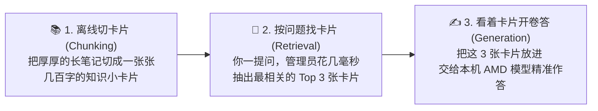

# 3.2 RAG 核心直觉实验：「今天吃什么 · 黑暗料理菜谱切分对比」

> **本节目标**：引用并复现 **[Datawhale `all-in-rag`](https://github.com/datawhalechina/all-in-rag)** 课程中最受好评的破冰实验 —— **「黑暗料理菜谱切分对比实验」**，用 10 分钟彻底悟透 RAG（检索增强生成）的核心命门：**文档切分（Chunking）决定了知识库的智商上限**！

---

## 一、30 秒白话秒懂：RAG 在后台到底干了哪三件事？

想象你电脑里存了一本长达 **50 万字** 的《大学四年全部专业课笔记合集》。当你问本地模型一个具体问题时，为什么要搞 RAG，而不是每次把 50 万字一股脑全塞进对话框？
1. **显存和速度吃不消**：50 万字相当于六七十万个 Token，普通 8G/16G 显卡瞬间爆显存，就算塞进去每问一句话也要等好几分钟；
2. **大海捞针容易走神**：无关的废话太多，反而会干扰小模型的注意力。

因此，**RAG（Retrieval-Augmented Generation，检索增强生成）** 就像一位手脚麻利的图书管理员，只干三步活：



听起来很简单对吧？但**魔鬼全藏在第 1 步「切卡片（Chunking）」里**！下面我们亲手用菜谱做个对照实验，你一秒钟就会笑出声并终身难忘。

---

## 二、🧪 爆笑动手实验：一刀切错，米其林秒变“八角冰糖西红柿炒蛋”！

假设你在本地沙箱里写了一份私房菜谱 `recipes.md`，里面紧挨着记录了三道家常菜：

```markdown
## 西红柿炒鸡蛋
食材：熟透西红柿 2 个、土鸡蛋 3 个、食盐半勺、小葱花少许。
做法：鸡蛋打散下热油滑熟盛出；锅留底油把西红柿炒出红汁，倒回鸡蛋大火翻炒 15 秒，撒盐和葱花出锅。

## 秘制红烧排骨
食材：猪肋排 500g、老冰糖 35g、八角 2 颗、桂皮 1 小段、老抽 2 勺、料酒。
做法：排骨冷水下锅加料酒焯水；小火把老冰糖炒出琥珀糖色，下排骨、八角、桂皮和老抽慢炖 45 分钟收汁。

## 蒜蓉粉丝蒸扇贝
食材：鲜活扇贝 6 只、龙口粉丝 1 把、大蒜 2 头、蒸鱼豉油 2 勺。
做法：粉丝泡软铺底，摆上洗净的扇贝肉，浇上金银蒜蓉酱，水开上锅大火蒸 5 分钟淋热油即可。
```

现在，你的问题是：**“按我的菜谱，做西红柿炒鸡蛋一共要准备哪些调料、怎么炒？”**

### 对比两种切卡片方式，看看检索器拿到了什么！

#### ❌ 方案 A：粗暴按固定字数（每 110 个字符）一刀硬切！
不管段落和标题，够 110 个字就咔嚓剪一刀，结果切出来的 **第 1 张卡片** 长这样：
> `## 西红柿炒鸡蛋 食材：熟透西红柿 2 个、土鸡蛋 3 个、食盐半勺、小葱花少许。做法：鸡蛋打散下热油滑熟盛出...撒盐和葱花出锅。\n## 秘制红烧排骨\n食材：猪肋排 500g、老冰糖 35g、八角 2 颗、桂皮 1 小段...`

看到惨剧是怎么发生的了吗？！
- 这一刀刚好把隔壁《秘制红烧排骨》的**老冰糖、八角、桂皮**连带着切进了《西红柿炒鸡蛋》的卡片末尾！
- 当检索器把这张混血卡片递给老实巴交的本地小模型时，小模型心想：*“主人让我严格依据参考卡片回答，卡片里写了冰糖和八角，可不敢漏掉！”* —— 于是郑重其事地教你往西红柿炒蛋里丢两颗八角和一把老冰糖！

#### ✅ 方案 B：按 Markdown 语义标题（`## `）结构化切分！
遇到二级标题 `## ` 才换一张新卡片，结果切出来整整齐齐 **3 张独立卡片**：
- 卡片 1：完整且纯净的《西红柿炒鸡蛋》
- 卡片 2：完整且纯净的《秘制红烧排骨》
- 卡片 3：完整且纯净的《蒜蓉粉丝蒸扇贝》

检索器精准抽出 **卡片 1** 交给本地模型，回答干净利落、一滴酱油八角都不会串味！

---

## 三、35 行 Python 亲眼复现对比（直接连你本机的 AMD 引擎跑！）

在 `~/ai_workspace/sandbox/` 下新建 `recipe_chunk_demo.py`，把下面这段零额外依赖的对比脚本跑一遍，亲眼见证两种切法喂给本机模型后的真实输出差异：

```python
"""recipe_chunk_demo.py — 复现 all-in-rag 经典菜谱切分对比实验"""
import os
from openai import OpenAI

RECIPES_MD = """## 西红柿炒鸡蛋
食材：熟透西红柿 2 个、土鸡蛋 3 个、食盐半勺、小葱花少许。
做法：鸡蛋打散滑熟盛出；西红柿炒出红汁倒回鸡蛋，撒盐和葱花出锅。
## 秘制红烧排骨
食材：猪肋排 500g、老冰糖 35g、八角 2 颗、桂皮 1 小段、老抽 2 勺。
做法：排骨焯水；老冰糖炒糖色，下排骨八角桂皮慢炖 45 分钟收汁。"""

# 1. 错误切法：按固定 115 字符硬切（导致红烧排骨的食材串进第一块！）
bad_chunks = [RECIPES_MD[i : i + 115] for i in range(0, len(RECIPES_MD), 115)]

# 2. 正确切法：按 Markdown 二级标题 '## ' 语义边界切分
good_chunks = ["## " + block.strip() for block in RECIPES_MD.split("## ") if block.strip()]

print("❌ [硬切第1块(串味了!)]:\n", bad_chunks[0], "\n" + "-" * 50)
print("✅ [按标题语义切第1块(纯净!)]:\n", good_chunks[0], "\n" + "=" * 50)

# 若本机 8080/13305/8000 服务在线，直接让本地模型分别基于两张卡片作答！
if os.getenv("RUN_LIVE_LLM", "0") == "1":
    client = OpenAI(base_url=os.getenv("OPENAI_BASE_URL", "http://127.0.0.1:8080/v1"), api_key="local-rocm")
    model = os.getenv("ROCM_MODEL", "gemma-4-e4b")
    for label, ctx in [("硬切卡片回答", bad_chunks[0]), ("语义切分卡片回答", good_chunks[0])]:
        resp = client.chat.completions.create(
            model=model,
            temperature=0.1,
            messages=[{"role": "user", "content": f"仅根据以下资料列出做这道菜看到的调料：\n<context>\n{ctx}\n</context>"}],
        )
        print(f"\n🍽️ [{label}]:\n{resp.choices[0].message.content}")
```

运行测试：
```bash
# 先秒看切块对比；若第 1 章引擎开着，加 RUN_LIVE_LLM=1 直接看本地模型对比回答！
RUN_LIVE_LLM=1 python ~/ai_workspace/sandbox/recipe_chunk_demo.py
```

---

## 💡 从实验带走「AI 时代记笔记的三条黄金军规」

很多同学问：*“以后我记课堂笔记、整理公司规章文档时，怎么写才能让本地 AI 检索得最准？”*  
答案根本不需要懂算法，只需养成 **3 个清爽的 Markdown 写作好习惯**：

1. **标题层级清晰自包含**：多用二级标题 `## 知识点名称` 分隔独立小节，而且标题尽量写具体（比如写 `## ROCm 10 Windows 驱动要求`，别只写模糊的 `## 注意事项`——因为标题本身就是检索权重最高的路标！）；
2. **一卡一主题（Atomic Notes）**：在 Obsidian 里，与其建一个一万字乱七八糟的《2026杂记.md》，不如拆成十篇各五百字的主题小卡片，再通过 `[[双向链接]]` 串起来；
3. **顶部加上 YAML 小标签**：在重要笔记开头放三行 `tags: [课程名, 考点]`，到了第 4 章你的「知识管理 MCP」就能一秒钟按标签把整门课的重点全捞出来！

---

## 👉 下一节：零代码实战！把 Obsidian 变成你的双链私人问答库

原理和记笔记秘诀全都装进兜里了！接下来我们不装任何复杂的向量数据库容器，直接用最优雅的 **`WorkBuddy + Obsidian`** 组合，15 分钟搭好你的私人第二大脑，并完成 **10 道开卷防幻觉自测题**：

➡️ **[3.3 & 3.4 私人第二大脑实战：`WorkBuddy + Obsidian` 双链知识库与 10 题防幻觉自测](./03-workbuddy-obsidian-rag.md)**
