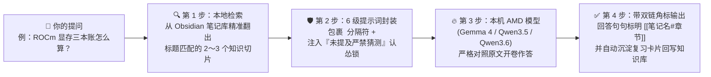

# 第 3 章｜让助手读懂你：6 级提示词工程与私人笔记库 RAG 实战

> **本章使命**：掌握让本地 4B～12B 模型智商跃升的 **「6 级结构化提示词法则」**，亲手跑通妙趣横生的 **「黑暗料理菜谱切分实验」**，并用 **`WorkBuddy + Obsidian`** 零代码搭好句句带真实 `[[双向链接]]` 出处角标的私人第二大脑，正式解锁 **`个人学习助手 v1.5`**！

在第 2 章里，我们已经用本地 AMD 大模型爽快地跑通了做 PPT、填 Excel 和改代码。但只要你试着问它一句**只有你自己才知道的私有信息**——比如：
- *“根据我们这学期《操作系统》王老师第三周课件，进程调度的期末必考公式是哪两个？”*
- *“翻一下我上个月记的实验踩坑日记，上次串口通信丢包最后是怎么修好的？”*

你会发现，如果不把笔记喂给它，再强的模型也只能两手一摊，甚至开始**一本正经地胡说八道（大模型幻觉，Hallucination）**！

本章就带你用最轻巧、零数据库负担的方式，彻底治好本地模型的“失忆症”与“瞎编症”。

---

## 一、一张表分清：什么时候靠「提示词」？什么时候上「RAG 知识库」？

很多初学者一遇到模型答不好，第一反应就是*“我是不是得去重新训练（微调）模型？”*  
其实在工业界，**90% 的日常私有知识问答根本不需要微调，靠「好提示词 + RAG（检索增强生成）」就能完美解决！** 先花 1 分钟记住这张黄金决策表：

| 你的真实需求 | 该用哪一招？ | 生活中的直观比喻 | 所在章节 |
|:---|:---|:---|:---|
| 手头已经有这篇文本，想让模型**按固定格式提炼、翻译、改写或分步推理** | **🎯 结构化提示词（Prompt）** | 给聪明的实习生发一份**条理清晰的《任务说明书》** | **本章 3.1 节** |
| 答案藏在你电脑里**几百篇 Markdown 笔记、PDF 讲义或规章制度**里，没法一次性全塞进对话框 | **📚 检索增强生成（RAG）** | 考试允许**带字典翻书开卷考**，先翻到对应那两页再照着答 | **本章 3.2～3.4 节** |
| 想让模型**主动调用外部软件接口、跨软件查库或自动执行多步动作** | **🔌 MCP 工具与 Agent Skills** | 给实习生配一台**联网电脑与标准操作SOP手册** | **第 4 章** |
| 模型死活学不会某种**高难度内部缩写抽取格式**，或者你想让它**彻底模仿你本人的微信说话语气** | **🧬 LoRA 模型微调（Fine-Tuning）** | 送实习生去参加**为期一周的专项岗前封闭培训** | **第 5 章** |

---

## 二、本章架构全景图：`助手 v1.5` 是如何实现“零幻觉开卷答题”的？

---

## 🗺️ 本章 3 节循序渐进实操导航

1. 🎯 **[3.1 提示词闯关实训：6 关彻底驯服本地中小模型（附真题对比）](./01-prompt-6-levels.md)**  
   *为什么同一颗 `Gemma 4 E4B` 在别人手里像资深专家，在新手手里像迷糊蛋？6 组前后对比立竿见影！*
2. 🍳 **[3.2 RAG 核心直觉实验：「今天吃什么 · 黑暗料理菜谱切分对比」](./02-chunking-intuition.md)**  
   *联动 Datawhale `all-in-rag` 经典实验！用 40 行小脚本亲眼看看“乱切文档”是怎么让 AI 做出“八角冰糖炒西红柿鸡蛋”的。*
3. 🧠 **[3.3 & 3.4 私人第二大脑实战：`WorkBuddy + Obsidian` 双链知识库与 10 题防幻觉自测](./03-workbuddy-obsidian-rag.md)**  
   *全程零代码！搭好永久属于你自己的本地双链笔记库，并用 10 道科学开卷考题拿到作品集第 2 份评测成绩单！*

---

👉 让我们先从回报率最高、学完每一章都能立刻受用的基本功开始：**[3.1 提示词闯关实训：6 关彻底驯服本地中小模型](./01-prompt-6-levels.md)**！
