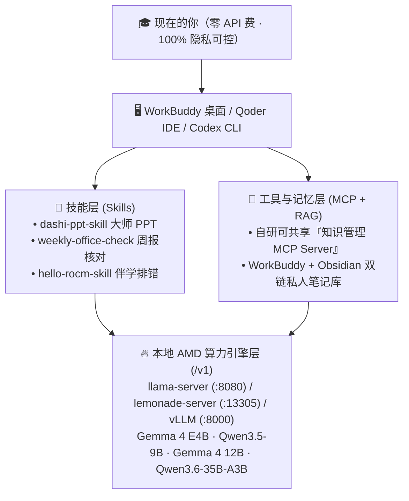

# 4.4 本地 Agent 安全护栏、`个人学习助手 v2.0` 验收与进阶导流

> **本节目标**：为你的本地智能体配齐工业级 **「四道工程安全护栏」**，完成全书上半场最重磅的阶段性成果 —— **`个人学习助手 v2.0`（私人笔记 RAG + 可共享知识管理 MCP + 自定义办公 `SKILL.md`）** 验收打卡，并通过真实体验复盘自然开启下半场的 **中文微调（第 5 章）** 与 **量化提速（第 6 章）** 之旅！

---

## 一、给本地智能体系紧「四道工程安全护栏」

能力越大，边界越要清晰。相比只在网页沙盒里打字的纯聊天机器人，连接了 MCP 工具与文件系统后的本地 Agent 具备真实改变外部状态的能力。在自己开发或使用任何本地智能体时，请逐条核对以下 **4 道必配安全护栏**（这也是面试官考察你“做没做过真 Agent 工程”的试金石！）：

| 护栏编号 | 防御什么风险？ | 具体工程落地方案（本书已全部内置示范！） |
|:---|:---|:---|
| **🛡️ 护栏 1：目录边界硬隔离** （Path Confinement） | 防止模型幻觉传入 `../../` 越权读取或覆盖系统目录与私人敏感区 | 绝不只靠提示词口头警告！必须在工具函数代码层做 `Path.resolve().is_relative_to(vault_root)` 硬校验（见 `4.2` 节 `server.py`）。 |
| **🔁 护栏 2：最大步数熔断与低温采样** （Loop Circuit Breaker） | 防止 4B～9B 模型在某个工具报错时死钻牛角尖、无限循环刷爆显卡 | ① 客户端设置单次任务最大工具调用轮数 `maxSteps = 8 ~ 10`； ② 工具调用场景将采样温度压低至 **`temperature = 0.1 ~ 0.2`**。 |
| **🚦 护栏 3：读写权限分级审批** （Human-in-the-Loop） | 防止自动执行高危删除、覆盖原表或外发邮件动作 | • **只读类工具**（如 `search_notes`、`list_notes_by_tag`）：设为自动放行，保持丝滑体验； • **写删/命令类工具**（如删除文件、执行 Shell）：开启 `on-request` 人工点击确认或强制只写 `output/` 新文件。 |
| **🔑 护栏 4：敏感密钥 `.env` 物理隔离** （Secret Hygiene） | 防止把知识库 MCP 分享给同学或推上 GitHub 时不小心泄露高德/飞书等外部 API Key | 所有第三方 API Key 一律存放在本地 `.env` 文件中（仓库仅提交 `.env.example` 占位模板），并在 `.gitignore` 中永久屏蔽 `.env`！ |

---

## 二、🏆 里程碑大验收：恭喜建成「个人学习助手 v2.0」！

走到这里，你已经完成了从“第 0 章面对裸机一头雾水”到 **独立搭建一套全栈本地 Agentic AI 办公与知识中枢** 的壮举！让我们对照验收你的 **`个人学习助手 v2.0` 全景能力清单（作品集素材 #3）**：

### ✅ `助手 v2.0` 五项通关核验打钩表

- [x] **三大引擎标准底座在线**：本地 `/v1` 接口支持 `32,768` 上下文与原生工具调用；
- [x] **办公自动化三件套跑通**：能用 `dashi-ppt-skill` 导出可编辑 `.pptx`、能零幻觉自动填 Excel、能跑日常定时任务；
- [x] **私人双链笔记库就绪**：Obsidian 笔记问答句句带 `[[文件名#小节]]` 出处，超纲陷阱题零瞎编；
- [x] **可共享知识管理 MCP 跑通**：`TestKnowledgeMCPServer` 单元测试全绿，已在客户端成功调通 `search_notes` / `create_note_card` / `list_notes_by_tag`，掌握打包或 SSE 分享给他人调用的方法；
- [x] **省显存自定义办公 Skill 生效**：`weekly-office-check/SKILL.md` 能与知识库 MCP 协同生成结构化周报。

---

## 三、真实重度使用后的「痛点复盘」：为什么我们还需要第 5 章和第 6 章？

如果你是一个纯粹的日常使用者，其实用到现在的 `助手 v2.0` 已经能帮你省下每天一两个小时的重复劳动了！  
但当你连续用它处理更刁钻的任务时，你一定会敏锐地察觉到 **两个让人忍不住想动手改造的痛点**——而这恰恰就是区分“普通工具使用者”与“真正懂大模型工程的开发者”的分水岭：

### 痛点一：“遇到充满口语缩写和倒装的中文微信群通知，小模型偶尔还是会抽错字段；而且让它帮我写朋友圈或小红书文案时，总有一股浓浓的机械 AI 客服味！”
- **原因诊断**：提示词和 RAG 只能给模型递参考书，却改不了模型骨子里的语言习惯与特定格式肌肉记忆。
- **破局武器** 👉 **[第 5 章｜能力不够？亲手做你的第一次中文模型 LoRA 微调](../05-fine-tune/index.md)**！我们将用一张消费级 AMD 显卡，带你完成 **5 分钟弱智吧破冰实验 + 中文群通知 JSON 精准提取微调 + `WeClone` 个人微信聊天分身 / 小红书种草体微调**，并用客观评测脚本算出实打实的准确率涨幅！

### 痛点二：“挂上大师 PPT、十几个 MCP 工具和几万字文档后，每次发消息要等好几秒才蹦出第一个字；或者我想把微调好的 `BF16` 大模型塞进 8G/16G 显卡飞快跑起来，该怎么压、怎么加速？”
- **原因诊断**：原版 `BF16` 权重体积大、搬运占满显存带宽，且多轮长前缀重复计算拖慢了首字响应（TTFT）。
- **破局武器** 👉 **[第 6 章｜速度不够？AMD Quark 量化对比、零 C++ 算子加速与 `Hyperloom` 自动寻优](../06-optimize-speed/index.md)**！**全程不写一行 C++ 代码**，带你跑通单模型量化前后体积与速度实测对比，点亮 `AITER` 融合算子与多智能体自动调优！

---

## 🔗 本章课程引用与进阶导流：直通 `hello-agents`

在本章中，我们聚焦于使用工业标准协议（MCP 与 `SKILL.md`）快速构建实用的单智能体办公与知识管理闭环。

如果你在读完 `2.4` 节的 `toy-cli` 和本章的 `FastMCP` 后意犹未尽，渴望**从底层纯 Python 代码手搓一整套完整的现代智能体框架**——包括：
- 亲手从零实现 **ReAct、Plan-and-Solve（先规划后执行）、Reflection（自我反思修正）** 三大经典范式；
- 设计智能体的 **短期工作记忆 + 长期向量/图谱记忆系统**；
- 编排 **MCP + A2A（Agent-to-Agent 多智能体分工协作，如产品经理 Agent + 架构师 Agent + 测试工程师 Agent 组团开发软件）**；

强烈推荐无缝进阶学习本章一对一联动的 Datawhale 爆款专精课程 —— **[`datawhalechina/hello-agents`（《从零开始构建智能体》）](https://github.com/datawhalechina/hello-agents)**！

---

## 👉 推开下半场大门：亲手训练一颗“专属于你”的中文模型！

系好安全带，让我们正式从“模型调用与智能体组装者”进阶为“模型训练师”：

➡️ **[进入第 5 章｜能力不够？亲手做你的第一次中文模型微调（LoRA 实战与客观评测）](../05-fine-tune/index.md)**
