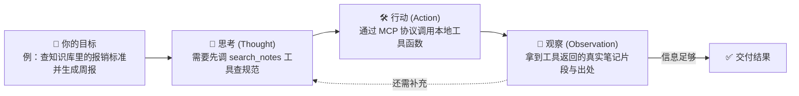

# 第 4 章｜让助手长出手脚：知识管理 MCP、Agent Skills 与智能体实战

> **本章目标**：看懂智能体 `观察 → 思考 → 行动` 闭环，**亲手把第 3 章搭建的个人知识库制作成标准的「知识管理 MCP 服务」供跨软件及他人调用**，并编写省显存的自定义办公 `SKILL.md`，正式建成 **「个人学习助手 v2.0」**！

---

## 4.1 智能体核心循环（`观察 → 思考 → 行动`）与趣味 MCP 初体验

普通聊天模型只有“嘴巴”，而 **Agent（智能体）** 同时拥有大脑与手脚。引用 **[Datawhale `hello-agents`](https://github.com/datawhalechina/hello-agents)** 中的经典 ReAct 闭环，每一次智能体帮你干活都经历以下三步循环：



其中，**MCP（Model Context Protocol，模型上下文协议）** 就是 AI 界的 **“USB-C 万能扩展坞”** —— 只要按 MCP 标准写好一次工具服务，无论是 **WorkBuddy**、**`Qoder`** 还是 **Codex**，插上就能立刻调用（比如一键挂载高德地图 MCP 查天气排旅行路线，详见本仓库第 8 章案例与 [`src/cases/hello-agents`](https://github.com/datawhalechina/hello-rocm/tree/dev_1.0/src/cases/hello-agents)）。

---

## 4.2 🌟 核心实战：把你的「个人知识库」制作成可共享的 `知识管理 MCP`

与其只调别人的现成工具，不如直接把你在第 3 章用心积累的 **Obsidian 个人知识库** 封装成一个标准的 **`知识管理 MCP Server`**！这样做有两大超级价值：
1. **你自己的全软件互通**：在 `Qoder` 写代码时也能直接查 Obsidian 里的技术踩坑笔记，在 WorkBuddy 聊天时随手一句话就能往知识库新增双链卡片；
2. **打包给别人调用**：把服务脚本连同专题知识库（如《实验室设备操作手册库》《课程复习题库》）发给师弟师妹或队友，他们的 AI 助手挂载后瞬间继承你的全部经验！

### Step 1：安装依赖并运行仓库内置的「知识管理 MCP」源码

本仓库已为你编写并通过完整单元测试（含目录穿越安全拦截）的开箱即用源码：**[`src/main-assistant/knowledge_mcp/server.py`](https://github.com/datawhalechina/hello-rocm/blob/dev_1.0/src/main-assistant/knowledge_mcp/server.py)**。

它通过官方 `FastMCP` 装饰器（`@mcp.tool()`）向外暴露了 **3 个标准知识管理工具**：
- `search_notes(query, top_k=5)`：检索相关笔记标题、正文片段与精确出处路径；
- `create_note_card(title, content, tags, folder)`：安全写入带 YAML 标签与双链的 Markdown 笔记卡片；
- `list_notes_by_tag(tag)`：按 `#标签` 或 YAML `tags` 盘点专题笔记清单。

在你的虚拟环境中安装轻量依赖：

```bash
uv pip install -r src/main-assistant/knowledge_mcp/requirements.txt
```

### Step 2：在 WorkBuddy / `Qoder` / Codex 中一键挂载

在 WorkBuddy 或 `Qoder` 的 **MCP Servers 配置** 中添加以下标准 JSON（将 `OBSIDIAN_VAULT_PATH` 改成你的真实笔记目录即可）：

```json
{
  "mcpServers": {
    "my-knowledge-vault": {
      "command": "python3",
      "args": ["/你的绝对路径/hello-rocm/src/main-assistant/knowledge_mcp/server.py"],
      "env": {
        "OBSIDIAN_VAULT_PATH": "/你的绝对路径/my-obsidian-vault"
      }
    }
  }
}
```

### Step 3：如何分享给队友/别人调用？

- **方式 A（开源知识包共享，最推荐）**：将 `server.py`、`requirements.txt` 与你的专题 Markdown 文件夹一起打包发给队友（或推上 GitHub），对方只需配好上面 8 行 JSON 即可离线调用！
- **方式 B（局域网多人共享调用）**：将 `server.py` 末尾的 `server.run()` 改为 `server.run(transport="sse")` 启动局域网 HTTP/SSE 端点，团队成员无需拷贝文件即可远程检索同一套团队知识库！

---

## 4.3 模块化技能包 Agent Skills（`SKILL.md`）：拯救本地小模型显存的秘籍

> ❓ **思考题**：既然有了 MCP 工具，为什么还需要 `SKILL.md`（Agent Skills）？

答案藏在第 1 章算过的 **显存草稿纸（KV Cache）账单** 里！
- 如果你把做 PPT 规范、周报排版规范、代码审查规范共 2 万字全部塞进系统提示词（System Prompt），本地 8G/16G 显卡还没开始干活，上下文显存就先被吃掉一大半，首字等待也会变慢！
- 而 **`SKILL.md` 采用「渐进式披露（Progressive Disclosure）」机制**：平时智能体启动时，**只读取每个 `SKILL.md` 顶部 YAML 里的 `name` 和 `description` 两行摘要（仅占几十个 Token！）**；只有当你真正在对话中提到“帮我核对报销表并出周报”时，它才会按需打开对应的 `SKILL.md` 全文！

### 动手编写并加载你的专属办公 `SKILL.md`

查看本仓库为你准备的标准范例 **[`src/main-assistant/skills/weekly-office-check/SKILL.md`](https://github.com/datawhalechina/hello-rocm/blob/dev_1.0/src/main-assistant/skills/weekly-office-check/SKILL.md)**（你也可以对比阅读本仓库的伴学技能 [`src/hello-rocm-skill/SKILL.md`](https://github.com/datawhalechina/hello-rocm/blob/dev_1.0/src/hello-rocm-skill/SKILL.md)）：

```bash
# 一行命令将该技能同时装入 WorkBuddy (.codebuddy/skills) 与 Qoder/Codex (.agents/skills)
mkdir -p .codebuddy/skills .agents/skills
cp -r src/main-assistant/skills/weekly-office-check .codebuddy/skills/
cp -r src/main-assistant/skills/weekly-office-check .agents/skills/
```

现在对 WorkBuddy 或 `Qoder` 说一句：“按周报核对技能，从我的知识库 MCP 中调取本周笔记并生成周报”，体验 **MCP（手脚查数据）+ Skill（大脑守规矩）** 双剑合璧的威力！

---

## 4.4 本地 Agent 安全护栏与真实痛点复盘（引出第 5、6 章）

在使用本地 `4B` / `8B` 模型跑通 **「个人学习助手 v2.0」（私人笔记 RAG + 知识管理 MCP + 自定义办公 `SKILL.md`）** 后，记得在客户端设置最大工具循环步数（如 `maxSteps = 10`）防止小模型死循环。

与此同时，在真实高频使用中，你一定会敏锐地发现本地小模型的**两个进阶瓶颈**：
1. **能力瓶颈**：“遇到满是口语缩写的中文群通知，4B 小模型偶尔会把工具调用的 JSON 括号写漏，或者写文案总有一股浓浓的机械 AI 客服味！” ➡️ **这正是 [第 5 章｜动手做第一次中文模型微调](../05-fine-tune/index.md) 要彻底解决的痛点！**
2. **速度瓶颈**：“挂载了十几个工具和长文档后，每次发消息要等好几秒才蹦出第一个字，能不能让我的 AMD 显卡再快一倍？” ➡️ **这正是 [第 6 章｜AMD 量化对比与算子自动加速](../06-optimize-speed/index.md) 要大显身手的舞台！**

---

## 🔗 本章课程引用与进阶导流

想穿透现成软件表象，用纯 Python **从零亲手实现 ReAct、Plan-and-Solve、Reflection 智能体架构、长期记忆系统以及 A2A 多智能体协同编排**？强烈推荐深入学习本章联动的 Datawhale 王牌专精课程 —— **[`hello-agents`（从零开始构建智能体）](https://github.com/datawhalechina/hello-agents)**！
