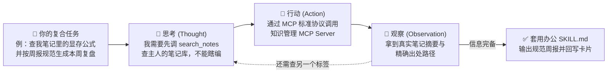
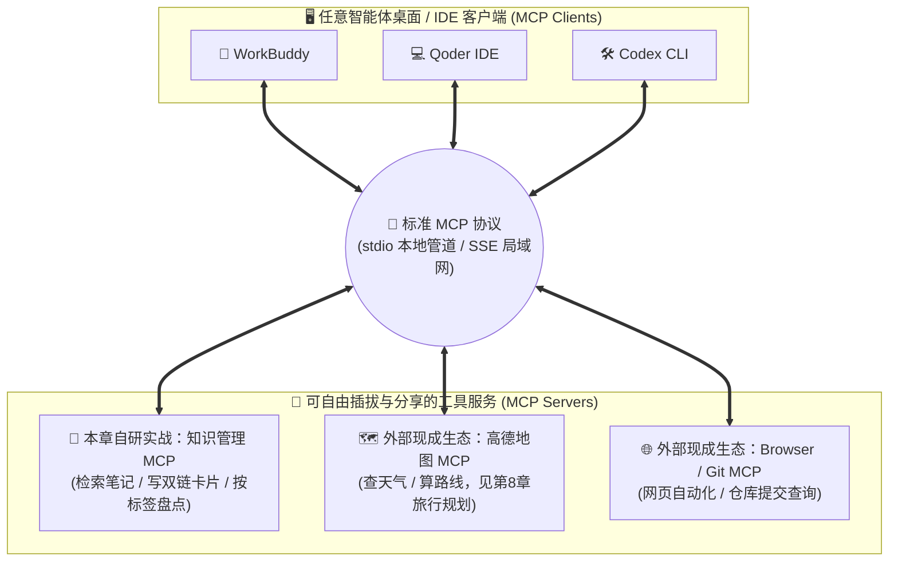

# 第 4 章｜让助手长出手脚：把个人知识库做成可共享 MCP 与自定义 Skills

> **本章使命**：吃透智能体 **`观察 → 思考 → 行动`（ReAct）** 核心原理，用官方 `FastMCP` **把你在第 3 章搭好的 Obsidian 个人知识库封装成标准的「知识管理 MCP 服务」（既能自己跨软件调，也能打包给同学/同事直接调用！）**，再配上省显存的自定义办公 `SKILL.md` 与安全护栏，正式交付全书核心里程碑 —— **`个人学习助手 v2.0`**！

在第 3 章结束时，我们已经拥有了一个在 WorkBuddy 里很好用的 Obsidian 双链笔记库。但很快你就会遇到两个极具价值的进阶诉求：
1. **跨软件无缝互通**：当你在 **`Qoder` IDE** 里写代码遇到一个老报错，或者在 **`Codex CLI`** 终端里配环境时，难道还得切回 Obsidian 手动翻笔记？能不能让所有软件共享同一个“私人记忆插座”？
2. **把你的知识沉淀变成别人也能调用的服务**：如果你是课题组大师兄、课程助教或团队技术骨干，整理好了一套《实验室设备避坑指南》或《部门业务规范库》，**怎么把它做成一个标准的即插即用模块，发给师弟师妹或队友，让他们的本地 AI 助手一秒继承你的毕生功力？**

本章的主角 **MCP（Model Context Protocol）** 与 **Agent Skills（`SKILL.md`）**，正是当今 Agentic AI 时代最优雅的标准答案！

---

## 4.1 一图看懂：ReAct 智能体循环与 AI 界的“USB-C 万能扩展坞”

### 一、从“动嘴聊天”到“动手干活”：ReAct 三步循环

引用 **[Datawhale `hello-agents`](https://github.com/datawhalechina/hello-agents)** 中的经典智能体范式，一个真正的 Agent 并不是算命先生那样一口气瞎猜到底，而是像人类工程师一样遵循 **`Thought（思考） → Action（行动） → Observation（观察）`** 的闭环：

---

### 二、为什么全世界都在拥抱 MCP（模型上下文协议）？

在没有 MCP 之前，生态是碎片化的：如果你想让自己的知识库同时支持 WorkBuddy、`Qoder`、Codex 和 Claude，你得按四个软件各自的私有插件格式写四遍代码（$N \times M$ 适配地狱）。

而 **MCP（Model Context Protocol）** 就像电子产品界的 **“USB-C 万能扩展坞标准”**：
- **左端插任何宿主软件（MCP Client）**：WorkBuddy、`Qoder`、Codex CLI、OpenClaw 全都原生自带 USB-C 母口；
- **右端插任何工具服务（MCP Server）**：只要你用几十行 Python 按 MCP 标准写一次服务，全世界所有支持 MCP 的 AI 软件**一行代码不用改，插上就能直接调用**！

---

### 三、热身小体验：MCP 到底有多简单？（8 行 JSON 的魔法）

在任何支持 MCP 的客户端（如 WorkBuddy 或 `Qoder` 的 `MCP Servers` 设置页）里，挂载一个 MCP 服务根本不需要改软件源码，本质上就是填一段短短的“启动说明书”：
- 如果是别人发布在 npm 上的现成工具（比如第 8 章智能旅行规划案例用到的大热门高德地图 MCP），填入 `npx` 命令和存在 `.env` 里的 API Key 就能立刻查天气排路线；
- 而更酷、完全零外部网络依赖的，是**亲手用 Python `FastMCP` 把你自己的本地知识库写成这样一个标准服务**！

---

## 🗺️ 本章 3 节硬核实战导航

1. 🌟 **[4.2 核心实战：把个人知识库制作成可共享的「知识管理 MCP Server」](./02-knowledge-mcp-server.md)**  
   *逐行剖析本仓库 [`src/main-assistant/knowledge_mcp/server.py`](https://github.com/datawhalechina/hello-rocm/blob/dev_1.0/src/main-assistant/knowledge_mcp/server.py) 满分源码，在 WorkBuddy 与 `Qoder` 跨软件打通，并学会打包离线分享与局域网 SSE 共享两种给别人调用的方式！*
2. 📦 **[4.3 模块化技能包 Agent Skills（`SKILL.md`）：拯救本地小模型显存的秘籍](./03-custom-office-skill.md)**  
   *算清为什么 `SKILL.md` 渐进式披露能省下 90% 系统提示词显存，亲手编写你的第一个办公自动核对技能并与知识库 MCP 联动！*
3. 🛡️ **[4.4 本地 Agent 安全护栏、`个人学习助手 v2.0` 验收与进阶导流（`hello-agents`）](./04-safety-guardrails.md)**  
   *配齐防越权、防死循环四大工程护栏，完成 `助手 v2.0` 里程碑验收，并定位引出第 5、6 章的两大优化方向！*

---

👉 挽起袖子，马上开始全书最有工程成就感的自研实战之一：**[4.2 核心实战：把个人知识库制作成可共享的「知识管理 MCP Server」](./02-knowledge-mcp-server.md)**！
