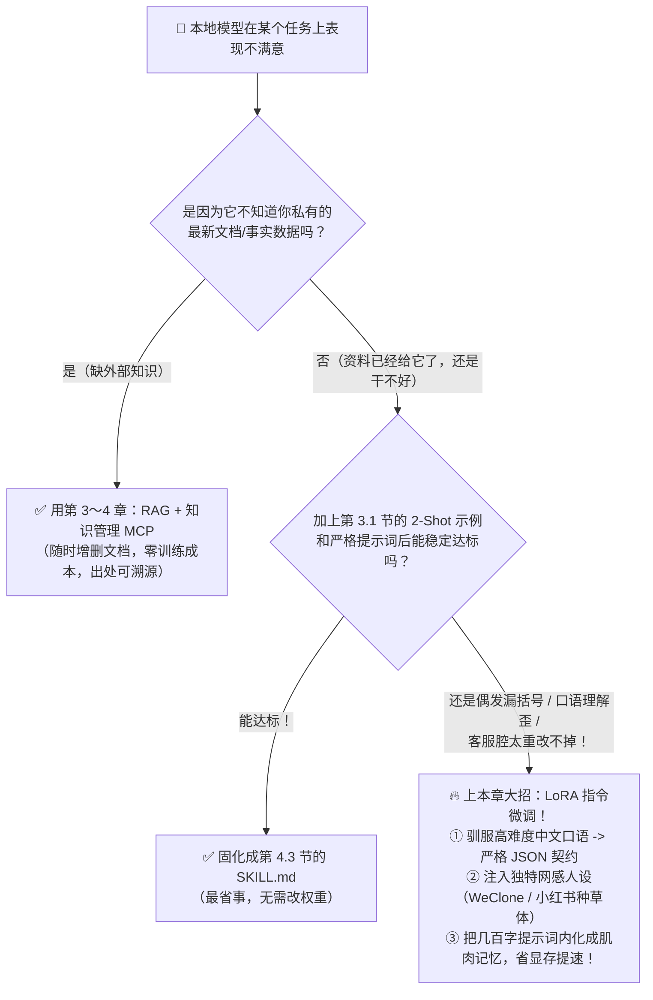

# 第 5 章｜能力不够？亲手做你的第一次中文模型微调（LoRA 实战与客观评测）

> **本章使命**：全流程基于国内免翻墙的 **魔搭社区（ModelScope）+ `LLaMA-Factory` + `SwanLab`** 纯中文生态，在单张消费级 AMD 显卡（或免费云算力）上跑通人生第一次 **中文大模型 LoRA 微调**——从 **5 分钟弱智吧破冰实验**，到 **中文群通知 JSON 精准提取主线微调与客观评测**，再到趣味十足的 **`WeClone` 个人微信聊天分身 / 小红书爆款种草体**！

很多零基础同学一听到“训练/微调大模型”，脑海里立刻浮现出上百张昂贵服务器轰鸣的画面，觉得那只有大厂研究院才玩得起。

但今天你将在自己的电脑上亲眼打破这个迷思：**借助精巧的 LoRA（低秩自适应）技术，哪怕是一张 8G～16G 显存的家用 AMD Radeon 显卡，也能在十几分钟内把一颗通用开源模型“调教”成懂你内部格式规矩、甚至说话语气跟你本人如出一辙的专属定制模型！**

---

## 5.1 动手前先避开头号深坑：到底什么时候才该做微调（Fine-Tuning）？

在业界流传着一句血泪名言：**“不要用微调去教模型背诵天天变化的事实，要用微调去教模型掌握稳定的规矩、格式与说话风格！”**

为什么？假设你们公司下周换了无线网密码或更新了报销额度，如果你靠微调往模型脑子里硬塞，每次改一个数字你都得重新训练一遍，而且微调极易产生事实幻觉；这种“查动态知识”的活，交给第 3 章的 **Obsidian 知识库 RAG** 1 秒钟改完 `.md` 文件就生效了！

请牢记这张面试必考的 **「Prompt vs RAG vs LoRA 微调」黄金决策树**：

---

## 🛠️ 本章纯中文零门槛技术栈与硬件对号入座

为了让国内每一位同学都能一口气跑通、绝不卡在海外网络报错上，本章 100% 锁定全中文友好工具链：
1. **模型与中文数据集源**：**魔搭社区（ModelScope）**（设置 `USE_MODELSCOPE_HUB=1` 自动国内满速拉取）；
2. **微调瑞士军刀**：**[`hiyouga/LLaMA-Factory`](https://github.com/hiyouga/LLaMA-Factory)**（同时支持零代码网页点选 `WebUI` 与可复现的一键 YAML 命令行）；
3. **训练曲线可视化看板**：**[`SwanLab`](https://swanlab.cn/)**（国产开源训练监控神器，实时绘出漂亮的 Loss 下降曲线，直接截图放进第 7 章简历作品集！）。

### 你的硬件该选哪颗模型微调？

| 你的算力环境 | 推荐微调底座模型 | 精度与显存占用预估 | 通关建议 |
|:---|:---|:---|:---|
| **🟢 8G～12G 独显** | **`Gemma 4 E4B`**（或超轻量练手 `Qwen3-0.6B` / `1.7B`） | 开启梯度检查点 `BF16` LoRA 约 **6.5 GB ～ 10.5 GB** | 把 `cutoff_len` 设为 `1024`、`batch_size=1`，单卡丝滑跑完！ |
| **🔵 16G～24G 甜点独显** | **`Qwen3.5-9B`** 或 **`Gemma 4 E4B`** | `BF16` LoRA 约 **13 GB ～ 21 GB** | **中文微调主力甜点**！注意在 ROCm 上优先直接用原生稳健的 **`BF16` LoRA**，比第三方 `bitsandbytes` 4bit 更稳更快！ |
| **🟣 64G+ AI PC / ☁️ 云算力** | **`Qwen3.5-9B`** / **`Gemma 4 12B`** | 显存宽裕，可调大 `batch_size` 与 `cutoff_len=2048` | 在 [AMD Radeon Cloud](../cloud/amd-radeon-cloud.md) 大显存实例上几分钟即可训完 3 个 Epoch！ |

---

## 🗺️ 本章 4 节循序渐进实操导航

1. 🧪 **[5.2 直觉算清 LoRA 显存账 + 5 分钟「弱智吧（`COIG-CQIA`）」中文破冰实验](./02-lora-and-ruozhiba.md)**  
   *看懂为什么贴两张“透明便利贴矩阵”就能省下 90% 训练显存，零代码点开 WebUI 亲眼看着 Loss 曲线一路下降，治好小模型被中文谐音双关忽悠的毛病！*
2. 📋 **[5.3 主线实战：中文办公群通知 JSON 精准提取微调（含隐私脱敏铁律）](./03-office-json-sft.md)**  
   *反哺我们的个人办公助手！清洗构造 200 条口语化中文群通知训练集，训出 100% 严守 JSON 契约的办公专精适配器并合并导出。*
3. 📊 **[5.4 拒绝凭感觉吹牛！自建中文测试集微调前后客观评测实战](./04-eval-before-after.md)**  
   *运行本仓库单元测试护航的 [`eval_before_after_zh.py`](https://github.com/datawhalechina/hello-rocm/blob/dev_1.0/src/main-assistant/eval/eval_before_after_zh.py)，在严格隔离的测试集上跑出微调前 vs 微调后的硬核涨分表！*
4. 🎭 **[5.5 趣味进阶专场（网感与分身）：`WeClone` 微信聊天数字分身 / 小红书爆款种草体](./05-weclone-and-xhs.md)**  
   *全书人气最高选修实战！彻底消灭“作为一个人工智能”机械客服腔，打造说话神态和你一模一样的本地赛博分身，并无缝导流 Datawhale 王牌课 [`happy-llm`](https://github.com/datawhalechina/happy-llm)！*

---

👉 先用 5 分钟揭开微调的神秘面纱，亲眼跑出你人生第一条漂亮的 Loss 下降曲线：**[5.2 直觉算清 LoRA 显存账 + 5 分钟「弱智吧（`COIG-CQIA`）」中文破冰实验](./02-lora-and-ruozhiba.md)**！
