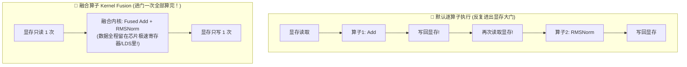

# 6.3 零 C++ 代码算子加速：三招唤醒 `@torch.compile`、`hipBLASLt` 与 `AITER`

> **本节目标**：不写一行 C++ / HIP 底层代码！先用“外卖骑手合并顺路单”的直觉秒懂什么是 **算子融合（Operator Fusion）**，再掌握三个开箱即用的 AMD 官方加速开关 —— **`@torch.compile`**、**`hipBLASLt`** 与 **`ROCm/AITER` 高性能推理算子库**！

---

## 一、1 分钟直觉：为什么“算子不融合”，再猛的显卡也在干等？

假设你在 PyTorch 里写了一行再普通不过的大模型计算：`y = rms_norm(x + residual)`（先把残差加起来，再做一次层归一化）。

在默认未优化的逐算子模式（Eager Mode）下，显卡居然像个死板的快递员一样干了 **两趟冤枉活**：
1. **第一趟**：把大矩阵 `x` 和 `residual` 从慢速显存（VRAM）搬进高速计算核心算完加法，然后**又傻乎乎地把中间结果写回慢速显存**；
2. **第二趟**：下一微秒，为了算 `rms_norm`，**又把刚刚写回显存的中间结果重新从显存搬回计算核心**算一遍！



看懂了吗？**算子融合（Kernel Fusion）** 就是让外卖小哥把同一栋楼的三单餐一次性拎上楼送完，彻底省掉中间来回上下电梯（读写显存）的耗时！

最棒的是：在 ROCm 10 时代，**你完全不需要自己用 C++ 手写融合算子**，下面这 **3 把官方现成金钥匙** 拧开就能直接享受融合红利！

---

## 二、第一招：一行装饰器 `@torch.compile` —— 自动生成 Triton 融合内核！

PyTorch 2.x 在 ROCm 上原生集成了 OpenAI Triton 编译器后端（`TorchInductor`）。你只需要在普通 Python 函数头上轻轻加一行 **`@torch.compile`**，它就会在首次运行时自动分析你的计算图，把零碎的加减乘除和激活函数自动合并编译成极速 GPU 融合内核！

花 30 秒在你的 `.venv` 终端里亲手跑这段 **20 行同台测速实验**（零门槛见证不写 C++ 带来的真实提速！）：

```bash
python -c "
import time, torch

def swiglu_block(x, gate, up):
    # 大模型每层必跑的核心 SwiGLU 计算：包含两次激活与逐元素乘加，最适合算子融合！
    return torch.nn.functional.silu(x @ gate) * (x @ up)

compiled_swiglu = torch.compile(swiglu_block)

x = torch.randn(4096, 4096, device='cuda', dtype=torch.bfloat16)
g = torch.randn(4096, 4096, device='cuda', dtype=torch.bfloat16)
u = torch.randn(4096, 4096, device='cuda', dtype=torch.bfloat16)

# 预热触发首次自动编译（首次会花几秒编译 Triton 内核，属正常现象！）
for _ in range(3):
    _ = swiglu_block(x, g, u)
    _ = compiled_swiglu(x, g, u)
torch.cuda.synchronize()

for name, fn in [('🐢 原生未融合 PyTorch', swiglu_block), ('🚀 @torch.compile 自动融合后', compiled_swiglu)]:
    t0 = time.perf_counter()
    for _ in range(30):
        _ = fn(x, g, u)
    torch.cuda.synchronize()
    print(f'{name}: 30轮平均单次耗时 {(time.perf_counter()-t0)/30*1000:.2f} ms')
"
```

---

## 三、第二招：矩阵乘加速阀门 `TORCH_BLAS_PREFER_HIPBLASLT=1`

在大模型里，70% 以上的重体力活都是巨型矩阵乘法（GEMM）。AMD 专门为现代 AI 矩阵指令与混合精度（`BF16` / `FP8`）打造了新一代高性能矩阵库 **`hipBLASLt`**（不仅支持自动为你的特定矩阵尺寸挑选最快分块算法，还能把矩阵乘后面的偏置加法和激活函数顺手融合掉！）。

在运行 PyTorch 推理、微调或评测脚本前，加上这一行环境变量即可优先调用 `hipBLASLt` 高速通道：

```bash
export TORCH_BLAS_PREFER_HIPBLASLT=1
```

---

## 四、第三招：推理大杀器 —— 一键点亮 AMD 官方 [`ROCm/aiter`](https://github.com/ROCm/aiter) 算子库！

如果你在 Ubuntu 或 [AMD Radeon Cloud](../cloud/amd-radeon-cloud.md) 上运行第 1.5 节的工业级引擎 **`vLLM`**，AMD 官方工程师团队已经提前把大模型推理最吃性能的所有核心部件——包括 **PagedAttention、FlashAttention、Fused MoE（专为 `Qwen3.6-35B-A3B` 混合专家加速！）、RMSNorm 与量化反量化**——用极致汇编与 HIP/Triton 打磨成了开源王牌库：**[`ROCm/aiter`（AI Tensor Engine for ROCm）](https://github.com/ROCm/aiter)**！

你一行算子代码都不用碰，只需在启动 `vLLM` 时开启环境变量：

```bash
# 一键激活 AITER 融合算子引擎启动 vLLM！
VLLM_ROCM_USE_AITER=1 vllm serve ~/ai_workspace/models/Qwen3.5-9B \
  --served-model-name qwen3.5-9b \
  --max-model-len 32768 \
  --enable-prefix-caching
```

---

## 👉 下一节：专治 WorkBuddy 与 `Qoder` 多轮等待的“架构级秒回绝招”！

学会了用 `Quark` 瘦身模型、用 `AITER` 加速算子，接下来我们在 **6.4 节** 再揭秘一个能让你的桌面智能体从第 2 句开始**响应速度直接飙升 10 倍（从干等 8 秒变成 0.4 秒秒回！）** 的零成本架构神技：

➡️ **[6.4 智能体秒回绝招：Prefix Caching 前缀缓存、投机采样与 `NPU + GPU` 异构双打](./04-agent-prefix-caching.md)**
