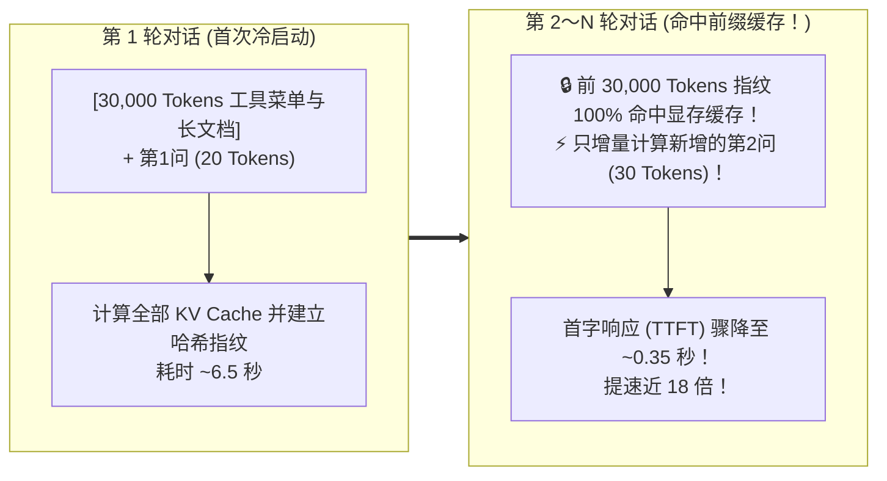

# 6.4 智能体秒回绝招：Prefix Caching 前缀缓存、投机采样与 `NPU + GPU` 异构双打

> **本节目标**：掌握专门针对 Agentic AI（WorkBuddy、`Qoder`、`Codex` 与第 8 章 `OpenClaw`）三大高频痛点的系统级加速秘籍 —— **开启 Prefix Caching 让次轮响应暴降 90%**、用 **投机采样（Speculative Decoding）** 无损提速解码，以及在锐龙 AI 电脑上玩转 **`XDNA 2 NPU + Radeon GPU` 异构双打**！

---

## 一、头号秒回绝招：自动前缀缓存（Automatic Prefix Caching）

回想一下你在第 2～4 章使用 **WorkBuddy**、**`Qoder`** 或第 8 章 **`OpenClaw`** 时的真实数据流：
- 第 1 轮发消息时，客户端在后台悄悄给你拼上了 **15,000～35,000 个 Token 的固定前缀**（包括系统角色设定、十几个 MCP 工具的 JSON Schema 说明书，以及你刚上传的一整份项目文档），最后才加上你问的那句 20 个字的问题；
- 5 秒钟后，你追问了第 2 句话：*“把刚才第 3 条再展开讲细一点”*。

**如果没有开启 Prefix Caching**，推理引擎会傻乎乎地把前面那 **3 万个一字未改的固定前缀重新做一遍完整的矩阵乘法（Prefill）**——于是你每追问一句，都要重新干瞪眼等上 **6～10 秒**！

而一旦开启 **Prefix Caching（前缀 KV 缓存复用）**：

### 一表查清三大标准引擎的 Prefix Caching 开启开关

检查一下你在第 1 章的启动命令，确保这个“免费十倍加速器”已经打开：

| 标准推理引擎 | 开启参数写法 | 如何确认真的命中缓存了？ |
|:---|:---|:---|
| **`llama-server` (`:8080`)** | 加上 **`--cache-reuse 256`**（默认亦开启 slot 相似前缀复用） | 看服务端日志出现 `slot update_slots: reusing XXXXX tokens from cache`！ |
| **`vLLM` (`:8000`)** | 加上 **`--enable-prefix-caching`** | 访问 `http://127.0.0.1:8000/metrics` 或日志查看 `Prefix cache hit rate` 飙升至 `85%+`！ |
| **`lemonade-server` (`:13305`)** | 底层 `llamacpp` 后端自动继承上下文槽位缓存 | 连续针对同一长文档追问第 2 题，直观感受毫秒级秒回！ |

> [!TIP]
> **搭配黄金提示词排序习惯（让缓存命中率 100%！）**：  
> 前缀缓存是从头往后逐字比对的——如果在文档最开头塞了一个每秒都在变的 `当前精确时间戳: 17:35:21`，后面 3 万字的缓存就全失效了！**永远把固定不变的系统指令和长参考文档放在最前面，把动态变化的当前时间和新问题放在最末尾！**

---

## 二、解码无损提速魔法：投机采样（Speculative Decoding）

如果一颗 12B 或 35B 大模型一个字一个字蹦还是觉得不够过瘾，能不能不靠有损量化、**100% 原封不动保留原模型输出质量**的前提下再提速 `1.5x ~ 2.2x`？

这就是极其聪明的 **投机采样（Speculative Decoding，“实习生打草稿 + 博导一眼批改”模式）**：
1. 我们在显存里顺手塞一颗体积只有几百 MB、跑得飞快的同家族微型草稿模型（Draft Model，比如 `0.6B`）；
2. 每次生成时，先让 `0.6B` 小实习生飞速往前连猜 5 个词（比如猜出 `return sum(scores) / len`——这种常规代码语法小模型十拿九稳！）；
3. 然后让 `12B` 大博导**只花算 1 个词的时间并行审阅这 5 个词**——猜对的全部一次性盖章通过，万一第 4 个词猜歪了就当场改成博导的标准答案！

在 `llama-server` 中只需额外加一个 `-md <小草稿模型.gguf> --draft-max 5`（或在 `vLLM` 中配置 `--speculative-config`），写代码和固定格式 JSON 生成场景立刻快如闪电！

---

## 三、AMD 锐龙 AI 电脑独家绝活：`XDNA 2 NPU + Radeon GPU` 异构双打！

如果你手头是一台搭载 **AMD Ryzen AI 300 / 400 或 Ryzen AI Max+ 395** 的全能本/迷你主机，你的芯片里其实同时住着两位性格互补的算力高手：
1. **🌱 超低功耗耐力王 —— XDNA 2 NPU（神经网络处理单元）**：运行模型时整块单元功耗仅 **3W ～ 6W**，不占一滴 GPU 显存，连续开一天后台风扇都不转；
2. **🔥 重装火力爆发王 —— Radeon 890M / 8060S GPU**：拥有超高带宽与庞大算力，专治几万字长报告、大师 PPT 生成与重度代码重构。

通过第 1.4 节学过的 **`lemonade-server`**，你可以轻松搭建最科学的 **「日常双引擎分工方案」**：
- **后台 24 小时定时巡检（第 2.2.3 节 WorkBuddy 定时任务）与轻量随手问**：路由到跑在 **XDNA 2 NPU（`FastFlowLM` 后端）** 上的 `Gemma 4 E4B`，省电静音零打扰；
- **前台攻坚大师 PPT、跨文件 `Qoder` 重构与复杂推理**：路由到跑在 **Radeon GPU** 上的 `Qwen3.5-9B`、`Gemma 4 12B` 或旗舰 `Qwen3.6-35B-A3B`！

---

## 👉 本章终极压轴：不用手调参数！让 AI 智能体自己帮你的 AMD 显卡调到最快！

从 6.1 节的 `TraceLens` 找瓶颈，到 6.2 节的 `Quark` 量化、6.3 节的 `AITER` 融合算子，再到本节的前缀缓存——有没有一种更酷的 Agentic AI 玩法：**我在 `Qoder` 或 `Codex` 里说一句人话，让一套专门懂 AMD 硬件的多智能体系统自动替我压测、剖析、找最优参数甚至自动重写融合算子？**

翻开本章最后一节，迎接 ROCm 10 时代最惊艳的黑科技 **`AMD-AGI/Hyperloom`**！

➡️ **[6.5 压轴闭环：结合 `AMD-AGI/Hyperloom` 与 `AMD Skills` 实现全自动推理寻优（导流 `hello-gpu`）](./05-hyperloom-auto-opt.md)**
