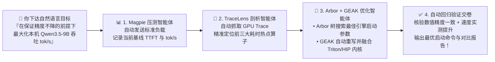

# 6.5 压轴闭环：结合 `AMD-AGI/Hyperloom` 与 `AMD Skills` 全自动寻优

> **本节目标**：迎来全书第 0～6 章主线最酷的**首尾大闭环** —— 把你在第 2、4 章掌握的 **`Qoder` / `Codex` + `SKILL.md` 技能机制** 用回到 AMD 算力底座本身！体验 ROCm 10 官方开源王牌 **[`AMD-AGI/Hyperloom`](https://github.com/AMD-AGI/Hyperloom)** 与 **[`amd/skills`](https://github.com/amd/skills)** 多智能体自动优化流水线，并在章末无缝导流至 Datawhale 底层算子专精课 **[`hello-gpu`](https://github.com/datawhalechina/hello-gpu)**！

---

## 一、全书最妙的首尾呼应：从“在显卡上跑智能体”到“让智能体自动优化显卡”！

回顾一下我们一路走来的旅程：
- 在第 1～4 章，我们学会了在 AMD 显卡上跑起本地模型，并用 **`SKILL.md` + MCP** 让智能体替我们自动做 PPT、填表格、查知识库；
- 那么面对复杂的 GPU 推理调优（几十个 `vLLM` / `llama-server` 参数组合、成百上千种 Triton 算子分块大小），为什么还要人类工程师一个个熬夜手试呢？

AMD 官方在 ROCm 10.0.0 里程碑中重磅开源的 **[`AMD-AGI/Hyperloom`](https://github.com/AMD-AGI/Hyperloom)** 与 **[`amd/skills`](https://github.com/amd/skills)**，干的正是一件让人拍案叫绝的大事 —— **把顶级 GPU 性能专家的毕生调优经验写成标准 `SKILL.md` 与多智能体协同工厂，让 AI 全自动把你的 AMD 显卡调到极致！**



看看上面这四个名字（`Magpie`、`TraceLens`、`Arbor`、`GEAK`）组成的全自动闭环：它不靠盲猜，每改一个参数或融合一段算子，都会真刀真枪在 GPU 上跑一遍计时和数值校验，有效才保留、变慢自动回滚！

---

## 二、5 分钟上手体验：给你的 `Qoder` / `Codex` 装上官方 `AMD Skills`！

即使在个人消费级 Radeon / Ryzen AI 电脑上，你现在就可以一行命令把 AMD 官方工程师维护的 **`amd/skills`** 技能库装进你的 `Qoder` 或 `Codex CLI`，让它瞬间变身资深 ROCm 性能顾问；而在 [AMD Radeon Cloud](../cloud/amd-radeon-cloud.md) 大显存实例上，更能一键跑通完整的 `Hyperloom` 自动内核生成闭环！

### Step 1：一行命令安装官方 `amd/skills` 技能包

```bash
# 自动将 AMD 官方 ROCm 排障、性能剖析与推理调优技能包安装到 .agents/skills/
npx skills add amd/skills
```

### Step 2：克隆 `AMD-AGI/Hyperloom` 并在智能体中发起自动诊断寻优

```bash
git clone https://github.com/AMD-AGI/Hyperloom.git ~/ai_workspace/Hyperloom
```

现在打开 **`Qoder` IDE** 或 **`Codex CLI`**，直接引用官方技能下达你的性能寻优任务：

```text
请结合已加载的 amd/skills 与 ~/ai_workspace/Hyperloom 中的推理优化工作流：
1. 检查我当前的显卡型号与显存容量，评估我当前启动本地 Qwen3.5-9B（32K 上下文）的推理配置是否存在显存带宽或 Prefill 瓶颈；
2. 给出针对我这张显卡的最高吞吐启动参数组合（包括量化格式、KV Cache 策略、FlashAttention / AITER 开关与批处理参数），并生成一段自动对比调优前 vs 调优后 TTFT 与 tok/s 的基准测试脚本。
```

---

## 🏆 第 6 章完美收官：解锁终极满血形态「个人学习助手 v3.0」！

恭喜你！走完第 0 章到第 6 章的完整技术主线，你的本地 AI 助手已经彻底蜕变为集 **「全能办公 + 私人双链记忆 + 可共享知识库 MCP + 专属中文微调 + 极速量化加速」** 于一身的 **`个人学习助手 v3.0`**！

核对一下你在本章收获的 **《作品集素材 #5：模型量化与推理加速实测对比报告》**：
- [x] 能清晰讲出大模型推理 **`Prefill`（算力受限，看 `TTFT`）** 与 **`Decode`（显存带宽受限，看 `tok/s`）** 两大阶段本质；
- [x] 亲手跑完了 **同一颗模型在 `AMD Quark` 量化前 vs 量化后的体积、显存、`TTFT` 与 `tok/s` 对比表**（并掌握了对称量化避坑原则）；
- [x] 零 C++ 代码点亮了 `@torch.compile`、`hipBLASLt`、`AITER` 融合算子与 **Prefix Caching 前缀秒回**，体验了 `Hyperloom` + `amd/skills` 智能体调优闭环！

---

## 🔗 本章课程引用与进阶导流：直通硬核殿堂 `hello-gpu`！

在本章中，为了照顾每一位零基础学习者的体验，我们坚持**零 C++ 代码**，站在 Python 与官方工具箱肩膀上拿到了翻倍加速。

但当你在 `6.1` 节看到 `TraceLens` 打印出的 GPU 内核耗时表、在 `6.3` 节看到融合算子神奇地冲破了“显存带宽墙”时，如果你骨子里的极客好奇心被彻底点燃了——
- 🔥 **“AMD GPU 芯片内部的 Compute Unit（计算单元）、Wavefront（波前线程束）、LDS（片上高速共享内存）和 Matrix Core 到底长什么样？”**
- 🔥 **“我想亲手用 C++ HIP 和 Triton 从第一行代码手写出一个吊打原生实现的 FlashAttention 或 Fused SwiGLU 自定义算子，该怎么学？”**

欢迎从本章昂首阔步迈入 Datawhale 体系中最硬核、含金量极高的底层专精课程：
👉 **[`datawhalechina/hello-gpu`（《GPU 架构与算子优化实战》）](https://github.com/datawhalechina/hello-gpu)**！

---

## 👉 下一站：激动人心的收获时刻！把你的汗水变成闪闪发光的作品集与 Offer！

前 6 章你已经攒下了 **5 份实打实的真机代码、截图与评测数据表**！千万别让它们静静躺在硬盘角落吃灰——在 **第 7 章**，我们将手把手教你把这段“把自己的 AMD 电脑变成 AI 助手”的完整经历，打包成让人眼前一亮的 **GitHub 个人作品集五件套** 与 **STAR 法则高分简历项目经历**：

➡️ **[进入第 7 章｜收获时刻：打包你的五件套作品集、高含金量 STAR 简历与面试通关指南](../07-portfolio-resume/index.md)**
