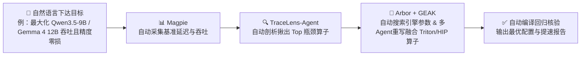

# 6.4 & 6.5 Agent 秒回秘籍与 `AMD-AGI/Hyperloom` 全自动寻优压轴

---

## 6.4 让 WorkBuddy、`Qoder` 与 Codex 秒回：Prefix Caching 前缀缓存与异构分流

### 一、为什么 Agent 聊第 2 轮开始明明只发了一句话，还要等好几秒？

回想第 2 章：每次你在 WorkBuddy 或 `Qoder` 里发一句话，客户端其实都在后台把 **“上万字内置工具定义 + 历史对话记录”** 重新发给本地模型算一遍！如果不做缓存，显卡每轮都在傻傻重复计算前面一模一样的 95% 内容。

**一招秒解 —— 开启前缀缓存（Prefix Caching）**：
- **`llama-server` 启动追加**：`--cache-reuse 256`
- **`vLLM` 启动追加**：`--enable-prefix-caching`

开启后，引擎会把前面不变的工具说明与长文档 KV Cache 直接锁在显存里复用，**第 2 轮起的首字等待时间（TTFT）直接从 8～10 秒暴降至 0.5 秒以内**（本仓库第 8 章 `OpenClaw` 案例实测立竿见影）！

### 二、投机采样与 Ryzen AI `NPU + GPU` 异构双打

- **投机采样（Speculative Decoding）**：让一个 `0.6B` 超快草稿小模型先一口气猜出后面 5 个词，再让 `8B`/`14B` 主模型并行一次性核对盖章，不损失一分钱准确率却能提速 `1.5x ~ 2x`！
- **锐龙 AI 笔记本省电绝招**：通过 `lemonade-server`（详见 [第 1.4 节](../01-first-model/04-lemonade-server.md)）将常驻后台的轻量定时办公任务交由超低功耗 **XDNA 2 NPU**（`FastFlowLM` 后端）运行，重度代码与 PPT 生成再唤醒 Radeon GPU，续航与性能兼得！

---

## 6.5 🌟【Agentic 自动寻优压轴】结合 `AMD-AGI/Hyperloom` 与 `AMD Skills` 全自动优化

还记得我们在第 2、4 章学会的 **`Qoder` / Codex + `SKILL.md`** 吗？在性能优化的最后一节，我们迎来全书最酷的首尾呼应闭环 —— **直接指挥智能体，全自动为你的 AMD GPU 调参并重写热点算子！**

AMD 官方开源的 **[`AMD-AGI/Hyperloom`](https://github.com/AMD-AGI/Hyperloom)**（ROCm 10.0.0 核心组件之一）与 **[`amd/skills`](https://github.com/amd/skills)** 将复杂的底层性能优化封装成了一套多智能体自动流水线：



### 快速体验步骤

1. **一行命令为你的 `Qoder` / Codex 装上官方 `AMD Skills`**：
   ```bash
   npx skills add amd/skills
   ```
2. **加载 `Hyperloom` 推理优化技能包**（本地 Radeon/Ryzen 电脑可直接用其 `TraceLens` + `amd/skills` 自动诊断并搜索最优启动参数；在 [AMD Radeon Cloud](../cloud/amd-radeon-cloud.md) Instinct 环境中更可一键跑通端到端自动改写算子闭环）：
   ```bash
   git clone https://github.com/AMD-AGI/Hyperloom.git ~/ai_workspace/Hyperloom
   ```
   在 `Qoder` 或 Codex 中直接 `@hyperloom/inference_optimizer/SKILL.md` 下达指令：
   ```text
   请结合 amd/skills 与 Hyperloom 优化工作流，剖析当前本地 vLLM 服务的推理瓶颈，并给出在不降低输出精度的前提下最大化 tok/s 吞吐的参数配置方案。
   ```

---

## 🎯 第 6 章实战产出与专精课程导流：直通 `hello-gpu`

- **本章产出**：《模型量化前后与算子加速实测对比表（体积 / 显存 / TTFT / `tok/s`）》。
- 🔗 **课程引用与进阶导流**：当你在本章亲眼见证了开启 `AITER` 融合算子与 `Hyperloom` 自动改写内核带来的翻倍加速后，如果你渴望**彻底揭开黑盒，亲手深入 AMD GPU 计算单元（CU / Wavefront / LDS）底层架构，手写极致性能的 HIP 与 Triton 算子**，欢迎无缝进阶进入 Datawhale 硬核专精课程 —— **[`hello-gpu`（GPU 架构与算子优化实战）](https://github.com/datawhalechina/hello-gpu)**！

👉 至此，你的本地 AI 助手已经集齐了「部署 + 办公/IDE 接入 + 私人知识库 + 可共享 MCP + 中文微调 + 量化加速」全套神装！马上进入 **[第 7 章｜收获时刻：把你的成长故事转化为作品集与高含金量简历项目](../07-portfolio-resume/index.md)**！
