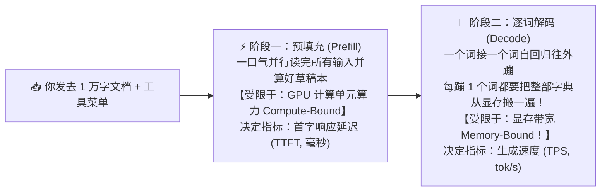

# 第 6 章｜速度不够？AMD Quark 量化对比、零 C++ 算子加速与 `Hyperloom` 自动寻优

> **本章使命**：**全程不需要写一行 C++ 或底层显卡汇编代码！** 先学会像资深性能工程师一样看懂 `TTFT` 与 `tok/s` 瓶颈，再用官方神器 **[`AMD Quark`](https://github.com/amd/Quark)** 对**同一个模型跑通量化前 vs 量化后的文件大小、显存占用与吐字速度同台实测对比**，最后一键唤醒 **`AITER` 融合算子**、**Prefix Caching 前缀秒回** 与 **`AMD-AGI/Hyperloom` 多智能体自动优化流水线**，锻造终极满血版 **`个人学习助手 v3.0`**！

很多同学一看到目录里有“算子优化、量化加速”几个字，心里就开始打退堂鼓：*“我又不是学计算机体系结构的，是不是得去背几百页 GPU 寄存器手册、手写几百行 C++ HIP 代码？”*

**在本书里，完全不需要！**  
今天的 ROCm 10 软件栈已经把底层极致优化封装成了**一行 Python 函数或一个环境变量开关**——你只需要先建立正确的物理直觉，知道“慢在了哪一步、该拧开哪一个官方加速阀门”，就能白嫖到 **2 倍～5 倍** 的真机提速！而如果你在体验完翻倍快感后对手写底层 GPU 算子产生了浓厚兴趣，本章末尾将无缝把你送到 Datawhale 专精硬核课 **[`hello-gpu`](https://github.com/datawhalechina/hello-gpu)** 的大本营。

---

## 6.1 秒懂大模型推理“两阶段”与 `TraceLens` 零代码体检

为什么有时候你觉得本地 AI **“发完消息要愣神等 6 秒才蹦出第一个字，但一旦开始吐字又哗啦啦挺快”**；而有时候又是 **“第一个字秒出，后面却像老牛拉车一顿一顿往外挤”**？

因为大模型回答你的每一个问题，显卡在后台其实干的是截然不同的 **两份活**！



### 一眼对症下药：卡在哪一阶段，就使哪一招！

| 你感受到的卡顿现象 | 对应的核心工程指标 | 真正的物理瓶颈在哪？ | 本章哪一节专门治它？ |
|:---|:---|:---|:---|
| **发完消息干等好几秒才出第 1 个字**<br/>（尤其在 WorkBuddy / `Qoder` 多轮对话时） | **`TTFT`**<br/>*(Time To First Token，首字延迟)* | **算力瓶颈（Compute-Bound）**：每次都在把前面几万字不变的工具说明重算一遍！ | 👉 **6.3 节 `AITER` 闪电注意力** + **6.4 节 `Prefix Caching`（次轮直降 90% 等待！）** |
| **出字后一个字一个字慢吞吞往外蹦**<br/>（比如 9B `BF16` 模型只有 20 `tok/s`） | **`TPS` / `tok/s`**<br/>*(Tokens Per Second，每秒吐字数)* | **显存带宽墙（Memory-Bound）**：每吐 1 个字都要从显存搬运 18GB 权重，水管被塞满了！ | 👉 **6.2 节 `AMD Quark` 4-bit 量化（把 18GB 瘦身到 5.5GB，搬运量砍 70%，速度直接翻倍！）** |
| **不确定到底是哪个算子在拖后腿** | **Kernel Time 占比** | 碎小算子（如 LayerNorm + SiLU）频繁读写显存浪费时间 | 👉 **下方 `TraceLens` 一键体检** + **6.5 节 `Hyperloom` 自动融合调优** |

---

### 🔍 动手体验：用官方纯 Python 神器 `AMD-AGI/TraceLens` 给模型拍一张“X 光片”

以前做 GPU 性能剖析（Profiling）要看密密麻麻几万行的时间轴火焰图，眼都看花了。AMD 官方开源的 **[`AMD-AGI/TraceLens`](https://github.com/AMD-AGI/TraceLens)** 能直接读取 PyTorch 或 `vLLM` 生成的 Trace JSON，自动帮你汇总成清清楚楚的 Excel / 终端性能瓶颈榜！

在已装好 ROCm PyTorch 的 `.venv` 环境中花 2 分钟试一下：

```bash
# 1. 安装官方轻量级性能剖析器 TraceLens
uv pip install -i https://pypi.tuna.tsinghua.edu.cn/simple git+https://github.com/AMD-AGI/TraceLens.git pandas openpyxl

# 2. 用 15 行 Python 采集一次真实 GPU 推理 Trace 日志并揪出最耗时 Top 5 算子！
python -c "
import torch
from torch.profiler import profile, ProfilerActivity

x = torch.randn(2048, 4096, device='cuda', dtype=torch.bfloat16)
w = torch.randn(4096, 4096, device='cuda', dtype=torch.bfloat16)

with profile(activities=[ProfilerActivity.CPU, ProfilerActivity.CUDA]) as prof:
    for _ in range(5):
        y = torch.nn.functional.silu(x @ w)
    torch.cuda.synchronize()

prof.export_chrome_trace('rocm_demo_trace.json')
print(prof.key_averages().table(sort_by='cuda_time_total', row_limit=6))
print('✅ Trace 文件已导出至 rocm_demo_trace.json，可直接交由 TraceLens 生成详细算子剖析表！')
"
```

你看！屏幕上清清楚楚列出了矩阵乘（`aten::mm`）与激活函数（`aten::silu`）各自吃掉了多少微秒 GPU 时间——专业工程师调优从来不靠瞎猜，全靠这张表指路！

---

## 🗺️ 本章 4 节实战提速导航

1. 🌟 **[6.2 AMD 官方量化实战：用 `AMD Quark` 压缩单个模型并实测对比量化前后大小与速度](./02-quark-before-after.md)**  
   *不搞繁琐花架子！选定一颗模型，用 15 行 Python 跑完压缩，同台对比量化前 vs 量化后的文件体积、显存峰值、`TTFT` 与 `tok/s`，并掌握对称 KV Cache 避坑口诀！*
2. ⚡ **[6.3 零 C++ 代码算子加速：三招唤醒 `@torch.compile`、`hipBLASLt` 与 `AITER`](./03-zero-cpp-operators.md)**  
   *为什么把零碎算子“打包融合”能立竿见影提速？三个官方开关直接拉满你的 AMD GPU 利用率！*
3. 🚀 **[6.4 智能体秒回绝招：Prefix Caching 前缀缓存、投机采样与 `NPU + GPU` 异构双打](./04-agent-prefix-caching.md)**  
   *专治 WorkBuddy、`Qoder` 与 `OpenClaw` 多轮对话慢，让第 2 轮响应从 8 秒骤降到 0.4 秒！*
4. 🤖 **[6.5 压轴闭环：结合 `AMD-AGI/Hyperloom` 与 `AMD Skills` 让智能体全自动优化推理（导流 `hello-gpu`）](./05-hyperloom-auto-opt.md)**  
   *首尾呼应！在 `Qoder` / `Codex` 里一句话指挥多智能体自动压测、剖析并调优你的本地引擎！*

---

👉 先拿下提速幅度最猛、也是简历最亮眼的第一战：**[6.2 AMD 官方量化实战：用 `AMD Quark` 压缩单个模型并实测对比量化前后大小与速度](./02-quark-before-after.md)**！
