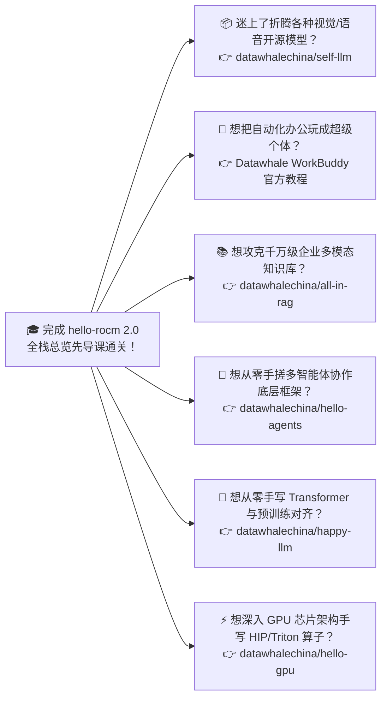

# 7.3 STAR 法则高分简历项目模板、6 道高频面试追问拆解与毕业深造驿站

> **本节目标**：将你的作品集转化为一页纸简历上最具含金量的 **STAR 法则量化项目经历**（按三大求职岗位精准定制），提前演练通关 **6 道面试官必问连环真题**，并获取从 `hello-rocm` 通往 **Datawhale 六大垂直专精课** 的毕业深造路线图！

---

## 一、拒绝平庸流水账！三大岗位方向 STAR 简历模板（把 `[XX]` 换成你的真机实测值）

简历项目描述最忌讳只写 *“我使用了 vLLM，学习了 LoRA，搭建了知识库”* 这种没有因果、没有难度的动词罗列。  
高分简历每一条都严格遵循 **STAR 法则**：**情境痛点（Situation/Task）→ 核心技术手段（Action）→ 可量化的硬核指标结果（Result）**！

请根据你心仪的投递方向挑选对应模板，并填入你在前 6 章测出的真实数字：

### 模板 A：投递「AI Agent 应用开发 / 大模型全栈开发工程师」（最广谱推荐！）

> **项目名称**：基于本地 AMD ROCm 的全隐私个人知识办公智能体构建与微调加速  
> **技术栈**：`Python` · `FastMCP` · `vLLM / llama.cpp` · `RAG` · `LLaMA-Factory (LoRA)` · `AMD Quark`  
> **核心工作与量化成果**：
> - **多端智能体架构与可共享 MCP 服务开发**：基于 `llama-server` / `vLLM` 在 AMD GPU 上构建 `32K` 长上下文 OpenAI 兼容服务，打通 WorkBuddy 办公桌面与 `Qoder` 编程环境；使用 `FastMCP` 研发支持沙盒路径穿越拦截（`is_relative_to`）与 `stdio/SSE` 双模式的**知识管理 MCP Server**，结合 `SKILL.md` 渐进式披露机制将常驻系统提示词显存开销降低 **85%+**；
> - **防幻觉双链 RAG 管线设计**：采用 Markdown 标题语义切分策略重构本地双链笔记库，设计“双链出处强制溯源 + 超纲明确拒答”双重约束，在自建 **10 题（含超纲陷阱）** 评测集中实现关键出处召回率 **[XX]%**、超纲瞎编率降至 **0%**；
> - **中文口语抽取 LoRA 微调与评测闭环**：针对端侧模型在口语化中文群通知抽取中偶发 JSON 失稳痛点，编写正则隐私脱敏流水线构造 **[XXX] 条** 指令样本完成单卡 `BF16` LoRA 微调；在物理隔离的 **[XX] 题** 测试集上，JSON 语法合法率达 **100%**，关键字段精确匹配率由 **[XX.X]%** 提升至 **[XX.X]%**；
> - **模型量化与多轮延迟优化**：利用 `AMD Quark` 完成对称 Per-Group `INT4` 权重量化，模型体积缩减 **[XX.X]%**、解码吞吐提升 **[X.XX]x**（达 **[XX.X] tok/s**）；启用 **Prefix Caching** 复用长工具定义 KV Cache，将多轮 Agent 调用首字延迟（TTFT）压缩 **[XX]%** 至 **< 500ms**。

---

### 模板 B：投递「大模型推理部署 / AI Infra 系统研发实习生」

> **项目名称**：面向消费级 AMD GPU/APU 的端侧大模型推理剖析、Quark 量化与吞吐优化实践  
> **技术栈**：`ROCm 10` · `PyTorch 2.13` · `vLLM` · `llama.cpp` · `AMD Quark` · `TraceLens` · `AITER`  
> **核心工作与量化成果**：
> - **跨引擎基准评测体系搭建**：在 AMD Radeon / Ryzen AI 硬件上系统对比 `llama-server`、`lemonade-server` 与 `vLLM` 在单并发交互与多路异步批处理（Continuous Batching）下的显存构成（Weights + KV Cache + Overhead）、`TTFT` 及 `TPS` 表现；
> - **瓶颈剖析与单模型量化压缩**：借助 `AMD-AGI/TraceLens` 定位 Decode 阶段显存带宽瓶颈，基于 `AMD Quark` 实施 `group_size=128` 对称 `INT4` 量化并规避非对称低比特 KV 精度退化，在中文结构化抽取精度损失 **< 1%** 的前提下，峰值显存下降 **[XX]%**、解码吞吐提升 **[X.XX] 倍**；
> - **融合算子与前缀缓存加速**：启用 `@torch.compile`、`hipBLASLt` 与 `ROCm/AITER` 高性能融合算子，结合 Prefix Caching 消除 Agent 场景 30K 固定系统前缀重复 Prefill，次轮 `TTFT` 降低 **[XX]%**。

---

### 模板 C：投递「AI 产品经理 / 数字化运营 / 复合型职能岗」

> **项目名称**：零成本本地全隐私 AI 办公自动化工作流落地（汇报生成 / 智能审核填表 / 定时巡检）  
> **核心工作与业务价值**：
> - **隐私合规办公流闭环设计**：针对财务报销单据与内部文档不可上传公有云的合规痛点，基于本地 AMD 算力与 WorkBuddy 搭建 100% 离线办公智能体，月均节省外部 API 成本并实现敏感数据零外发；
> - **标准化文档与报表提效**：引入 `dashi-ppt-skill` 建立从结构化提纲到原生可二次编辑 `.pptx` 的 5 分钟制稿流；设计“强字段契约 + 缺失项显式标 `待确认`”防幻觉审单规则及 `RRULE` 每日定时增量汇总机制，将单据人工核对汇总耗时缩短 **[XX]%**。

---

## 二、面试官最爱追问的 6 道高频真题与满分应答拆解

把简历投出去后，面试官大概率会顺着你的项目点连问以下 6 个问题——提前在脑海里过一遍，面试现场直接对答如流：

| 序号 | 面试官灵魂追问 | 满分作答逻辑（三层递进法） |
|:---:|:---|:---|
| **Q1** | *“现在云端大模型 API 这么便宜，你为什么非要在本地跑 4B/9B 模型？”* | ① **数据红线**：未公开文档、财务单据与个人聊天记录严禁出本机；② **Agent 高频边际成本**：定时巡检与多步循环工具调用在本地是 0 边际成本；③ **专精性价比**：经垂直 LoRA 微调后的 `Qwen3.5-9B` / `Gemma 4 E4B` 在固定 JSON 抽取准确率上追平云端大模型，且断网可用、延迟可控。 |
| **Q2** | *“你的知识库问答是怎么把幻觉压下来的？如果切块切坏了怎么办？”* | ① **上游切分**：摒弃固定字符硬切（举“菜谱串味”实例！），采用按 Markdown 标题语义结构切分保证语义自包含；② **中游溯源**：MCP `search_notes` 显式返回相对路径文件名与原句片段；③ **下游锁死**：提示词强制要求 `[[文件名#小节]]` 角标并设“未提及直接拒答”锁，用含超纲陷阱题的测试集量化验证。 |
| **Q3** | *“你手写的知识管理 MCP 如果大模型传了个恶意路径 `../../etc/passwd` 怎么办？”* | *（亮出工程杀手锏！）* 绝不只靠 Prompt 软约束！我在服务端 `KnowledgeVault._safe_resolve()` 里用 `Path.resolve().is_relative_to(self.vault_root)` 做了强路径边界断言，越界直接抛 `ValueError` 拦截，并专门写了单元测试覆盖该异常分支。 |
| **Q4** | *“既有 MCP 工具了，为什么还要搞 `SKILL.md`？全写进 System Prompt 不行吗？”* | 从 **KV Cache 显存账与注意力分散** 作答：MCP 解决“有没有手脚调外部接口”，`SKILL.md` 解决“守什么业务 SOP”；靠 **渐进式披露** 平时只加载两行 `name + description`（几十 Token），触发时才读全文，省下上千字常驻显存并避免多套规矩互相干扰。 |
| **Q5** | *“LoRA 微调时怎么防止过拟合把模型训傻？你怎么证明微调真的有效？”* | ① 控制 `lora_rank=8~16`、轮数 `2.5~3 Epoch`、对输入 `instruction` 掩码 `label=-100`，人设微调混入 15% 通用指令数据防遗忘；② 训练前严格物理隔离了 Hold-out 测试集，用自动化脚本对比微调前后 JSON 合法率与字段精确匹配率。 |
| **Q6** | *“接入桌面 Agent 后聊到第三轮首字特别慢，但吐字挺快，原因是什么？怎么治？”* | 精准区分 **Prefill（算力密集，决定 `TTFT`）** 与 **Decode（显存带宽密集，决定 `tok/s`）**！首字慢是因为每轮重复重算几万字工具定义前缀 → 开 **Prefix Caching** 复用 KV Cache 秒解；若吐字慢则是权重搬运卡带宽 → 用 **`AMD Quark` 对称 INT4 量化** 砍掉 70% 搬运体积实现翻倍提速！ |

---

## 三、🎓 毕业深造驿站：从 `hello-rocm` 第一站扬帆驶向六大专精海洋！

在 `hello-rocm 2.0` 这门全栈总览先导课中，你已经把 AI 与 Agentic AI 的每一个核心齿轮亲手转动了一遍。现在，请顺着你在实践中最着迷的那个瞬间，选择你的下一门 **Datawhale 垂直专精深造课**：

- 📦 **[`self-llm`（开源大模型食用指南）](https://github.com/datawhalechina/self-llm)**
- 💼 **[Datawhale WorkBuddy 从入门到实战官方教程](https://www.datawhale.cn/learn/content/382/8712?from=homepage)**
- 📚 **[`all-in-rag`（大模型应用开发实战：RAG 技术全栈指南）](https://github.com/datawhalechina/all-in-rag)**
- 🤖 **[`hello-agents`（从零开始构建智能体）](https://github.com/datawhalechina/hello-agents)**
- 🧠 **[`happy-llm`（从零开始的大语言模型原理与实践教程）](https://github.com/datawhalechina/happy-llm)**
- ⚡ **[`hello-gpu`（GPU 架构与算子优化实战）](https://github.com/datawhalechina/hello-gpu)**

---

## 👉 精彩还没结束！马上逛逛全书最好玩的「15 大脑洞应用案例超市」！

主线神装已经毕业，接下来两章是专门为你准备的 **实战游乐场与生态百宝箱**：在 **第 8 章** 中，我们把日常办公、学术论文精翻、实时语音口语陪练、高德旅行规划、24 小时飞书私人管家、扫雷与《我的世界》游戏 AI 全部做成了 **15 篇开箱即玩的独立五要素实战教程**！

➡️ **[进入第 8 章｜学以致用：15 篇独立五要素趣味应用案例超市（办公置顶 · 覆盖 8 大场景）](../08-fun-cases/index.md)**
