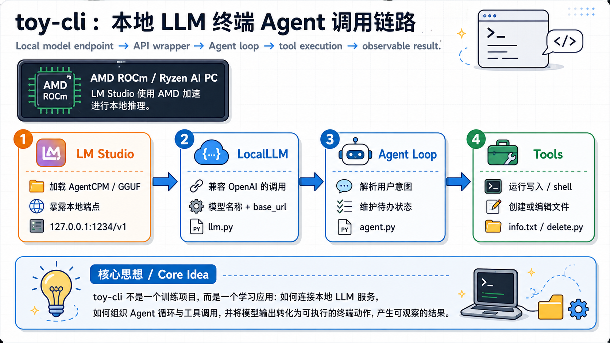

# Case 12：终端自主修 Bug 智能体与百行源码手搓 —— `Codex CLI` & `toy-cli` 双重修炼

> 🏷️ **场景分类**：编程助手  
> ⏱️ **预计耗时**：30 分钟 ｜ 🎮 **最低硬件档位**：🟢 入门档 8G 独显 / 锐龙核显本

---

## 1. 🎬 效果演示（Demo）

- **你将亲手做出什么**：
  - **输入**：一个在命令行报错崩溃的 Python 项目脚本 + 你对本地系统状态（如查看 AMD 显卡显存）的自动化查询需求；
  - **AI 自动执行**：先用 **`Codex CLI`** 在沙盒审批模式下自动读文件、分析 Traceback、打补丁并重跑测试直到变绿；再亲手为你自己的百行终端智能体 **[`toy-cli`](https://github.com/KMnO4-zx/toy-cli)** 扩展一个能实时调用 `amd-smi` 汇报本机显卡健康度的新工具！
  - **最终交付物**：既会驾驭顶级开源终端 Agent，又拥有一个自己亲手魔改过的纯命令行显卡管家智能体！



---

## 2. ✅ 支持配置清单（Verified Configurations）

| 配置项 | 已验证推荐组合 |
|:---|:---|
| **验证硬件与系统** | Ubuntu 24.04 / Windows 11（无桌面 SSH 服务器环境尤为好用！） |
| **底层推理服务引擎** | `llama-server`（`:8080`）/ `lemonade-server`（`:13305`）/ `vLLM`（`:8000`） |
| **推荐主体模型** | 🔵 `Gemma 4 12B` 或 `Qwen3.5-9B`；🟢 `Gemma 4 E4B`（务必保持 `temperature=0.1, top_p=0.7`！） |
| **标准配置与源码** | 仓库 [`src/configs/codex-config.toml`](https://github.com/datawhalechina/hello-rocm/blob/dev_1.0/src/configs/codex-config.toml) + [第 2.4 节 `mini_toy_cli.py`](../02-connect-tools/06-codex-and-toy-cli.md) + [`KMnO4-zx/toy-cli`](https://github.com/KMnO4-zx/toy-cli) |

---

## 3. 💻 完整代码与分步实操（Code & Step-by-Step）

### Step 1：配置 `Codex CLI` 完成一次无人值守修 Bug 实战

按 [第 2.4 节上半场](../02-connect-tools/06-codex-and-toy-cli.md) 将 [`src/configs/codex-config.toml`](https://github.com/datawhalechina/hello-rocm/blob/dev_1.0/src/configs/codex-config.toml) 写入 `~/.codex/config.toml` 后，在沙箱创建一个带双重 Bug（越界索引 + 空字符串未过滤）的解析器让它自修：

```bash
mkdir -p ~/ai_workspace/sandbox/case12_cli && cd ~/ai_workspace/sandbox/case12_cli
export LOCAL_ROCM_API_KEY="local-rocm"

cat << 'EOF' > parse_tags.py
def top_two_tags(raw_csv: str) -> list[str]:
    items = [x.strip() for x in raw_csv.split(",")]
    return [items[0], items[1]]

if __name__ == "__main__":
    print(top_two_tags("rocm"))  # IndexError!
EOF

codex "请运行 parse_tags.py 复现报错，将其修复为：自动忽略空白标签，不足 2 个标签时按实际个数返回不崩溃，并写 3 条 assert 断言验证通过。"
```

### Step 2：动手魔改 `toy-cli` —— 给它装上“查看本机 AMD 显卡显存”超能力！

复制 [第 2.4 节下半场的 `mini_toy_cli.py`](../02-connect-tools/06-codex-and-toy-cli.md) 到当前目录，在 `TOOLS` 列表和 `run_tool` 函数中亲手加上下面这 **12 行显卡体检工具**：

```python
import subprocess

# 在 TOOLS 数组中追加第 3 个工具定义：
GPU_TOOL = {
    "type": "function",
    "function": {
        "name": "check_amd_gpu_status",
        "description": "查询当前本机 AMD 显卡型号、温度、功耗与实时显存占用状态",
        "parameters": {"type": "object", "properties": {}, "required": []},
    },
}

# 在 run_tool() 中追加执行分支（只读安全命令，绝不开放任意危险 rm 命令！）：
def query_gpu_safe() -> str:
    res = subprocess.run(["amd-smi", "metric", "-g", "0"], capture_output=True, text=True, timeout=5)
    return res.stdout[:1200] if res.returncode == 0 else "当前环境未检测到 amd-smi 命令行输出"
```

把最后一行的提问改成：*“帮我查一下我现在这张 AMD 显卡显存用了多少、温度高不高，顺便看看当前目录刚才修好的 parse_tags.py 写了啥？”* —— 看着模型连续调用两个不同工具给你汇报战况！

---

## 4. 🔍 验证方法与验收标准（Verification）

- [x] **自动修 Bug 验收**：`python parse_tags.py` 零报错输出 `['rocm']` 且 3 条边界断言全部通过。
- [x] **自定义工具闭环验收**：`mini_toy_cli.py` 准确触发 `check_amd_gpu_status` 并用人话总结出当前显存与温度状态，未陷入重复调用死循环。

---

## 5. 🚀 扩展任务与专精课程导流（Extension Tasks）

- **⭐ 青铜改造（15 分钟）**：克隆完整版 [`https://github.com/KMnO4-zx/toy-cli`](https://github.com/KMnO4-zx/toy-cli)，将其 `LocalLLM` 的 `base_url` 改为本机 `http://127.0.0.1:8080/v1`，体验带彩色 Rich 终端交互界面的完整命令流。
- **⭐⭐ 白银改造（40 分钟）**：在 `mini_toy_cli.py` 中加入 `input("是否允许执行该写入操作? [y/N]: ")` 人工审批拦截器，亲手实现工业级 Human-in-the-Loop 安全护栏！
- **⭐⭐⭐ 黄金改造（进阶深造）**：想从这个 70 行原型继续升级，亲手写出支持多 Agent 角色协作与长期记忆的完整智能体框架？
  - 🔗 **进阶学习入口**：**[Datawhale `hello-agents`（从零开始构建智能体）](https://github.com/datawhalechina/hello-agents)**

---

## ❓ 新手试学常见问题（FAQ）

- **Q1：`Codex CLI` 连接本地时报 `404` 错误？**
  - **原因**：`~/.codex/config.toml` 中漏写了 `wire_api = "chat"`，导致客户端默认请求了云端专有的 `/v1/responses` 路径。
  - **一行解决**：核对仓库 [`src/configs/codex-config.toml`](https://github.com/datawhalechina/hello-rocm/blob/dev_1.0/src/configs/codex-config.toml)，确保每个 provider 下都包含 `wire_api = "chat"`。

---

👉 下一篇案例：**[Case 13｜网页自动化操控与高德 MCP 智能旅行规划师](./case-13-travel-planner-browser.md)**
