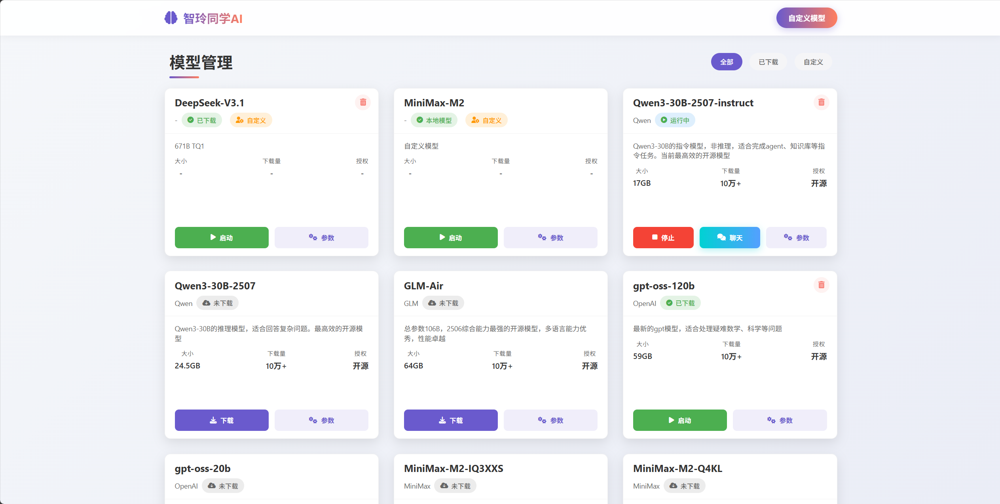

# Case 13：网页自动化操控与高德 MCP 智能旅行规划师 —— 多智能体查天气算路线全自动出路书

> 🏷️ **场景分类**：任务规划  
> ⏱️ **预计耗时**：35 分钟 ｜ 🎮 **最低硬件档位**：🔵 甜点档 16G 独显 / 🟣 旗舰 AI PC / ☁️ Radeon Cloud

---

## 1. 🎬 效果演示（Demo）

- **你将亲手做出什么**：
  - **输入**：一句假期出行心愿（如 *“周末想带父母去杭州西湖玩 2 天 1 夜，预算 2500 元，节奏轻松不爬高坡，帮我查真实天气并规划顺路美食景点路线！”*）；
  - **AI 自动执行**：直接运行本仓库配套的多智能体实战工程 **[`src/cases/hello-agents/smart-travel-planner`](https://github.com/datawhalechina/hello-rocm/tree/dev_1.0/src/cases/hello-agents/smart-travel-planner)**（或挂载高德地图 MCP + [`browser-use`](https://github.com/browser-use/browser-use)），本地模型分工担任「景点搜索专员 + 天气交通专员 + 行程统筹规划师」，调用真实高德地理编码、驾车/步行距离与实时天气预报，彻底杜绝纯聊天模型“上午城东、中午跨城跑 50 公里去城西吃碗面”的地理幻觉！
  - **最终交付物**：带每日精确地图坐标、实时穿衣提示、顺路餐饮与预算明细的可视化旅行路书网页！



---

## 2. ✅ 支持配置清单（Verified Configurations）

| 配置项 | 已验证推荐组合 |
|:---|:---|
| **验证硬件与系统** | Ubuntu 24.04 / Windows 11（🔵 16G+ 独显或 🟣 Ryzen AI Max+ 395） |
| **底层推理服务引擎** | `llama-server`（`:8080`）/ `lemonade-server`（`:13305`）/ `vLLM`（`:8000`） |
| **推荐主体模型** | 🔵 **`Qwen3.5-9B`** 或 **`Gemma 4 12B`**；🟣 旗舰 **`Qwen3.6-35B-A3B`**（多工具连续规划极稳！） |
| **配套仓库源码与安全要求** | 仓库 [`src/cases/hello-agents/smart-travel-planner`](https://github.com/datawhalechina/hello-rocm/tree/dev_1.0/src/cases/hello-agents/smart-travel-planner)；**高德免费 API Key 必须存入本地 `.env` 且严禁提交 Git！** |

---

## 3. 💻 完整代码与分步实操（Code & Step-by-Step）

### Step 1：申请免费高德 Web 服务 Key 并安全写入 `.env`

1. 前往 [高德开放平台控制台](https://lbs.amap.com/) 免费注册个人开发者，创建一个「Web 服务」应用获取 `AMAP_API_KEY`（每日免费额度数千次，个人学习绰绰有余）；
2. 进入本仓库内置案例目录并创建 `.env`（切记遵守安全规范，不要提交 `.env` 到 Git）：

```bash
cd ~/ai_workspace/hello-rocm/src/cases/hello-agents/smart-travel-planner

cat << 'EOF' > .env
LLM_MODEL_ID=qwen3.5-9b
LLM_BASE_URL=http://127.0.0.1:8080/v1
LLM_API_KEY=local-rocm
AMAP_API_KEY=在这里填入你自己的高德Web服务Key
EOF
```

### Step 2：安装前后端依赖并一键拉起智能旅行规划系统

参照案例目录下的 `README.md` 启动后端 FastAPI 智能体服务与前端看板（或者直接在 WorkBuddy / `Qoder` 的 MCP 配置里用 6 行 JSON 秒挂高德官方 MCP 体验零前端版！）：

```json
{
  "mcpServers": {
    "amap-maps": {
      "command": "npx",
      "args": ["-y", "@amap/amap-maps-mcp-server"],
      "env": {
        "AMAP_MAPS_API_KEY": "你的高德Web服务Key(本地配置勿传Git)"
      }
    }
  }
}
```

### Step 3：（进阶酷玩）搭配开源 `Browser-Use` 让本地视觉模型自动操作真实浏览器！

如果你运行的是原生多模态的 **`Gemma 4 E4B` / `Gemma 4 12B`**，还可以安装 [`browser-use`](https://github.com/browser-use/browser-use)（`uv pip install browser-use && playwright install chromium`），指向本地 `/v1` 接口，看着 Chromium 浏览器自己打开景点官网核对最新开放时间与门票政策！

---

## 4. 🔍 验证方法与验收标准（Verification）

- [x] **地理顺路零幻觉验收**：拿高德地图 App 核对生成的第 1 天上午、中午、下午三个打卡点，确认步行/打车距离真实顺路（无跨区折返跑），且包含真实未来 3 天当地天气温度。
- [x] **密钥隔离安全验收**：运行 `git status` 确认包含 `AMAP_API_KEY` 的 `.env` 文件已被 `.gitignore` 屏蔽，未出现在待提交列表中。

---

## 5. 🚀 扩展任务与专精课程导流（Extension Tasks）

- **⭐ 青铜改造（15 分钟）**：把生成的旅行规划 Markdown 直接喂给 [Case 01（`dashi-ppt-skill`）](./case-01-dashi-ppt.md)，一键导出一份发到家庭微信群让爸妈赞不绝口的《周末出游图文路书.pptx》！
- **⭐⭐ 白银改造（30 分钟）**：在 WorkBuddy 中同时开启 `amap-maps` MCP 与你的 `my-knowledge-vault` MCP，让 AI 先从你的 Obsidian 美食愿望清单笔记里挑餐厅，再用高德串成顺路觅食路线！
- **⭐⭐⭐ 黄金改造（进阶深造）**：本案例正是源自 Datawhale `hello-agents` 的标志性多智能体综合实战！想亲手从零写出它背后的 `SimpleAgent` 与 MCP 调度器？
  - 🔗 **进阶学习入口**：**[Datawhale `hello-agents`（从零开始构建智能体）](https://github.com/datawhalechina/hello-agents)**

---

## ❓ 新手试学常见问题（FAQ）

- **Q1：高德 MCP 返回 `INVALID_USER_KEY`？**
  - **原因**：在高德后台创建 Key 时选成了「Web 端 (JS API)」而不是 **「Web 服务」** 类型。
  - **一行解决**：在高德控制台新建一个服务平台勾选为 **「Web 服务」** 的 Key 替换进 `.env` 即可秒通。

---

👉 下一篇案例：**[Case 14｜24 小时全隐私飞书多端个人管家中枢（`OpenClaw` + Prefix Caching）](./case-14-openclaw-hub.md)**
