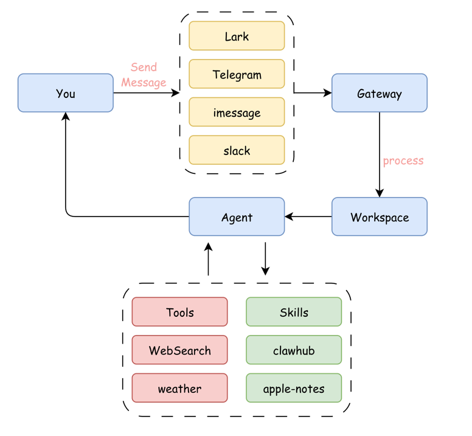
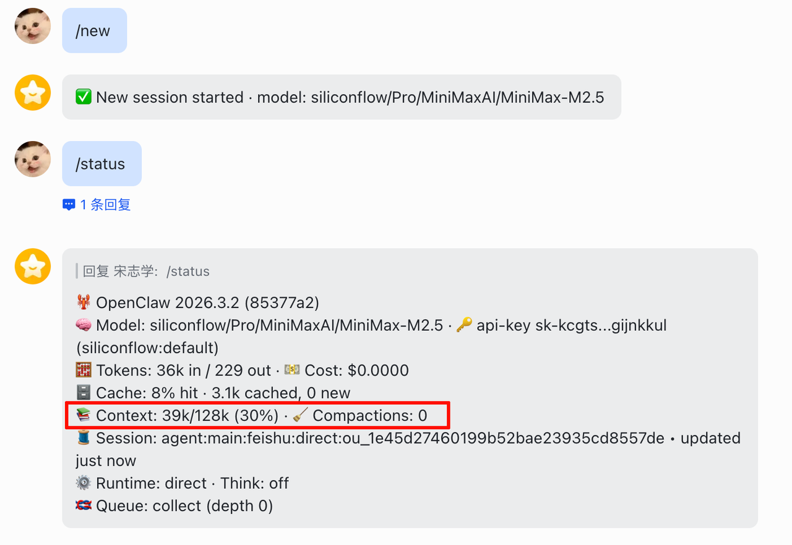

# Case 14：24 小时全隐私飞书/多端个人管家中枢 —— `OpenClaw` + 旗舰 `Qwen3.6-35B-A3B` 实战

> 🏷️ **场景分类**：任务规划（旗舰 AI PC 终极杀手级应用！）  
> ⏱️ **预计耗时**：40 分钟 ｜ 🎮 **最低硬件档位**：🟣 旗舰档统一内存 AI PC（如 Ryzen AI Max+ 395 64G/128G）或 ☁️ Radeon Cloud（🔵 16G～24G 独显亦可用 `Qwen3.5-9B` 体验）

---

## 1. 🎬 效果演示（Demo）

- **你将亲手做出什么**：
  - **输入**：你人走在校园路上或地铁里，掏出手机在 **飞书（Feishu）/ Telegram / Web 面板** 给自己家里开着的 AMD 电脑随手发一句语音或文字：*“帮我查一下家里电脑 Obsidian 里上周记的实验参数，整理成三点发回给我！”*
  - **AI 自动执行**：火爆全球的全隐私本地智能体网关 **[`OpenClaw`](https://github.com/openclaw/openclaw)** 在你本机安全沙盒中唤醒旗舰 MoE 模型 **`Qwen3.6-35B-A3B`**（配合第 6.4 节 **Prefix Caching** 化解其庞大的系统提示词开销，次轮秒回！），自主拆解任务、调用本地技能与知识库 MCP，并把结果推回你的手机飞书聊天框；
  - **最终交付物**：一座 24 小时待命在自己书桌上、**零云端月租费、零隐私外泄**的私人贾维斯（J.A.R.V.I.S.）多端智能体中枢！



---

## 2. ✅ 支持配置清单（Verified Configurations）

| 配置项 | 已验证推荐组合 |
|:---|:---|
| **验证硬件与系统** | 🟣 **AMD Ryzen AI Max+ 395（Strix Halo 64G～128G 统一内存）** / ☁️ Radeon Cloud / 🔵 24G RX 7900 XTX |
| **底层推理服务引擎** | **`lemonade-server`（`:13305`）**、**`llama-server`（`:8080`）** 或 **`vLLM`（`:8000`）** |
| **推荐主体模型** | 🟣 **`Qwen3.6-35B-A3B`**（35B 大脑容量稳控复杂多步规划，3B 激活参数飞速解码！）或 🔵 **`Qwen3.5-9B`** |
| **⚠️ 生死线必配参数** | **必须开启 `--ctx-size 65536`（至少 `49152`）+ Prefix Caching（`--cache-reuse 256` / `--enable-prefix-caching`）！** |

> [!IMPORTANT]
> **为什么跑 `OpenClaw` 必须开大上下文 + Prefix Caching？（真机实测揭秘！）**  
> 如下图所示，`OpenClaw` 内置了极其丰富的工具集、记忆与安全守则，光**初始空载系统提示词就高达 ~38,000+ Tokens**！  
> - 如果上下文只开 `32K` 以下，第一句话就会直接超限报错；  
> - 而一旦开启 `64K` 窗口 + **Prefix Caching**，只有第 1 句冷启动需要约 8～12 秒预填充，**从第 2 句开始 38K 系统前缀 100% 命中显存缓存，手机上发消息 1 秒内秒回**！



---

## 3. 💻 完整代码与分步实操（Code & Step-by-Step）

### Step 1：用 `64K` 窗口 + Prefix Caching 启动本地旗舰模型服务

```bash
# 方案 1：使用 llama-server 启动 Qwen3.6-35B-A3B (Q4_K_M) 并开启 64K 窗口 + 对称 Q8 KV 省显存 + 前缀缓存
llama-server \
  -m ~/ai_workspace/models/qwen3.6-35b-a3b/Qwen3.6-35B-A3B-Q4_K_M.gguf \
  --alias qwen3.6-35b-a3b \
  --host 127.0.0.1 --port 8080 \
  -ngl 99 -fa on \
  --ctx-size 65536 -ctk q8_0 -ctv q8_0 \
  --jinja --cache-reuse 256
```

*(若使用 `lemonade-server` 同样将 `--ctx-size` 设为 `65536`；若 16G 独显跑 `Qwen3.5-9B`，加上 `-ctk q8_0 -ctv q8_0` 同样能稳稳开满 `65536` 窗口！)*

### Step 2：安装 `OpenClaw` 并对接本机 `:8080/v1` 服务

```bash
# 安装开源 OpenClaw CLI（需 Node.js 22+）并在专用沙盒初始化向导
npm install -g openclaw@latest
openclaw onboard
```

在初始化配置向导（或 `~/.openclaw/openclaw.json`）中：
1. **Model Provider**：选择 `Custom OpenAI Compatible`；
2. **Base URL**：填入 `http://127.0.0.1:8080/v1` ｜ **API Key**：`local-rocm`（第三方通道如飞书 App Secret 请统一通过环境变量 / `.env` 注入，切勿明文提交仓库）；
3. **Model ID**：`qwen3.6-35b-a3b`（并将模型 `contextWindow` 显式声明为 `65536`）。

### Step 3：打开本地控制面板验收（可选绑定飞书机器人长连接免公网 IP！）

运行 `openclaw gateway` 启动网关，浏览器打开本地 Web 控制台即可开始多轮任务指派！如果想在手机飞书远程对话，在飞书开放平台创建一个企业自建机器人开启 **「WebSocket 长连接模式」**（无需家里有公网 IP，也无需内网穿透！），将飞书 `APP_ID` 与 `APP_SECRET` 填入本地 `.env` 即可在手机上随时召唤家里的 AMD 电脑！

---

## 4. 🔍 验证方法与验收标准（Verification）

- [x] **39K 超长系统提示词承载验证**：首轮发送 *“你好！请汇报你当前可用的核心工具类别”*，确认无上下文截断报错并准确列举能力。
- [x] **Prefix Caching 次轮秒回验证**：紧接着发送第 2 句 *“帮我在工作区沙盒新建一份今日待办备忘”*，观察服务端命中 ~38K 缓存块，响应速度相比首轮提升 **8 倍以上**！

---

## 5. 🚀 扩展任务与专精课程导流（Extension Tasks）

- **⭐ 青铜改造（20 分钟）**：把你在 [第 4.2 节](../04-mcp-and-skills/02-knowledge-mcp-server.md) 开发的「知识管理 MCP」挂进 `OpenClaw`，实现出门在外用手机飞书随时检索、随时往家里电脑的 Obsidian 收件箱记灵感卡片！
- **⭐⭐ 白银改造（40 分钟）**：记录开启与关闭 `--cache-reuse` 在 `OpenClaw` 真实 39K 提示词下的第 2 轮 `TTFT` 毫秒数反差，作为第 7 章简历最震撼的真实工程调优案例！
- **⭐⭐⭐ 黄金改造（进阶深造）**：想同时深挖长上下文智能体编排与超长序列 KV Cache 底层显存优化？
  - 🔗 **进阶学习入口**：**[Datawhale `hello-agents`](https://github.com/datawhalechina/hello-agents)** + **[Datawhale `hello-gpu`](https://github.com/datawhalechina/hello-gpu)**

---

## ❓ 新手试学常见问题（FAQ）

- **Q1：发第一句话就报错 `prompt is too long (39120 tokens > 32768)`？**
  - **原因**：仍沿用了前几章的 `32768` 上下文窗口，装不下 `OpenClaw` 庞大的全家桶系统提示词。
  - **一行解决**：启动引擎时将 `--ctx-size` 调大至 **`65536`**，显存紧张时搭配 `-ctk q8_0 -ctv q8_0` 即可轻松化解！

---

👉 收官趣味压轴案例：**[Case 15｜从扫雷推理挑战赛、《我的世界》AI 搭档到文字跑团剧场](./case-15-minesweeper-and-game-ai.md)**
