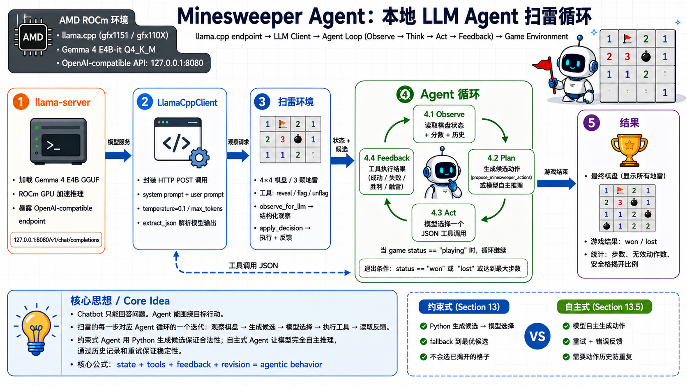

# Case 15：从扫雷推理挑战赛、《我的世界》AI 搭档到文字跑团剧场 —— 边玩游戏边悟透 Agent 工程哲学

> 🏷️ **场景分类**：游戏互动（寓教于乐收官之战！）  
> ⏱️ **预计耗时**：35 分钟 ｜ 🎮 **最低硬件档位**：🟢 入门档 8G 独显 / 锐龙核显本（🔵 16G 逻辑推演胜率更高！）

---

## 1. 🎬 效果演示（Demo）

- **你将亲手做出什么**：
  - **第一关（本仓库内置必玩王牌 · 扫雷挑战赛）**：打开本仓库配套的可交互 Notebook **[`src/cases/minesweeper_agent/minesweeper_agent.ipynb`](https://github.com/datawhalechina/hello-rocm/blob/dev_1.0/src/cases/minesweeper_agent/minesweeper_agent.ipynb)**，连接你的本地 AMD 模型去玩经典《扫雷（Minesweeper）》！你将亲眼对比 **「约束式工作流 Agent」vs「纯自主式多工具 Agent」** 在同一块雷区棋盘上的推理胜率与翻车名场面；
  - **第二关（创意拓展游乐场）**：把同一个本地 `/v1` 接口接进开源 **[`Mindcraft`](https://github.com/kolbytn/mindcraft)** 召唤《我的世界（Minecraft）》全离线 AI 挖矿建房搭子，或挂载你的 Obsidian 规则书 + 第 5 章古风/奇幻 LoRA 模型开启单人 **TRPG 文字冒险跑团剧场**！



---

## 2. ✅ 支持配置清单（Verified Configurations）

| 配置项 | 已验证推荐组合 |
|:---|:---|
| **验证硬件与系统** | Windows 11 / Ubuntu 24.04（🟢 8G ～ 🟣 128G 全档位畅玩） |
| **底层推理服务引擎** | `llama-server`（`:8080`）/ `lemonade-server`（`:13305`）/ `vLLM`（`:8000`） |
| **推荐主体模型** | 🔵 **`Gemma 4 12B`** 或 **`Qwen3.5-9B`**（二维网格坐标空间推理极强！）；🟢 **`Gemma 4 E4B`** |
| **本仓库内置源码** | [`src/cases/minesweeper_agent/minesweeper_agent.ipynb`](https://github.com/datawhalechina/hello-rocm/blob/dev_1.0/src/cases/minesweeper_agent/minesweeper_agent.ipynb) |

---

## 3. 💻 完整代码与分步实操（Code & Step-by-Step）

### Step 1：启动本仓库内置「扫雷智能体实验室」Notebook！

```bash
cd ~/ai_workspace/hello-rocm/src/cases/minesweeper_agent
source ~/ai_workspace/.venv/bin/activate
uv pip install -i https://pypi.tuna.tsinghua.edu.cn/simple jupyter openai

# 启动 Jupyter Notebook 打开 minesweeper_agent.ipynb（或直接在 Qoder / VS Code 中打开运行！）
jupyter notebook minesweeper_agent.ipynb
```

在 Notebook 第一个配置单元格中，将 `base_url` 确认指向你本机正在运行的 **`http://127.0.0.1:8080/v1`**（或 `13305/v1`、`8000/v1`），模型名设为你加载的 `gemma-4-12b` / `qwen3.5-9b` / `gemma-4-e4b`。

### Step 2：亲眼见证全书最深刻的 Agent 工程对决实验！

依次运行 Notebook 中的两种智能体模式挑战 `6×6`（5 颗雷）棋盘：
1. **模式一：约束式单动作 Agent（Constrained Workflow）**
   - 宿主程序每轮主动把最新棋盘 ASCII 图喂给模型，只让模型专注干一件事：**推理安全坐标并输出一步 `uncover(row, col)` 或 `flag(row, col)`**；
2. **模式二：纯自由自主 Agent（Unconstrained Autonomous Loop）**
   - 把 `get_board_state`（看棋盘）、`uncover_cell`（翻格子）、`flag_mine`（插旗）三个工具全甩给模型自己决定调哪个。
   - **神奇的工程发现**：你会亲眼看到，面对空间推理重任时，纯自由模式下的小模型有时会忘记调 `get_board_state` 刷新棋盘就凭旧记忆瞎连点踩雷；而**“结构化确定性状态刷新 + 受约束单步决策”的胜率高出一大截**！这正是工业界设计高可靠 Agent 的黄金准则：**能用确定性代码兜底的流程，绝不白白丢给大模型猜！**

### Step 3：（周末彩蛋玩法二选一）《我的世界》AI 生存搭档 & 文字跑团 DM！

- **⛏️ 召唤《我的世界》AI 搭子（[`kolbytn/mindcraft`](https://github.com/kolbytn/mindcraft)）**：克隆 `mindcraft`，在其 `profiles/` 配置文件里将 `api` 设为 `"openai"`、`url` 设为 `"http://127.0.0.1:8080/v1"`，打开 Minecraft 局域网联机端口，输入 `"!collectBlocks('oak_log', 10)"` 看本地显卡驱动小人帮你砍树盖房子！
- **🎲 开启全离线单人文字跑团剧场（TRPG DM）**：在 WorkBuddy 里挂载一本开源跑团规则书 Markdown（第 3 章 RAG 负责查规则判骰子点数）+ 第 5.5 节微调的生动叙事模型，开启无限自由度的奇幻冒险！

---

## 4. 🔍 验证方法与验收标准（Verification）

- [x] **扫雷通关验收**：在 `minesweeper_agent.ipynb` 中跑完一局初级棋盘，观察模型准确写出类似 *“坐标 (1,1) 数字为 1 且周围仅剩 (1,2) 未翻开，故 (1,2) 必为雷”* 的严密逻辑链并成功排雷。
- [x] **双模式对比记录**：记录约束式 vs 自主式各跑 5 局的平均存活步数与通关率差异。

---

## 5. 🚀 扩展任务与专精课程导流（Extension Tasks）

- **⭐ 青铜改造（15 分钟）**：改进扫雷 Notebook 中的棋盘展示格式——把枯燥的纯符号网格改成带 `(行, 列)` 显式坐标标注的提示词（例如 `(R2,C3)=1`），实测这一小改动能让 4B 小模型看错行列的概率下降多少！
- **⭐⭐ 白银改造（30 分钟）**：在本地搞一场 **「四大主体模型扫雷奥运赛」**——同一种子雷局下对比 `Gemma 4 E4B`、`Qwen3.5-9B`、`Gemma 4 12B` 与 `Qwen3.6-35B-A3B` 的通关率与平均每步思考耗时！
- **⭐⭐⭐ 黄金改造（进阶深造）**：想深入掌握复杂状态下 Workflow（确定性工作流）与 Autonomous Agent（自主智能体）的混合架构设计模式？
  - 🔗 **进阶学习入口**：**[Datawhale `hello-agents`](https://github.com/datawhalechina/hello-agents)** + **[Datawhale `all-in-rag`](https://github.com/datawhalechina/all-in-rag)**

---

## ❓ 新手试学常见问题（FAQ）

- **Q1：扫雷小模型第一步在全空白棋盘上纠结思考太久？**
  - **原因**：开局全未知状态下没有任何数字线索，数学上任何格子概率相同，开思考模式纯属空转。
  - **一行解决**：按扫雷标准规则，第 1 步由代码固定点开中心格 `(rows//2, cols//2)` 炸开一片安全区后再交由大模型接管推理！

---

🎉 **15 大趣味实战案例全部通关！** 意犹未尽？让我们迈入全书最后一章，俯瞰波澜壮阔的 **AMD 官方明星开源生态、具身智能/推荐系统科研前沿与全系硬件速查百宝箱**：

➡️ **[进入第 9 章｜拓展视野：AMD 优秀开源项目、前沿科研行业案例与全系 `gfx` 硬件资源百宝箱](../09-amd-ecosystem/index.md)**
