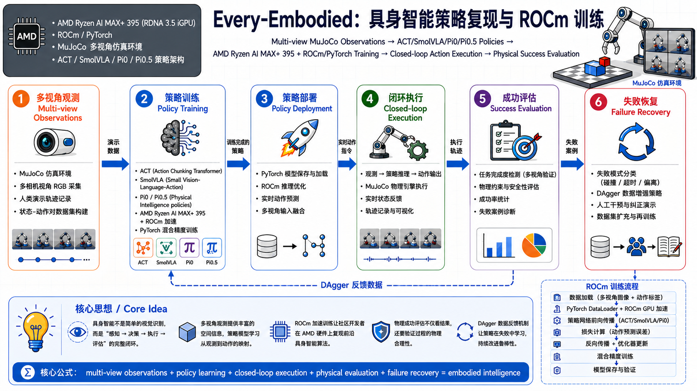
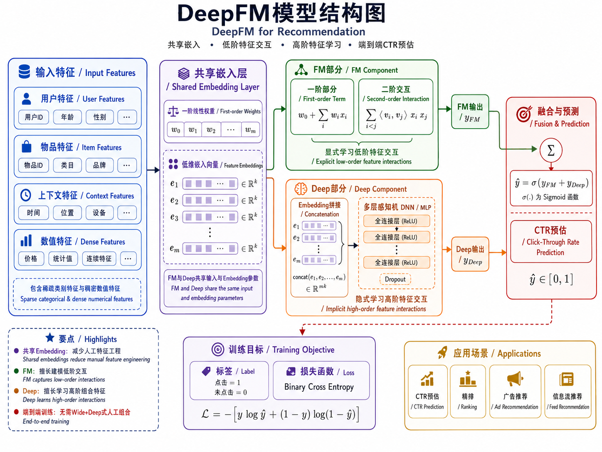
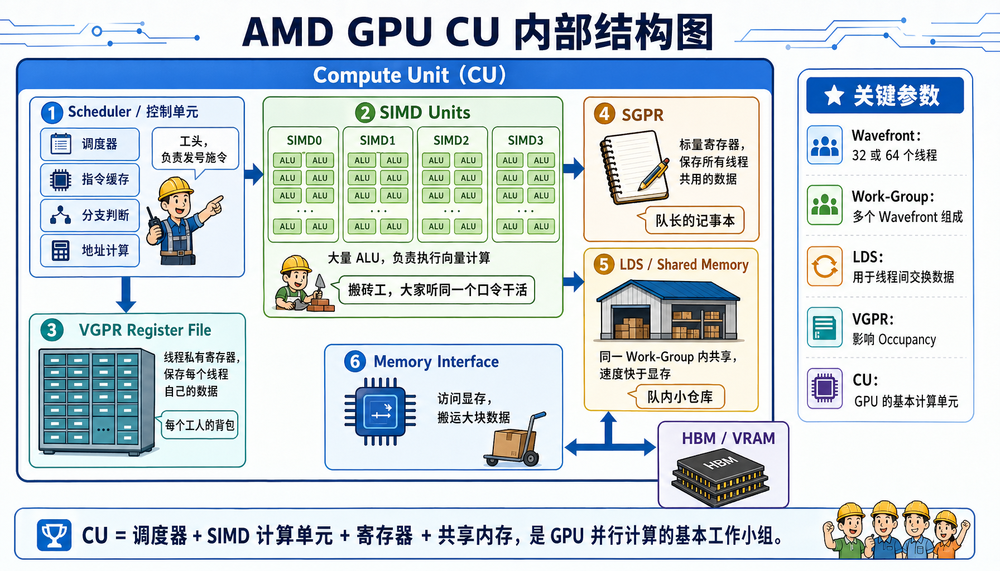

# 9.2 前沿科研与工业高阶案例精讲：从具身智能、推荐系统到多卡预训练

> **本节目标**：当你已经熟练掌握了单机大模型与智能体开发后，本节带你推开更广阔的科研与工业界大门——全景拆解 **Datawhale 社区联合 AMD ROCm 深度验证的五大前沿交叉领域实战路线**（具身智能机器人、工业级推荐系统、多卡分布式大模型从零预训练、Strix Halo 128GB 极限推理以及底层 GPU 算子架构），为你读研选题与算法深造点亮灯塔！

---

## 方向一：🤖 具身智能（Embodied AI）—— 在 ROCm 上训练机械臂视觉-语言-动作策略

大模型不仅能在屏幕里写文档，更能走进物理世界控制双臂机器人抓取物体！Datawhale 具身智能专精项目 **[`datawhalechina/every-embodied`](https://github.com/datawhalechina/every-embodied)** 已在 AMD ROCm 10 + PyTorch 环境中完整跑通从数据回放、模仿学习到视觉-语言-动作大模型（VLA）微调与 MuJoCo 闭环仿真评估的全流程：

### 核心复现要点与算法阶梯
1. **仿真渲染避坑口诀（Linux 无显示器服务器必记！）**：在云端或 SSH 远程 ROCm 实例运行 MuJoCo 桌面抓取评估时，一行 `export MUJOCO_GL=egl`（或无硬件 EGL 时用 `osmesa`）即可无头渲染多视角相机画面；
2. **四大主流具身策略一站通关**：从轻量级高成功率的 **ACT（Action Chunking with Transformers）** 起步，逐步进阶到预训练视觉语言动作模型 **SmolVLA**、**$\pi_0$（Pi0）** 与 **$\pi_{0.5}$** 的单卡/多卡微调！
3. 🔗 **专精深造入口**：👉 **[`datawhalechina/every-embodied`](https://github.com/datawhalechina/every-embodied)**

---

## 方向二：📚 工业级搜广推全链路 —— 用 `Torch-RecHub` 跑通召回、精排与多任务上线

互联网大厂营收占比最高、秋招岗位需求量极大的经典赛道就是 **搜索、广告与推荐系统（RecSys）**！Datawhale 明星开源框架 **[`datawhalechina/torch-rechub`](https://github.com/datawhalechina/torch-rechub)** 基于纯正 PyTorch 接口，在消费级 Radeon 显卡与云端 ROCm 环境零修改即可丝滑跑满全套工业级推荐流水线：

### 六步打通推荐算法工程师核心作品链
- **双塔召回（Matching）**：用 `DSSM` 从百万商品池毫秒级筛出候选集；
- **特征交叉与用户序列精排（Ranking）**：亲手训练 `DeepFM`（FM 二阶交叉 + DNN 高阶交叉）与阿里经典 `DIN`（深度兴趣网络，用目标注意力捕捉用户近期点击兴趣波动）；
- **多目标联合建模与工业部署**：用 `MMOE`（多门控混合专家）同时优化“点击率 + 转化率”，最后一键导出 **ONNX** 模型做低延迟生产级推理核验！
- 🔗 **专精深造入口**：👉 **[`datawhalechina/torch-rechub`](https://github.com/datawhalechina/torch-rechub)**

---

## 方向三：🧠 从零手搓大模型与多卡分布式训练 —— `Happy-LLM` × AMD 多卡集群

在第 5 章我们站在现成开源大模型肩膀上贴了 LoRA 便利贴；而如果你想彻底搞懂大模型每一层张量是怎么流动的，Datawhale 王牌教程 **[`datawhalechina/happy-llm`](https://github.com/datawhalechina/happy-llm)** 带你用几百行干净的 PyTorch 代码：
1. **亲手搭积木**：从 `RMSNorm`、`RoPE` 旋转位置编码、分组查询注意力 `GQA` 到 `SwiGLU` 逐层拼出一颗完整的现代 LLaMA/Qwen 架构模型；
2. **跑通完整三阶段训练生命周期**：**Pre-training（海量无标注语料自回归预训练） → Full SFT（全参数指令微调） → DPO（直接偏好对齐，让模型学会选好答案拒坏答案）**；
3. **ROCm 多卡分布式训练无缝迁移秘诀**：PyTorch 的 `DistributedDataParallel (DDP)` 与 `DeepSpeed ZeRO` 在 AMD 多卡环境下会自动将底层 `nccl` 后端无缝映射至高性能 **RCCL（ROCm Communication Collectives Library）**，业务训练脚本**零代码改动**直接利用 `torchrun --nproc_per_node=N` 多卡并行起飞！
- 🔗 **专精深造入口**：👉 **[`datawhalechina/happy-llm`](https://github.com/datawhalechina/happy-llm)**

---

## 方向四：⚡ 旗舰统一内存 AI PC 极限压榨 —— Strix Halo 128GB 与 `Strix Arena`

以 **AMD Ryzen AI Max+ 395（代号 Strix Halo，`gfx1151`）** 为代表的新一代桌面迷你工作站，凭借 **最高 128GB 256-bit LPDDR5X 统一内存（可划拨高达 96GB～110GB 作为连续 GPU 显存！）**，彻底改写了个人桌面跑大模型的天花板：
- 以往必须买两三张昂贵专业卡拼服务器才能塞下的 **`Qwen3.6-35B-A3B`（FP8 / Q8_0）** 乃至 **70B～120B 级稀疏 MoE 大模型**，现在一台巴掌大的静音桌面迷你主机就能单机全层放入 GPU 流畅对话！
- 想查看不同模型、不同量化档位、不同推理引擎在 Ryzen AI Max+ 395 真机上的实测 `Prefill` 与 `Decode tok/s` 权威横评榜单及一键复现参数？欢迎随时查阅社区联合维护的实时基准站：
  👉 **[Strix Arena 真机性能排行榜（strix-arena.web.app）](https://strix-arena.web.app/)**！

---

## 方向五：🔬 深入芯片沙盘 —— AMD GPU 计算单元（CU）与底层算子编程

当你在第 6 章尝到了 `@torch.compile` 与 `AITER` 融合算子翻倍加速的甜头后，如果你想往下多看一层，看看你的代码最终在 AMD 显卡硅片内部是怎么跑的：

- 每一颗 AMD GPU 都由数十到数百个 **计算单元（Compute Unit, CU）** 组成；
- 每个 CU 内部拥有高速执行矩阵指令的 **SIMD / Matrix Cores**、极低延迟的 **寄存器文件（VGPR/SGPR）** 以及供同一个线程块高速交换数据的 **LDS（Local Data Share，片上共享内存）**；
- 所谓“写高性能 HIP / Triton 算子”，核心艺术就是**把频繁使用的数据锁在极速的寄存器与 LDS 里算完，尽量少去敲慢速全局显存（Global VRAM）的大门（冲破内存墙！）**。
- 🔗 **底层架构与手写算子专精深造入口**：👉 **[`datawhalechina/hello-gpu`（《GPU 架构与算子优化实战》）](https://github.com/datawhalechina/hello-gpu)**！

---

## 👉 全书最后一页：收藏随时备查的「全系硬件 `gfx` 大字典与资源百宝箱」！

➡️ **[9.3 自包含权威速查百宝箱：全系 AMD GPU/APU `gfx` 架构大字典、免费云算力与开源共建指南](./03-hardware-dictionary-and-cloud.md)**
