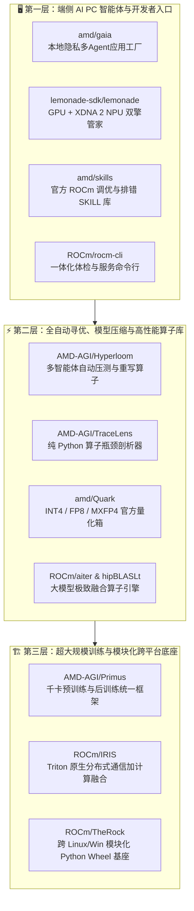

# 第 9 章｜拓展视野：AMD 官方明星开源项目、前沿行业案例与全系硬件百宝箱

> **本章定位（收官宝藏与案头工具书）**：当你完成了前 8 章从零基础破冰、日常办公提效、私人知识库 MCP、中文微调加速到 15 个趣味应用的全链路通关后，本章为你系统浓缩了 **AMD 官方最具代表性的开源 AI 项目矩阵**、**四大硬核科研与工业落地案例** 以及 **自包含的全系 AMD GPU/APU `gfx` 架构速查大字典与免费算力入口**，陪你在更广阔的 AI 世界里走得更深更远！

---

## 9.1 🌟 AMD 官方明星开源 AI 与 Agent 项目全景巡礼

过去两年里，AMD 在 GitHub 三大官方开源大本营 —— **[`github.com/amd`](https://github.com/amd)**、**[`github.com/ROCm`](https://github.com/ROCm)** 与 **[`github.com/AMD-AGI`](https://github.com/AMD-AGI)** —— 构建起了一套从轻薄本端侧 NPU 直通千卡 Instinct 集群的全开源工具链。

特别是随着 **ROCm 10.0.0** 里程碑发布，以 **「`AMD Skills` + `Hyperloom` + `ROCm CLI`」** 为代表的 Agent-Native（智能体原生）工具让开发者体验迎来了质的飞跃。下面这 **12 个官方高含金量开源仓库** 强烈建议收藏进你的浏览器书签：

---

### 一、端侧本地智能体与开发者生产力工具（个人电脑天天用得上！）

| 官方开源项目 | GitHub 仓库直达 | 核心能力亮点与你的使用时机 |
|:---|:---|:---|
| **AMD GAIA** | [`amd/gaia`](https://github.com/amd/gaia) | **Generative AI Is Awesome** —— AMD 官方开源的本地隐私多智能体应用框架，专为 Ryzen AI（NPU + iGPU）与 Radeon 硬件优化，开箱内置代码辅助、RAG 文档问答、会议语音摘要与剪辑智能体示例。 |
| **Lemonade SDK** | [`lemonade-sdk/lemonade`](https://github.com/lemonade-sdk/lemonade) | 本课程第 1.4 节主力引擎之一！一站式统一调度 Radeon GPU（`llama.cpp`）与 Ryzen AI XDNA 2 NPU（`FastFlowLM`），原生内置魔搭拉取与 OpenAI `/v1` 接口。 |
| **AMD Skills** | [`amd/skills`](https://github.com/amd/skills) | ROCm 10 三剑客之一！将 AMD 核心工程师的算子编写、性能剖析与环境排障规范封装成标准 `SKILL.md`，一行 `npx skills add amd/skills` 即可赋能你的 `Qoder`、Codex 与 WorkBuddy。 |
| **ROCm CLI** | [`ROCm/rocm-cli`](https://github.com/ROCm/rocm-cli) | ROCm 10 新一代统一命令行管家，整合硬件体检（`examine`）、SDK 组件按需安装与推理服务快捷拉起。 |

---

### 二、自动优化、模型量化与高性能推理算子底座（发论文与拼吞吐必看！）

| 官方开源项目 | GitHub 仓库直达 | 核心能力亮点与你的使用时机 |
|:---|:---|:---|
| **Hyperloom** | [`AMD-AGI/Hyperloom`](https://github.com/AMD-AGI/Hyperloom) | 本书第 6.5 节压轴神器！串联 `Magpie` 基准压测、`TraceLens` 瓶颈定位、`Arbor` 树搜索参数与 `GEAK` 多智能体自动重写融合内核的端到端优化工厂。 |
| **TraceLens** | [`AMD-AGI/TraceLens`](https://github.com/AMD-AGI/TraceLens) | 纯 Python 跨框架 GPU Trace 自动分析仪，一键把晦涩的 JSON 火焰图转化成清晰的算子耗时占比与带宽利用率报表。 |
| **AMD Quark** | [`amd/Quark`](https://github.com/amd/Quark) | 本书第 6.2 节实战主角！统一支持 PyTorch 与 ONNX 的官方量化压缩工具箱，通吃 `INT4 AWQ/GPTQ`、对称 `FP8` 与前沿 `MXFP4`。 |
| **AITER** | [`ROCm/aiter`](https://github.com/ROCm/aiter) | **AI Tensor Engine for ROCm** —— 汇集极致打磨的 PagedAttention、FlashAttention、Fused MoE 与量化内核，`vLLM` 开启 `VLLM_ROCM_USE_AITER=1` 即刻起飞。 |
| **Composable Kernel (CK)** | [`ROCm/composable_kernel`](https://github.com/ROCm/composable_kernel) | AMD 底层高性能模板化算子编程库（类似 CUTLASS 在生态中的角色），学习底层 C++ 矩阵块流水线设计的权威宝库。 |

---

### 三、大规模分布式大模型训练与跨平台构建底座

| 官方开源项目 | GitHub 仓库直达 | 核心能力亮点与你的使用时机 |
|:---|:---|:---|
| **Primus & Primus-Turbo** | [`AMD-AGI/Primus`](https://github.com/AMD-AGI/Primus) | 面向大规模基础模型预训练与强化后训练（兼容 Megatron-LM / TorchTitan / JAX）的旗舰统一训练框架，配套 `Primus-Turbo` 提供极致 FP8 与通信隐藏算子。 |
| **IRIS** | [`ROCm/iris`](https://github.com/ROCm/iris) | 基于 OpenAI Triton 的细粒度多卡计算与通信重叠（Compute-Communication Overlap）编程库，用纯 Python Triton 写出多 GPU 高速内核。 |
| **TheRock** | [`ROCm/TheRock`](https://github.com/ROCm/TheRock) | 新一代开源跨平台 ROCm 模块化构建系统——正是它让我们在第 1.2 节只需一行 `uv pip install "torch[device-gfxXXXX]"` 就能在 Windows 和 Linux 虚拟环境里直接用上 ROCm 10！ |

---

## 🗺️ 本章后续两节高能导览

1. 🚀 **[9.2 前沿科研与工业高阶案例精讲（具身智能 · 推荐系统 · 多卡预训练 · Strix Halo 极限部署）](./02-research-and-industry-cases.md)**  
   *走出单机日常助手，看看研究者和工程师是如何用 AMD ROCm 训练机械臂抓取策略、搭建工业级推荐系统、多卡手搓 Transformer 大模型以及压榨 128GB 统一内存极限的！*
2. 📋 **[9.3 自包含权威速查百宝箱：全系 AMD GPU/APU `gfx` 架构大字典、免费云算力与共建指南](./03-hardware-dictionary-and-cloud.md)**  
   *一张完整收录 RDNA 4 / RDNA 3.5 / RDNA 3 / CDNA 3 / XDNA 2 全家族型号与 `pip` 索引的案头速查字典！*

---

👉 先去领略四大硬核科研与工业实战风采：**[9.2 前沿科研与工业高阶案例精讲](./02-research-and-industry-cases.md)**！
