# ☁️ AMD Radeon Cloud · 云算力

> **AMD 官方为中国开发者提供的免费 GPU 云算力平台**，无需本地环境，浏览器登录即可上手 ROCm 实战。

## 🚀 立即体验

<div align="center">

[](https://developer.amd.com.cn/login?source=91kadjjnI)

<br>


**📱 微信 / 浏览器扫码直达**

🔗 <https://developer.amd.com.cn/login?source=91kadjjnI>

</div>


## 平台简介

**AMD Radeon Cloud** 是 **AMD AI 开发者计划中文站**（中国区官方平台）为开发者提供的云端算力入口。平台围绕 AMD 开源 AI 生态打造，目标是让中国本土开发者获得「无门槛、无网速焦虑」的原生 AMD 体验。

**核心特点**：

- 🇨🇳 **本地化部署**：中国区官方平台，免去访问与登录的网络障碍
- ☁️ **免费算力额度**：注册即送 **100 小时**中国区专属算力（活动期间）
- 🖥 **底层硬件**：基于 **AMD Radeon PRO W7900D** 等专业级 GPU 构建
- 📦 **开箱即用**：内置技术模板与预配置工作区，无需自行搭建环境
- ⭐ **积分体系**：完善信息、活跃贡献可累积积分，等额兑换算力券
- 🤝 **进阶通道**：通过魔搭社区联动「开发者激励计划」，最高可累计获得 **1000+ 小时** GPU 算力
- 💬 **官方技术支持**：中国成员专属微信群，AMD 官方团队解答 ROCm 与硬件适配问题

加入 AMD AI 开发者计划中文站，成员将围绕技术、资源、交流三大维度，解锁完整的本地化服务版图：

<div align="center">
  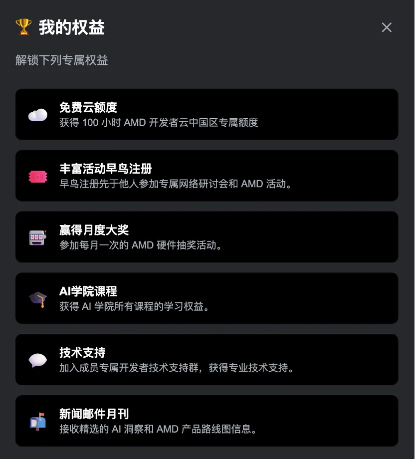
</div>


## 平台使用教程

完整流程：**注册登录 → 完善信息（领取 100 积分）→ 进入 Radeon Cloud → 选择模板 / 创建工作区 → 开始实战**。

### 1. 注册与登录

打开 <https://developer.amd.com.cn/login?source=91kadjjnI>，中文站全面接入了国内主流账号体系，提供 **3 种登录方式**：

| 方式 | 操作 | 适用场景 |
|------|------|---------|
| 🟢 **微信登录** | 扫描页面二维码 | 最快捷，一键直达 |
| 🤖 **魔搭社区账号** | 授权绑定已有账号 | 已有魔搭生态账号的开发者 |
| 📱 **手机号 / 邮箱验证码** | 输入接收验证码 | 灵活适配个人习惯 |

<div align="center">
  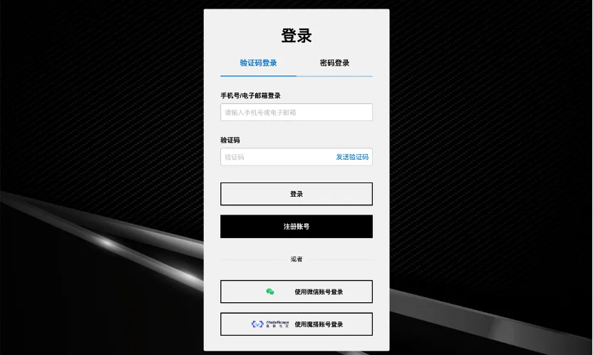
</div>

> 💡 推荐使用微信登录，节省注册成本。

**首次登录会跳转注册表单**，按提示填写姓名、邮箱 / 手机号并完成验证：

<div align="center">
  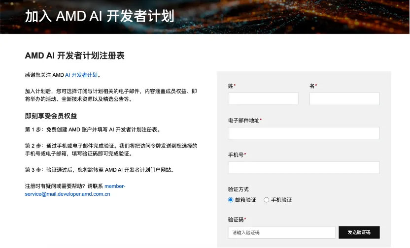
</div>

### 2. 完善信息领取积分

注册完成后，进入会员中心补全 **个人基础信息 → 项目环境与偏好 → 学术身份**，提交后即可获得 **100 积分** 奖励，用于后续兑换算力券。

<div align="center">
  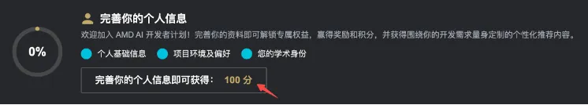
</div>

### 3. 进入云算力 / 创建工作区

登录后在中文站首页一键进入 **AMD 开发者云（Radeon Cloud）**：

<div align="center">
  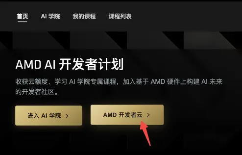
</div>

- 活动期间，注册成员**免费获得 100 小时中国区专属算力额度**
- 平台底层基于 **AMD Radeon PRO W7900D** 等专业级 GPU
- 提供**开箱即用的技术模板与工作区**，无需自行配置 ROCm / PyTorch 环境
- 直接选择模板 → 启动工作区 → 在浏览器内进入开发环境

<div align="center">
  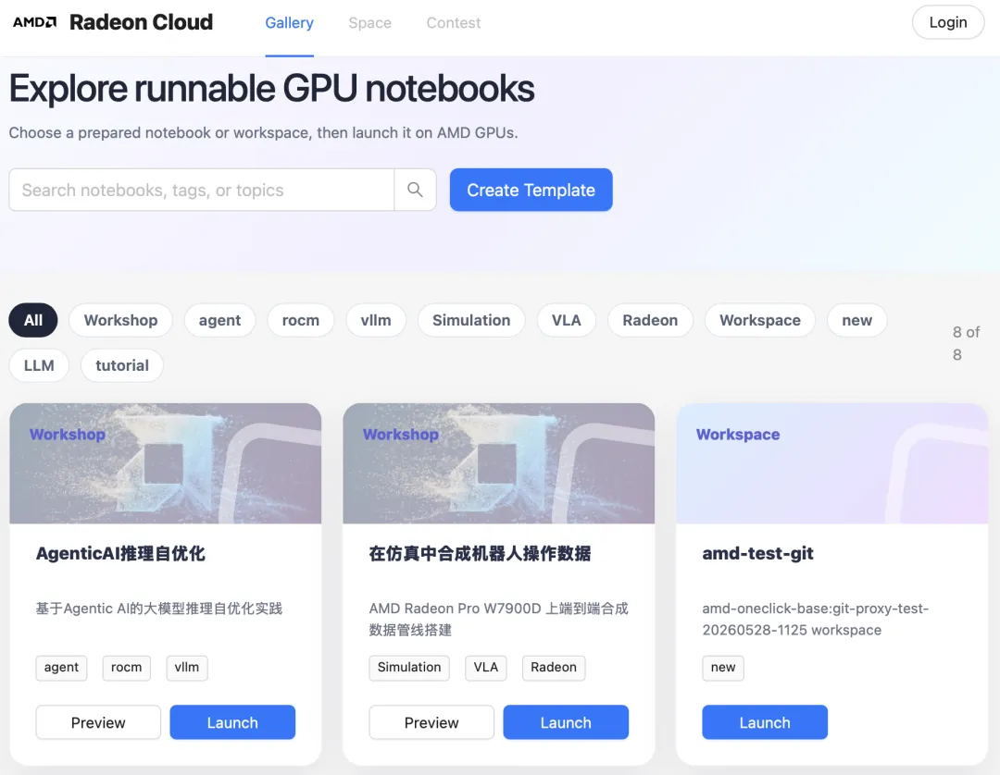
</div>

### 4. 算力扩展：积分兑换 + 魔搭联动

如果初始 100 小时不够用，有两条扩展路径：

#### 路径 A：积分兑换算力券

中文站采用透明的积分成长规则，开发者可通过技术贡献多维度积累积分，**积分等额兑换云算力券**——边沉淀技术能力边累积算力资源。

<div align="center">
  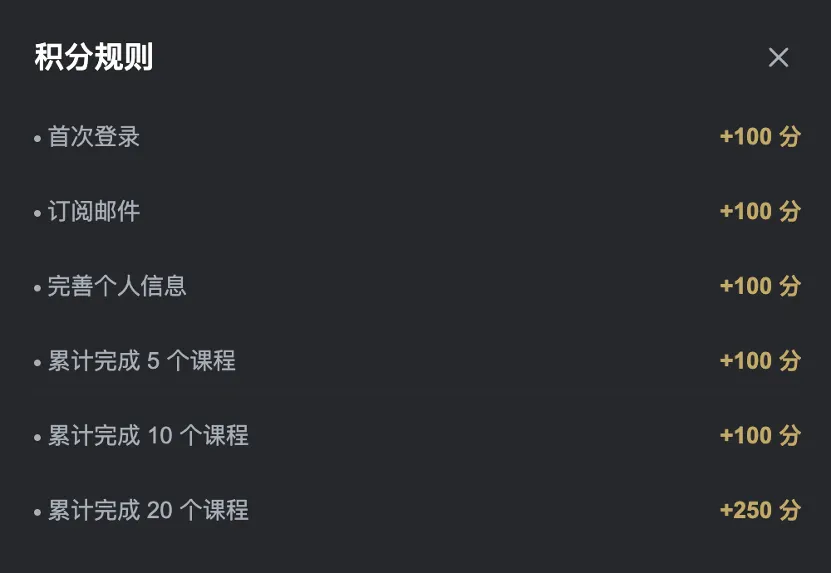
</div>

#### 路径 B：魔搭社区「开发者激励计划」

AMD 与魔搭社区联合启动激励计划，提供 **3 条完全独立的进阶任务路径**，灵活叠加最高可累计获得 **1000+ 小时** GPU 算力：

1. 通过魔搭 Notebook 活动页进入
2. 授权绑定 AMD 开发者计划账号（即完成上述注册步骤）
3. 完成对应进阶任务即可解锁算力

<div align="center">
  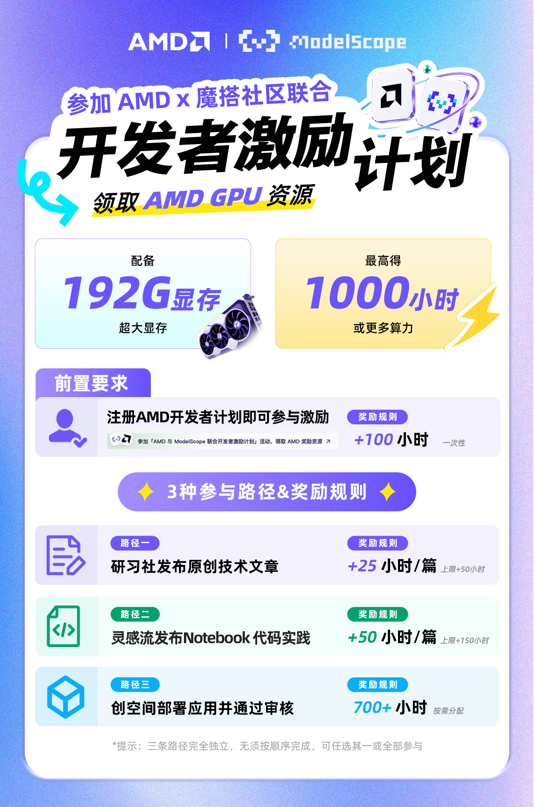
</div>

> 📌 详情参见 AMD AI 开发者计划中文站公告。

#### 积分兑换

积分兑换的完整逻辑是：先在 **AMD AI 开发者计划中文站**消耗积分生成云算力券链接，再前往 **AMD 开发者云平台**完成兑换入账。

<div align="center">
  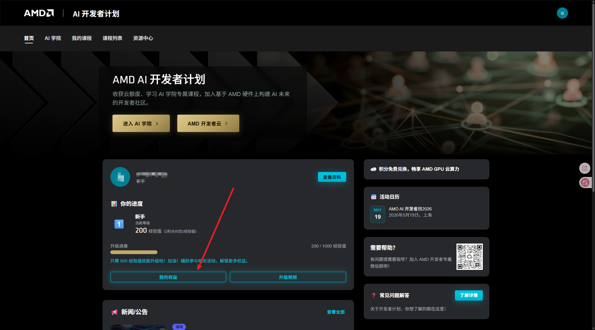
</div>
<div align="center">
  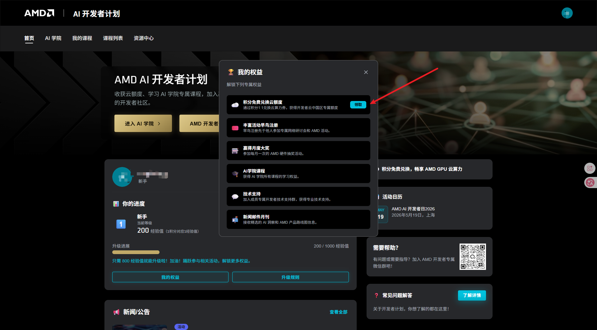
</div>

##### 兑换规则

- **兑换比例**：1 积分可兑换 1 小时 AMD GPU 云算力
- **起兑门槛**：100 积分起兑，兑换小时数不超过当前剩余可兑换积分数
- **兑换结果**：兑换成功后会生成虚拟云算力券 / 兑换链接
- **使用方式**：复制兑换链接后，需要前往 AMD 开发者云平台完成入账
- **有效期**：云算力券通常自兑换日起 30 天内有效，请及时使用
- **注意事项**：兑换的是线上云算力服务，不是实物或现金；请勿转售或违规获取积分

<div align="center">
  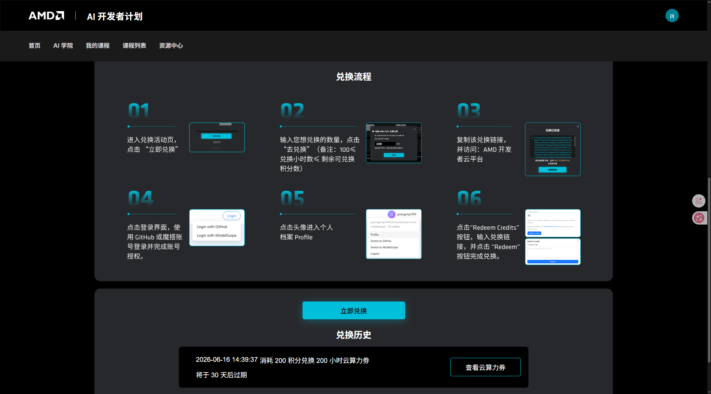
</div>

##### 兑换流程

1. 从中文站主页面或活动入口进入云算力兑换区域
2. 在兑换活动页点击 **立即兑换**
3. 输入想兑换的云算力小时数，点击 **去兑换**
4. 兑换成功后复制生成的兑换链接
5. 访问 **AMD 开发者云平台**
6. 使用 GitHub 或魔搭账号登录，并完成账号授权
7. 点击右上角头像进入 **Profile**
8. 点击 **Redeem Credits**
9. 在 **Coupon Link** 输入框粘贴兑换链接，点击 **Redeem** 完成兑换


### 5. 跑通你的第一个 ROCm 任务

平台预置了开箱即用的环境，建议起步路径：

1. 启动一个内置 ROCm + PyTorch 模板的工作区
2. 参考本仓库 [Gemma4 部署教程](/zh/01-deploy/) 跑通推理
3. 进入 [LoRA 微调实战](/zh/02-fine-tune/) 体验训练
4. 进阶 [算子优化](/zh/03-infra/) 了解底层

### 6. 从本地连接：SSH 与 VS Code（进阶）

默认工作区在浏览器内通过 JupyterLab 使用。如果你希望用本地终端、VS Code 或 AI 编程工具直接操作工作区文件与 GPU，可以通过 SSH 接入。

> ⚠️ 该方式需要手动完成配置，且**实例重建后部分设置会失效**，请按本节顺序操作。

#### 6.1 生成密钥并上传公钥

本地生成密钥（Windows / macOS / Linux 通用）：

```bash
ssh-keygen -t ed25519 -C "amd-radeon-cloud" -f ~/.ssh/id_ed25519_radeon_cloud
```

在平台 **SSH Public Keys** 中粘贴公钥内容：

```bash
cat ~/.ssh/id_ed25519_radeon_cloud.pub
```

> ⚠️ 公钥**必须一行一个**。多粘贴一行裸 base64 会导致整份配置报 `SSH public key type is unsupported`，且该改动**只对之后启动的实例生效**。

#### 6.2 连接实例

实例卡片的 `SSH access` 会给出 `Host:Port`。建议在本地 `~/.ssh/config` 中配置别名，避免每次手输：

```text
Host radeon-cloud
  HostName <实例 Host>
  Port     <实例 Port>
  User     root
  IdentityFile ~/.ssh/id_ed25519_radeon_cloud
  IdentitiesOnly yes
```

之后直接 `ssh radeon-cloud` 即可。

> ⚠️ **每次重建实例，Host 与 Port 都会变化**，需要在实例卡片上重新核对并更新 `Port`。这是最容易卡住的一步。

#### 6.3 VS Code 卡在「正在初始化」

用 VS Code 的 Remote-SSH 连接时，若界面一直停在「正在初始化 VS Code 服务器」，且日志停在 `Install and start server if needed`，通常不是网络问题，而是**平台默认关闭了 TCP 端口转发**。

平台运行中的 sshd 使用独立配置文件（非 `/etc/ssh/sshd_config`），其中 `AllowTcpForwarding` 默认为 `no`。因此 `sshd -T` 查到的配置与实际生效配置不一致，是本问题最容易误判的地方。

确认当前 sshd 的启动参数：

```bash
ps aux | grep sshd | grep -v grep
```

若输出中包含 `-f /tmp/amd-oneclick-sshd_config`，即为实际生效的配置文件。将其中的 `AllowTcpForwarding no` 改为 `yes` 并重载：

```bash
sed -i 's/^AllowTcpForwarding no/AllowTcpForwarding yes/' /tmp/amd-oneclick-sshd_config
kill -HUP $(cat /tmp/amd-oneclick-sshd.pid)
```

验证端口转发是否生效：

```bash
ssh -o ExitOnForwardFailure=yes -L 18080:127.0.0.1:22 radeon-cloud "echo FORWARD_OK"
```

输出 `FORWARD_OK` 即表示转发可用。

> ⚠️ 该配置文件位于 `/tmp` 下，**实例重建后会重新生成**，需要再次执行上述修改。

#### 6.4 Remote-SSH 推荐设置

在 VS Code 的 `settings.json` 中加入以下配置，可避免大部分连接问题：

| 设置项 | 值 | 作用 |
|:---|:---|:---|
| `remote.SSH.path` | `C:\\Windows\\System32\\OpenSSH\\ssh.exe` | 避免调用到 Git 自带的 ssh（读不到 ssh-agent） |
| `remote.SSH.useExecServer` | `false` | 规避部分环境下执行通道静默失败 |
| `remote.SSH.showLoginTerminal` | `true` | 失败时可见 SSH 原始输出，便于定位 |
| `remote.SSH.enableDynamicForwarding` | `false` | 改用普通端口转发，兼容性更好 |

#### 6.5 组件与扩展下载失败

平台出网经过 egress 代理，直接访问部分 CDN 会失败（例如 `wget download failed`、扩展市场返回 `403`）。

可通过平台预设代理访问，代理地址可从当前会话的环境变量中读取：

```bash
echo $HTTP_PROXY
```

配置后重试：

```bash
export HTTPS_PROXY="$HTTP_PROXY"
```

若 VS Code Server 或扩展仍无法下载，可在本地下载对应产物后上传至远程目录，或改用平台镜像中已预装的工具。

#### 6.6 已知限制

部分第三方远程开发工具仅实现 TCP 端口转发。若工具的服务端进程监听的是 Unix domain socket（形如 `~/.xxx/server/run/control.sock`），则无法通过该类客户端连接。排查方法：

```bash
ss -ltnp        # 无任何 TCP 监听端口
```

此时应改用支持 StreamLocal 转发的客户端（如系统 OpenSSH + VS Code Remote-SSH），或等待工具侧支持。

## 常见问题

**Q1：完全免费吗？**
活动期间注册即送 100 小时中国区专属算力。后续可通过积分兑换或魔搭激励计划继续扩展。

**Q2：需要科学上网吗？**
不需要。中文站本地化部署，访问与登录均针对中国网络环境优化。

**Q3：可以用本仓库的教程吗？**
可以。平台内置 ROCm + PyTorch 等常见模板，本仓库 `01-deploy` / `02-fine-tune` / `03-infra` 的教程可直接在工作区内运行。

**Q4：遇到 ROCm 软件栈或硬件适配问题怎么办？**
加入「中国成员专属技术支持微信群」，AMD 官方技术支持团队会随群协助解答。入口在中文站个人中心。

**Q5：100 小时用完后怎么办？**

- 走积分兑换路径：完善贡献、参与活动累积积分，兑换算力券
- 走魔搭路径：完成「开发者激励计划」3 条独立任务路径，最高 1000+ 小时
- 详见上面「算力扩展」小节

## 配套教程对应关系

> 本仓库哪些教程可以直接在 AMD Radeon Cloud 上运行：

| 学习阶段 | 对应教程 | 推荐工作区模板 |
|---------|---------|---------|
| 大模型部署 | [Gemma 4 / Qwen3 / Qwen3.5 部署](/zh/01-deploy/) | ROCm + PyTorch |
| LoRA 微调 | [Gemma4-E4B LoRA 微调](/zh/02-fine-tune/) | ROCm + PyTorch + Transformers |
| 算子优化 | [ROCm 算子优化实践](/zh/03-infra/) | ROCm + HIP 开发环境 |
| 组队学习 | [hello-rocm 组队学习](/zh/learning/) | 由 Datawhale 组队营提供 |

---

返回：[← hello-rocm 首页](/zh/)
