# 📅 hello-rocm · 20 天组队学习计划

> **和一群人按节奏，把 ROCm 从部署学到算子优化。**
> 本计划基于 hello-rocm 现有教程编排，覆盖**大模型部署、大模型微调、算子优化、案例实践**四个模块，20 天拆到每一天，学完一个模块就有一个可交付的实践作品。

## 环境约定（先读这一段）

本计划有明确的硬性约束，所有天的任务都按此设计：

| 约束 | 说明 |
|:---|:---|
| ☁️ **纯云平台** | 全程在 [AMD Radeon Cloud](/zh/cloud/amd-radeon-cloud) 工作区内操作，通过 SSH / VS Code Remote-SSH 接入 |
| 🖥 **无图形化操作** | 不使用任何 GUI 工具（包括 LM Studio 桌面端），全部交互走命令行与 HTTP API |
| 🎮 **纯 GPU + ROCm** | 不涉及 XDNA2 NPU，不使用 FastFlowLM / Lemonade，统一走 ROCm GPU 栈 |
| 🚀 **部署双框架** | 推理部署主线固定为 **vLLM** 与 **llama.cpp**，其余框架仅作选修加分 |
| ⏱ **单日投入** | 1–1.5 小时（总计约 28 小时） |

- 🎯 **适合人群**：有 Python 基础、零 ROCm / 微调 / 算子基础的同学
- 🧩 **硬件要求**：AMD GPU 8GB 显存起步；无本地 AMD 卡可全程使用云平台算力
- 🏆 **结营出口**：四个实践作品 + 一次结营答辩，优质笔记可参评优秀学习者证书

---

## 一、总体结构

20 天 = **4 个模块 + 4 个实践日 + 1 个开营日**。部署模块内容最实，拉长到 8 天；案例模块只做一个，压缩到 2 天。

```mermaid
flowchart LR
    subgraph M1["模块一 · 大模型部署（Day 1–8）"]
        D1["Day 1 开营 · 云环境上手"] --> D2["Day 2 环境基线"]
        D2 --> D3["Day 3 GPU 架构与显存"]
        D3 --> D4["Day 4 vLLM 基础部署"]
        D4 --> D5["Day 5 vLLM 进阶调优"]
        D5 --> D6["Day 6 llama.cpp 基础"]
        D6 --> D7["Day 7 llama.cpp 进阶"]
        D7 --> P1["Day 8 🔧 实践一<br/>部署对比报告"]
    end

    subgraph M2["模块二 · 大模型微调（Day 9–13）"]
        D9["Day 9 数据构造"] --> D10["Day 10 LoRA 原理"]
        D10 --> D11["Day 11 Qwen3-0.6B 实战"]
        D11 --> D12["Day 12 Gemma4-E4B 进阶"]
        D12 --> P2["Day 13 🔧 实践二<br/>微调作品"]
    end

    subgraph M3["模块三 · 算子优化（Day 14–18）"]
        D14["Day 14 硬件全景"] --> D15["Day 15 软件栈到硬件"]
        D15 --> D16["Day 16 手写 HIP 算子"]
        D16 --> D17["Day 17 PyTorch 自定义算子"]
        D17 --> P3["Day 18 🔧 实践三<br/>算子实验报告"]
    end

    subgraph M4["模块四 · 案例实践（Day 19–20）"]
        D19["Day 19 案例实战<br/>命令行对话应用"] --> P4["Day 20 🏁 结营<br/>选一个模块做优化 + 答辩"]
    end

    P1 --> D9
    P2 --> D14
    P3 --> D19
```



| 模块 | 天数 | 学习日 | 实践日 | 交付物 |
|:---|:---|:---:|:---:|:---|
| 一、大模型部署 | Day 1–8 | 7 | Day 8 | vLLM vs llama.cpp 对比报告 |
| 二、大模型微调 | Day 9–13 | 4 | Day 13 | LoRA 作品 + 笔记 |
| 三、算子优化 | Day 14–18 | 4 | Day 18 | 算子实验报告 |
| 四、案例实践 | Day 19–20 | 1 | Day 20 | 对话应用 + 一次优化 + 答辩 |

### 设计约束

- 每天 1–1.5 小时可完成（阅读 + 动手 + 打卡）
- 难度单调递增，第 3、4 章（算子）是全课峰值，独占两天不做堆叠
- 所有操作可在无显示器的云工作区内完成

---

## 二、积分体系（运营主线）

> ⚠️ 这是**组队学习内部运营积分**，用于排名与评优权重，与 AMD 中文站官方积分（可兑换算力券）是两套体系，请勿混用。

### 1. 基础分

| 项目 | 分值 | 规则 |
|:---|:---:|:---|
| 每日打卡 | +10 | 当天 24:00 前按模板提交，贴图须含真实命令回显或数值 |
| 补卡 | +5 | 次日内补交；**模块实践日不可补卡** |
| 轮值领学 | +15 | 当天汇总组内问题并发出，每人每模块至多 2 次 |

### 2. 交付物分

| 实践 | 基础分 | 精选加分 |
|:---|:---:|:---:|
| 实践一 · 部署对比报告（Day 8） | +30 | +20 |
| 实践二 · 微调作品（Day 13） | +50 | +30 |
| 实践三 · 算子实验报告（Day 18） | +50 | +30 |
| 结营优化 + 答辩（Day 20） | +60 | +40 |

### 3. 行为分

| 项目 | 分值 | 规则 |
|:---|:---:|:---|
| 助人 | +15/次 | 需被助者在评论区 @助教确认，自评不计，每日上限 2 次 |
| 诚实记录负面结果 | +10/次 | 明确写出「哪一步没用、为什么」，防止只报喜 |
| 笔记被仓库收录 | +100 | 一次性，需过仓库 PR Review |

### 4. 选修挑战分（可选做，用于拉开差距）

| 挑战 | 分值 | 出现日 |
|:---|:---:|:---:|
| Ollama 一条命令部署对比 | +20 | Day 8 |
| llama.cpp 全量化等级横评（Q4_K_M / Q5_K_M / Q8_0 / FP16） | +20 | Day 8 |
| vLLM 并发压测报告 | +20 | Day 8 |
| 微调数据集 ≥300 条 | +20 | Day 13 |
| DPO / 偏好对齐选修 | +30 | Day 13 |
| `rocprof` 性能剖析 | +30 | Day 18 |
| 算子优化倍数 ≥2× | +40 | Day 18 |
| 结营现场演示零失误 | +20 | Day 20 |

### 5. 三张榜

| 榜单 | 排序依据 | 设计意图 |
|:---|:---|:---|
| **个人榜** | 累计积分 | 每日 22:00 刷新，前 10 上墙 |
| **小组榜** | **人均**积分 | 防止大佬单刷，逼组内互助 |
| **单项榜** | 最高 tok·s⁻¹ / 最低首字延迟 / 最小显存占用 / 最大算子优化倍数 | 让 8G 小卡同学也能上榜 |

**理论满分约 670**（基础 200 + 交付物 190 + 精选 120 + 选修 160）。及格线建议设 **350**，对应「四个实践都交、打卡不断、做 1–2 个选修」。

---

## 三、每日固定节奏

每天统一四步，控制在 1–1.5 小时：

| 步骤 | 时长 | 做什么 |
|:---|:---:|:---|
| ① 读 | 20–30 min | 当天指定的 1 篇教程，不许贪多 |
| ② 做 | 30–50 min | 完成当天「动手清单」 |
| ③ 交 | 10 min | 按打卡模板发群 / 笔记 |
| ④ 聊 | 10 min | 看同组别人的打卡，评论区互助 |

### 打卡模板（复制即用）

```text
【Day N | 模块名】
✅ 完成了：
📊 关键输出：（贴终端回显 / 贴数值，必须有）
🐛 卡住的和怎么解决的：
❓ 想问大家的：
```

> 💡 云平台没有图形界面，**打卡一律贴终端输出或 `curl` 响应**，不要截图桌面。

---

## 四、模块一 · 大模型部署（Day 1–8）

### Day 1 ｜ 开营日 · 云环境上手

- **目标**：拿到算力，用纯命令行跑通第一条 ROCm 命令
- **读**：[AMD Radeon Cloud 使用指南](/zh/cloud/amd-radeon-cloud)
- **做**：
  1. 微信扫码登录注册，完善信息领取积分
  2. 进入 Radeon Cloud，创建 ROCm + PyTorch 模板工作区
  3. 本地生成 SSH 密钥并上传公钥，配置 `~/.ssh/config` 别名，`ssh` 登上工作区
  4. （选修）VS Code Remote-SSH 接入，处理 `AllowTcpForwarding` 与出网代理
  5. 运行 `rocminfo` 与 `amd-smi monitor`，认识自己的卡
- **交**：GPU 型号 + 显存 + 剩余算力小时数
- **分值**：+10

> ⚠️ 今天最容易卡在三处：工作区创建、公钥一行一个、实例重建后 Host/Port 变化。允许花满 1.5 小时。

### Day 2 ｜ 环境基线 · ROCm 10.0.0 + PyTorch 2.13

- **目标**：建成统一环境，`torch.cuda.is_available()` 返回 `True`
- **读**：[第 1.2 节：ROCm 10 环境一键配置与体检](/zh/01-first-model/02-rocm-env-setup)
- **做**：
  1. 安装 uv，创建 Python 3.12 虚拟环境
  2. 按自己的 GPU 架构安装 wheel：

     ```bash
     uv pip install --index-url https://stable.repo.amd.com/rocm/whl-next/ \
       "torch[device-gfx1151]==2.13.0+rocm10.0.0" \
       "torchvision[device-gfx1151]==0.28.0+rocm10.0.0" \
       "torchaudio==2.11.0.2+rocm10.0.0"
     ```

  3. 跑校验三连：`torch.__version__` / `torch.cuda.is_available()` / 一次 GPU 矩阵乘法
  4. 普通 PyPI 包配置清华镜像加速
- **交**：校验输出 + `x @ y` 结果
- **分值**：+10

> ⚠️ `is_available()` 为 `False` 时先查：驱动版本 / 是否加入 `render,video` 用户组 / 云平台是否分配到了 GPU。

### Day 3 ｜ GPU 架构与显存预算

- **目标**：拿到一张「我的卡能跑什么」的清单
- **读**：[第 0.3 节：硬件档位与主体模型速查](/zh/00-guide/03-hardware-and-cloud) · [第 1.1 节：大模型显存三本账与量化直觉](/zh/01-first-model/01-model-intuition)
- **做**：
  1. 查表确认自己的 GPU 对应的 `gfxXXXX` 架构标签与 `device-gfxXXXX` extras
  2. 理解显存由三部分构成：**模型权重 + KV Cache + 激活值**
  3. 用 `amd-smi monitor` 连续观察 2 分钟，记录空载与推理时的利用率 / 温度 / 功耗 / 显存占用
  4. 算一笔账：Gemma 4 E4B 在 FP16 与 Q4_K_M 下各占多少显存，你的卡能装哪个
- **交**：你的 gfx 标签 + 显存账目 + `amd-smi` 采集的一段输出
- **分值**：+10

> 💡 这一天是后面所有天的地基：显存算错，Day 4–7 会反复 OOM。

### Day 4 ｜ vLLM 基础部署

- **目标**：用 Docker 拉起一个 OpenAI 兼容推理服务
- **读**：[第 1.5 节：vLLM 高并发工业级引擎部署实战](/zh/01-first-model/05-vllm-server)
- **做**：
  1. 拉取官方 ROCm vLLM 镜像并启动容器
  2. 加载 Gemma 4 E4B-it，暴露 OpenAI 兼容端口
  3. `curl /v1/chat/completions` 完成第一次调用
  4. 用 Python 客户端（`openai` SDK）再调一次，跑一个三轮对话
- **交**：容器启动命令 + API 成功响应 JSON + 首字延迟
- **分值**：+10

> ⚠️ Gemma 4 官方权重要 Hugging Face `Agree & Access` 并注入 `HF_TOKEN`；这是本天最常见的卡点。

### Day 5 ｜ vLLM 进阶调优

- **目标**：读懂启动参数，会做一次压测
- **读**：同上教程的进阶部分
- **做**：
  1. 逐项理解 `--max-model-len` / `--gpu-memory-utilization` / `--max-num-seqs` / `--dtype` / `--tensor-parallel-size`
  2. 改其中两个参数，观察 tok·s⁻¹ 与显存占用的变化，记录成一张小表
  3. 用一个简单脚本发 10 个并发请求，测平均 tok·s⁻¹ 与首字延迟
  4. 用自己的话说清 PagedAttention 与连续批处理分别解决了什么问题
- **交**：参数对比小表 + 并发压测结果 + 两句话原理解释
- **分值**：+10
- **选修**：完整并发压测报告（+20）

### Day 6 ｜ llama.cpp 基础部署

- **目标**：不靠 Docker，用预编译二进制跑通 GGUF 推理
- **读**：[第 1.3 节：llama-server 轻量级全能引擎部署实战](/zh/01-first-model/03-llama-server)
- **做**：
  1. 获取面向 ROCm 的 llama.cpp（预编译二进制或 Docker 二选一）
  2. 下载 Gemma 4 E4B-it 的 GGUF 量化权重
  3. 命令行单轮推理跑通，记录 tok·s⁻¹ 与显存占用
  4. 和 Day 4 的 vLLM 数字填进同一张表
- **交**：启动命令 + 推理输出 + 测速结果
- **分值**：+10

> 💡 llama.cpp 更适合单用户 / 端侧场景，vLLM 更适合多并发服务——先有这个直觉，Day 8 的对比报告才有结论可写。

### Day 7 ｜ llama.cpp 进阶：server 模式与量化横评

- **目标**：让 llama.cpp 也对外提供 API，并看懂量化等级的取舍
- **读**：同上教程
- **做**：
  1. 用 `llama-server` 起服务，同样用 `curl /v1/chat/completions` 调通
  2. 下载同一模型的两种量化（如 Q4_K_M 与 Q8_0），对比显存占用、tok·s⁻¹、回答质量
  3. 记录「质量开始明显下降」的量化档位，写下你的结论
  4. 对比 vLLM 与 llama.cpp 在**同一模型同一档位**下的行为差异
- **交**：量化对比表 + 服务调用响应 + 你的选型结论
- **分值**：+10
- **选修**：四种量化全横评（+20）

### Day 8 ｜ 🔧 实践一 · 我的部署对比报告

- **任务**：同一模型，在 **vLLM 与 llama.cpp** 上都跑通，产出一张对比表
- **对比维度**：部署难度 / 首字延迟 / tok·s⁻¹ / 显存峰值 / API 完备度 / 并发表现 / 适用场景
- **硬性要求**：所有数字必须是本机实测，注明模型档位、量化等级、上下文长度
- **选修挑战**：Ollama 一条命令部署对比（+20）；全量化等级横评（+20）；vLLM 并发压测报告（+20）
- **产出**：一张对比表 + 3 句结论（含「我的场景该选哪个」）
- **验收**：表格数值真实可复现；结论能指导他人选型
- **分值**：+30（助教标精选 +20）

---

## 五、模块二 · 大模型微调（Day 9–13）

### Day 9 ｜ 数据构造与 chat template

- **目标**：把自己想教模型的东西变成训练样本
- **读**：[第 5 章：中文 LoRA 微调实战](/zh/05-fine-tune/)（进阶原理可对照 [`happy-llm`](https://github.com/datawhalechina/happy-llm)）
- **做**：
  1. 理解 `instruction` / `input` / `output` 三键结构
  2. 用 `tokenizer.get_chat_template()` 打印 Qwen3-0.6B 的指令模板
  3. 写一个 `process_func`，把样本转成 `input_ids` / `attention_mask` / `labels`，**instruction 段 label 置 -100**
  4. 构造 20 条自己主题的样本试跑
- **交**：一条你自己的样本 + `process_func` 输出 + 截断前后长度对比
- **分值**：+10

> ⚠️ 这是微调模块最容易被跳过的一天。跳过去，后面全是黑盒。

### Day 10 ｜ LoRA 原理 + PEFT 配置

- **目标**：每个超参都说得上来在调什么
- **读**：通用教程「高效微调（PEFT）」小节
- **做**：
  1. 逐行解释 `LoraConfig` 的 `target_modules` / `r` / `lora_alpha` / `lora_dropout` / `inference_mode`
  2. 算一笔账：全量微调 vs LoRA 的可训参数量与显存占用差多少
- **交**：参数量对比数字 + 「r=8 和 r=64 该怎么选」的一句话答案
- **分值**：+10

### Day 11 ｜ 训练实战 · 轻量模型 LoRA + SwanLab

- **目标**：完整跑完一次训练，会看 loss 曲线
- **读**：[第 5.2 节：5 分钟弱智吧破冰实验与 SwanLab 可视化](/zh/05-fine-tune/02-lora-and-ruozhiba)
- **做**：
  1. 跑通训练，SwanLab 看 loss 曲线
  2. 逐项理解 `per_device_train_batch_size` / `gradient_accumulation_steps` / `gradient_checkpointing` / `learning_rate` / `save_steps`
  3. 合并 LoRA 权重（`merge_and_unload`）并推理验证一次
- **交**：loss 曲线 + 训练总时长 + 「梯度累积 = 2 时全局 batch 是多少」
- **分值**：+10

### Day 12 ｜ 进阶 · Gemma 4 E4B / Qwen3.5-9B 中文 LoRA（ModelScope 单卡）

- **目标**：在主体模型上体会显存管理与微调前后客观评估
- **读**：[第 5.3 节：中文通知 JSON 提取微调](/zh/05-fine-tune/03-office-json-sft) · [第 5.4 节：微调前后客观评测](/zh/05-fine-tune/04-eval-before-after)
- **做**：
  1. ModelScope 拉取 `AI-ModelScope/emotion` 数据集与 `google/gemma-4-E4B-it`（**不需要 `HF_TOKEN`**）
  2. 单卡 BF16 LoRA 训练
  3. 显存吃紧时依次降 `TRAIN_LIMIT` / `EVAL_LIMIT` / `per_device_train_batch_size` / `max_length`，记录哪一招有效
- **交**：微调前后同一 prompt 的回答对比 + 显存调节记录
- **分值**：+10

> ⚠️ ROCm 上 BF16 通常比 `bitsandbytes` 4bit 更稳，不要一上来就开 4bit。

### Day 13 ｜ 🔧 实践二 · 微调一个「会好好说话」的模型

- **任务**：自选主题（甄嬛 / 客服 / 代码助手 / 方言 / 你的垂直领域），构造 **≥100 条**指令数据，LoRA 微调 Qwen3-0.6B 或 Gemma4-E4B
- **硬性要求**：
  1. 数据集 ≥100 条，含 `instruction` / `input` / `output` 三键
  2. 有 SwanLab 训练曲线
  3. 有微调前后对比（同一 prompt 各问 3 次）
  4. 有权重合并后的推理验证（`PeftModel` + `merge_and_unload`）
- **选修挑战**：数据集 ≥300 条（+20）；DPO / 偏好对齐选修（+30）
- **产出**：LoRA 权重 + 一篇笔记
- **验收**：换人盲测 5 个 prompt，能分辨出「这是微调过的」
- **分值**：+50（助教标精选 +30）

> 📌 这个 LoRA 权重是 **Day 19 案例实战的原材料**，务必保存好并记下路径。

---

## 六、模块三 · 算子优化（Day 14–18）

> 本模块是全课难度峰值。每天只推进一章，**不要提前预习堆叠**。第 3、4 章需要 `hipcc` / CMake / GCC 环境。

### Day 14 ｜ 性能剖析与硬件全景

- **读**：[第 6 章：TraceLens 瓶颈剖析与量化加速总览](/zh/06-optimize-speed/) · [第 9 章：AMD 硬件架构与生态全景](/zh/09-amd-ecosystem/)
- **做**：
  1. 梳理 Radeon 独显、Ryzen AI APU 与 Instinct 数据中心卡产品线与典型场景
  2. 说清 ROCm 在「框架 → 运行时 → 驱动 → GPU」中的位置
  3. 用 `amd-smi monitor` 结合 `TraceLens` 观察利用率 / 温度 / 功耗 / 瓶颈算子
- **交**：`amd-smi` 曲线 + 「我的卡属于哪条产品线、适合干什么」
- **分值**：+10

### Day 15 ｜ 从软件栈到硬件架构

- **读**：[`hello-gpu`：GPU 架构与算子优化实战](https://github.com/datawhalechina/hello-gpu)
- **做**：
  1. 用 `ldd` 追踪 PyTorch → HIP → HSA → 驱动 → GPU 的调用链
  2. 理解 SIMT 执行模型、CPU 低延迟 vs GPU 高吞吐、CU / LDS / 显存带宽
- **交**：你的 `ldd` 调用链输出 + 每一层一句话解释
- **分值**：+10

> ⚠️ 今天是纯认知日，不写代码，但要想清楚「为什么 GPU 需要这么多线程」。

### Day 16 ｜ 手写第一个 HIP 算子（联动 `hello-gpu`）

- **读**：[`hello-gpu` HIP / GPU 算子编程章节](https://github.com/datawhalechina/hello-gpu)
- **做**：
  1. HIP 与 CUDA 的对应关系、Host / Device 代码结构
  2. 手写 Kernel 复现 Tensor 加法
  3. 用 `hipEvent` 计时
  4. 初识 rocBLAS / MIOpen 分工
- **交**：手写算子 vs `torch` 原生算子耗时对比表
- **分值**：+10

### Day 17 ｜ 零 C++ 算子加速与自定义算子拓展

- **读**：[第 6.3 节：零 C++ 算子加速](/zh/06-optimize-speed/03-zero-cpp-operators) · [第 6.5 节：Hyperloom 自动寻优](/zh/06-optimize-speed/05-hyperloom-auto-opt) · [`hello-gpu` PyTorch C++ Extension 实战](https://github.com/datawhalechina/hello-gpu)
- **做**：
  1. 用 C++ Extension 把 HIP Kernel 注册成 PyTorch 可调用算子
  2. 实战 Fused Swish；用 Grid-Stride Loop 优化；接 Autograd 自动求导
  3. 跑内存墙基准测试，量化带宽瓶颈
- **交**：Fused Swish 优化前后耗时 + 测得的有效带宽数值
- **分值**：+10

> ⚠️ 今天最长（约 2 小时），允许拆成两段做。编译报错先查 `hipcc` 是否在 `PATH`、`HIP_PATH` 是否指向 `/opt/rocm/core`。

### Day 18 ｜ 🔧 实践三 · 算子优化小实验报告

- **任务**：任选一个算子（逐元素加法 / Swish / ReLU / 小矩阵乘），完成三轮对比
- **三轮**：`torch` 原生 → 手写 HIP → Grid-Stride Loop / 融合优化后
- **硬性要求**：
  1. 用 `hipEvent` 或 `time.perf_counter` 计时，每组 ≥5 次取中位数
  2. 给出优化倍数与理论带宽利用率
  3. 写清哪一步没用、为什么（**负面结果也算成果**）
- **选修挑战**：`rocprof` 性能剖析（+30）；优化倍数 ≥2×（+40）
- **产出**：实验报告（含代码 + 数据 + 结论）
- **验收**：数据可复现，别人照着能跑出同一量级
- **分值**：+50（助教标精选 +30）

---

## 七、模块四 · 案例实践（Day 19–20）

> 本模块只做**一个**案例，且必须是命令行可完成的。选它是因为能直接吃掉 Day 13 的微调成果，把「部署 + 微调」两个模块串起来。

### Day 19 ｜ 案例实战 · 命令行智能体与人设对话应用

- **任务**：用 **Day 13 自己微调的 LoRA 模型**，做一个纯命令行的多轮对话或终端 Agent 应用
- **读**：[第 2.4 节：Codex CLI 与 toy-cli 终端智能体实战](/zh/02-connect-tools/06-codex-and-toy-cli) · [第 5.5 节：WeClone 与人设分身微调](/zh/05-fine-tune/05-weclone-and-xhs)
- **参考实现方式**（二选一，或自己写）：
  - **A · 本地推理脚本**：`transformers` + `PeftModel` 加载基座与 LoRA，命令行多轮对话
  - **B · API + 客户端**：用 Day 4 学的 vLLM 起服务挂 LoRA，再写一个终端客户端调 `/v1/chat/completions`
- **硬性要求**：
  1. 全程无图形界面，终端内可多轮对话
  2. 正确使用该模型的 chat template（`apply_chat_template`）
  3. 能切换「基座模型 / 微调后模型」做同 prompt 对比
  4. 有退出命令与基本的异常处理（空输入、超长输入）
- **交**：终端演示输出（多轮对话）+ 代码 + 3 句「比基座好在哪里 / 差在哪里」
- **分值**：+10
- **验收**：别人 `ssh` 上来能照着 README 跑起来

### Day 20 ｜ 🏁 结营 · 选一个模块做一次优化 + 答辩

- **任务**：**从下面三个方向里选一个**，做一次「小改动 + 前后数据对比」。不要做复杂链路，一个点打透即可。

| 方向 | 做什么 | 需要对比的指标 |
|:---|:---|:---|
| **A · 部署优化** | 在 Day 8 的结论基础上，给选定的框架调 1–2 个参数（如 `--max-num-seqs` / `--gpu-memory-utilization` / 换量化档位） | tok·s⁻¹ 或首字延迟改善幅度 |
| **B · 微调优化** | 给 Day 13 的数据集加量或调 LoRA 超参（`r` / `lora_alpha` / `learning_rate`） | 盲测 5 个 prompt 的胜率变化 |
| **C · 算子优化** | 给 Day 18 的算子再改一版（换 block 大小 / 加访存合并 / 换 Grid-Stride 策略） | 优化倍数是否再上一个档位 |

- **硬性要求**：
  1. 只改**一个**变量，改动前有基线数据、改动后有新数据
  2. 3 分钟内可现场演示（终端操作即可）
  3. 写清哪一步没用、为什么
- **选修挑战**：现场演示零失误（+20）
- **答辩结构**：每组 5 分钟——**我做了什么 / 卡在哪 / 学到什么**
- **分值**：+60（助教标精选 +40）

> 🏆 优质笔记与作品可参评**优秀学习者证书**，并直通 **AMD 布道师计划**。

---

## 八、四个实践任务总览

| 实践 | 日期 | 交付物 | 验收标准 |
|:---|:---:|:---|:---|
| 一 · 部署对比 | Day 8 | vLLM vs llama.cpp 对比报告 | 数值真实可复现，结论能指导他人选型 |
| 二 · 微调作品 | Day 13 | LoRA 权重 + 笔记 | ≥100 条数据 + 曲线 + 前后对比 + 合并推理 |
| 三 · 算子报告 | Day 18 | 算子实验报告 | 三轮计时数据 + 优化倍数 + 负面结果 |
| 四 · 结营优化 | Day 20 | 一次优化 + 演示 + 答辩 | 单变量改动 + 前后数据对比 + 3 分钟演示 |

---

## 九、运营机制

| 机制 | 规则 |
|:---|:---|
| **分组** | 4–6 人一组，**尽量硬件异构**（有人大显存 / 有人 8G 小卡），互补而非同质 |
| **轮值领学** | 每天 1 人汇总组内问题并发出，+15 分，避免重复提问刷屏 |
| **助教驻守** | 只守 5 个高危日：**Day 1**（工作区与 SSH）、**Day 2**（环境与 GPU 可见性）、**Day 4**（vLLM 镜像与 HF Token）、**Day 16–17**（`hipcc` 编译）、**Day 20**（答辩） |
| **补课机制** | 模块实践日未通过的，下一模块学习日可用一半时间补，不阻塞主线；实践日不补卡 |
| **反刷分** | 助人分需被助者 @助教确认；精选分每人每模块至多 1 次；打卡贴图必须含真实终端输出 |
| **榜单刷新** | 每日 22:00 刷新个人榜 / 小组榜 / 单项榜 |
| **算力提醒** | Day 8 与 Day 20 前各提醒一次剩余算力小时；微调与压测最吃算力，建议集中在工作区空闲时段跑 |

---

## 十、硬件分层路径（同一天不同做法）

| 你的显存 | 部署部分 | 微调部分 | 算子部分 |
|:---|:---|:---|:---|
| 8–12GB | vLLM 与 llama.cpp 均用 Q4_K_M，`--max-model-len` 压到 4K | Qwen3-0.6B LoRA | 全可做（算子实验不吃显存） |
| 16–24GB | 全套，可试 Q8_0 与更长上下文 | Gemma4-E4B LoRA | 全可做 |
| ≥64GB 统一内存 | 全套，可跑更大 `--max-num-seqs` 与并发压测 | E4B + 更长 `max_length` | 全可做 |
| 无本地 AMD 卡 | 全程用 AMD Radeon Cloud | 同上（盯算力小时） | 同上 |

---

## 十一、时间预算校验

| 模块 | 阅读 | 动手 | 打卡 | 合计 | 日均 |
|:---|:---:|:---:|:---:|:---:|:---:|
| 一 · 部署（8 天） | 2.5h | 6.0h | 1.6h | 10.1h | 1.26h |
| 二 · 微调（5 天） | 1.5h | 4.5h | 1.0h | 7.0h | 1.40h |
| 三 · 算子（5 天） | 1.5h | 5.0h | 1.0h | 7.5h | 1.50h |
| 四 · 案例（2 天） | 0.5h | 2.5h | 0.4h | 3.4h | 1.70h |
| **总计** | 6.0h | 18.0h | 4.0h | **≈28.0h** | **1.40h** |

峰值在 Day 17（约 2h，已标注可拆）。20 天 × 1.5h 上限 = 30h，留 2h 缓冲给卡点。

---

## 十二、前置阅读索引

| 模块 | 教程链接 |
|:---|:---|
| 云平台 | [AMD Radeon Cloud 使用指南](/zh/cloud/amd-radeon-cloud) |
| 环境与硬件 | [第 0.3 节：硬件体检与模型选型](/zh/00-guide/03-hardware-and-cloud) · [第 1.2 节：ROCm 10 环境准备](/zh/01-first-model/02-rocm-env-setup) |
| 部署 | [第 1.3 节：llama-server 部署](/zh/01-first-model/03-llama-server) · [第 1.4 节：lemonade-server 部署](/zh/01-first-model/04-lemonade-server) · [第 1.5 节：vLLM 部署](/zh/01-first-model/05-vllm-server) |
| 微调 | [第 5 章：中文 LoRA 微调概览](/zh/05-fine-tune/) · [中文通知抽取微调](/zh/05-fine-tune/03-office-json-sft) · [WeClone 人设分身](/zh/05-fine-tune/05-weclone-and-xhs) · [`happy-llm`](https://github.com/datawhalechina/happy-llm) |
| 量化与算子 | [第 6.2 节：AMD Quark 量化对比](/zh/06-optimize-speed/02-quark-before-after) · [零 C++ 算子加速](/zh/06-optimize-speed/03-zero-cpp-operators) · [Hyperloom 自动寻优](/zh/06-optimize-speed/05-hyperloom-auto-opt) · [`hello-gpu`](https://github.com/datawhalechina/hello-gpu) |
| 案例 | [第 2.4 节：Codex 与 toy-cli 终端智能体](/zh/02-connect-tools/06-codex-and-toy-cli) · [第 8 章：15 个趣味应用案例超市](/zh/08-fun-cases/) |

---

返回：[← hello-rocm 组队学习](/zh/learning/)
